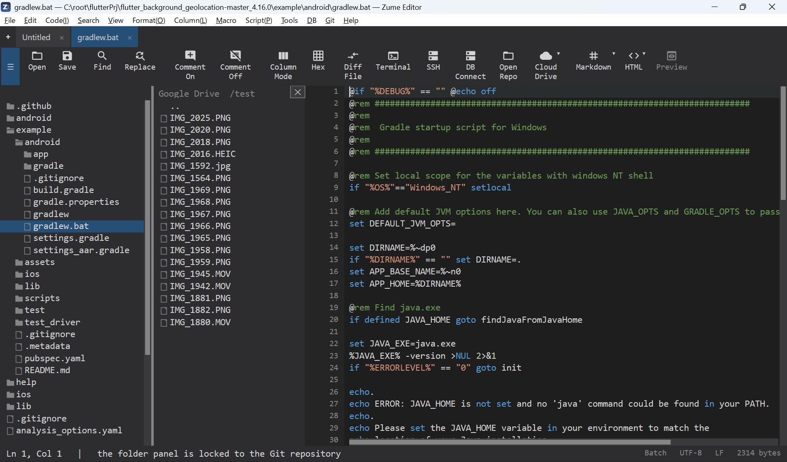

# 云盘

打开并编辑存储在云存储账户中的文件：

- **Dropbox**
- **Google Drive**
- **OneDrive**
- **Box**

通过 **Remote → CloudDrive** 连接账户，并借助提供商自己的安全登录流程（OAuth）登录——Zume Editor
绝不会看到你的云端密码。在侧边栏中浏览云盘，在标签页中打开文件，保存即可将其上传回云端。

{ loading=lazy }

!!! note
    云盘面向的是消费级云存储。若要连接你自己的服务器，请使用
    [远程文件（SFTP / FTP / FTPS）](remote.md)。

## 需要你自备 OAuth 应用凭据

Zume Editor 不内置云客户端。首次连接某个提供商时，你需要输入**你自己的 OAuth 应用凭据**（一个
Client ID，对大多数提供商还需一个 Client Secret）。这个应用只需在提供商的开发者控制台中创建一次——
免费、几分钟即可完成，凭据会保存在操作系统的凭据存储中（绝不写入文件），并与 `zume-cli` 共享。

### 重定向 URI

Google Drive、OneDrive 和 Box 会通过重定向到 Zume Editor 运行的一个本地小型服务器来完成登录。请在你的
应用中注册这个**完全一致**的重定向 URI：

```text
http://localhost:53682/callback
```

这里的不匹配是最常见的配置错误（`redirect_uri_mismatch`）。Dropbox 采用的是粘贴验证码的方式，无需重定向 URI。

## 首次连接

1. **Remote → CloudDrive → Connect to &lt;provider&gt;**。
2. 输入 **Client ID**，然后输入 **Client Secret**（Dropbox 只需 app key；OneDrive 只需 Client ID）。
3. 浏览器会打开提供商的授权页面——批准访问。（Dropbox 则会显示一个验证码，供你粘贴回编辑器。）
4. Zume Editor 会在 `localhost:53682` 上捕获重定向（约 3 分钟内）并保存令牌。云盘随即出现在侧边栏中。

下次会直接复用已保存的令牌——无需浏览器步骤——直到你执行
**Remote → CloudDrive → Disconnect**（或在 CLI 中执行 `logout`）。

## 在哪里获取 Client ID / Client Secret

### Google Drive

1. 打开 [Google Cloud Console](https://console.cloud.google.com/)，创建或选择一个项目。
2. **APIs & Services → Library** → 启用 **Google Drive API**。
3. **APIs & Services → OAuth consent screen** → 完成设置（User type 选 **External**；
   在应用处于 *Testing* 状态时，在 **Test users** 下添加你的 Google 账户）。
4. **APIs & Services → Credentials → Create credentials → OAuth client ID** →
   Application type 选 **Web application**。
5. 在 **Authorized redirect URIs** 下添加 `http://localhost:53682/callback`。
6. 创建后，复制 **Client ID** 和 **Client secret**。

### Dropbox

1. 打开 [Dropbox App Console](https://www.dropbox.com/developers/apps) →
   **Create app** → **Scoped access**，并选择 Full Dropbox 或 App folder。
2. 在应用的 **Permissions** 标签页中启用文件权限范围（读和写）。
3. 从 **Settings** 标签页复制 **App key**。（Dropbox 使用粘贴验证码的方式，因此无需重定向 URI 和 secret。）

### OneDrive

1. 打开 [Azure Portal](https://portal.azure.com/) → **App registrations** →
   **New registration**。
2. 添加重定向 URI `http://localhost:53682/callback`（作为 Mobile & desktop /
   public client——不使用 secret）。
3. 授予委派的 **Files.ReadWrite** 权限。
4. 复制 **Application (client) ID**。

### Box

1. 打开 [Box Developer Console](https://app.box.com/developers/console) →
   **Create New App → Custom App → User Authentication (OAuth 2.0)**。
2. 将重定向 URI 设为 `http://localhost:53682/callback`。
3. 从应用的 Configuration 中复制 **Client ID** 和 **Client Secret**。

## 从命令行使用

```text
zume-cli cloud googledrive login <client_id> <client_secret>
zume-cli cloud dropbox     login <app_key>
zume-cli cloud onedrive    login <client_id>
zume-cli cloud box         login <client_id> <client_secret>

zume-cli cloud <provider> ls [path]
zume-cli cloud <provider> get <remote> <local>
zume-cli cloud <provider> put <local> <remote>
zume-cli cloud <provider> logout
```

CLI 使用同样的回环登录流程，并与编辑器共享已保存的令牌。
详见[命令行](cli.md)页面。
