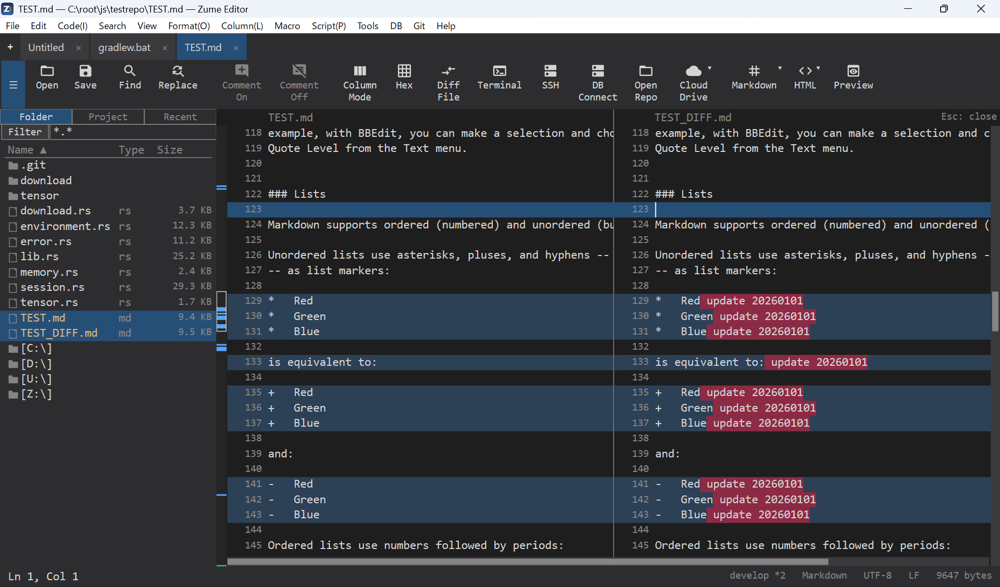

# 比较与合并

## 比较文件

**比较 → 与文件比较**会打开一个双窗格差异视图。两个窗格都**可编辑**，
并实时重新计算差异，因此你可以通过编辑来解决差异，也可以从另一侧
**取用一个代码块**（合并）。使用 ++f7++ / ++shift+f7++ 在差异之间导航。

## 比较文件夹

**比较 → 比较文件夹**会遍历两棵目录树，并将每个路径列为*相同*、
*不同*、*仅左侧*或*仅右侧*。从列表中打开某个文件即可对其进行差异比较。

## 字节比较

对于二进制文件，**与文件比较字节**会将两个文件对齐为十六进制行。

## 合并冲突

打开一个带有 Git 冲突标记的文件，使用**合并 → 下一个/上一个冲突**
以及**取用我方 / 对方 / 两者**，将每个冲突作为一个撤销步骤来解决。

{ loading=lazy }
