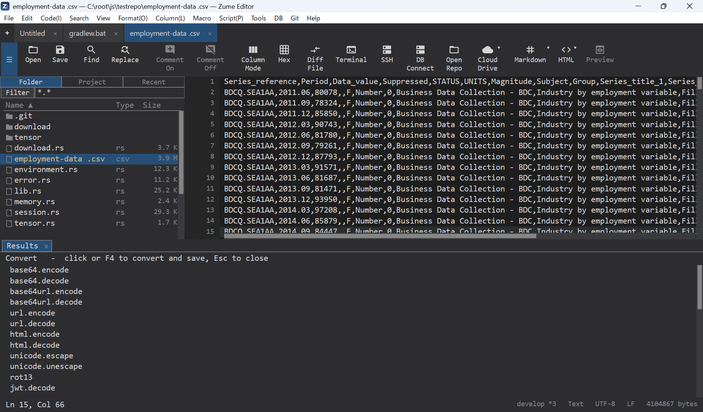

# 文件转换与归档

Zume Editor 可在多种格式之间转换文本和数据，将 Markdown / HTML 导出为 PDF，
并创建和解压 zip / tar / 7z 归档——既可在编辑器中操作，也可通过 `zume-cli` 命令行操作。

## 转换文件

**Convert: Convert File…**（在命令面板 / Tools 中）会列出所有转换器。
选择其中一个并指定保存位置；结果会写入你所选的文件。当前文档即为输入。

{ loading=lazy }

可用的转换器：

| 组 | 转换器 |
| --- | --- |
| 文本编码 | Base64 / Base64URL 编码·解码、URL 编码·解码、HTML 实体编码·解码、Unicode 转义·反转义、ROT13、Base32 编码·解码 |
| 令牌 | JWT 解码 |
| 数据 | CSV ↔ JSON、CSV ↔ TSV、CSV → Markdown 表格、CSV → HTML、CSV → SQL、JSON ↔ YAML、JSON ↔ TOML、JSON ↔ INI、JSON 压缩 / 美化、HTML → Markdown |
| 压缩（单一流） | gzip、zlib 和 bzip2——压缩 / 解压 |

!!! note
    这里的 gzip / zlib / bzip2 是将一个文件压缩成一个流。若要处理多文件的
    `.tar.gz` / `.tar.bz2` 归档，请参见下文的[归档](#archives)。

!!! tip
    若要就地在选区上串联执行其中多个步骤（例如
    `base64.decode | gzip.decompress | json.pretty`），请使用 **Code → Apply Convert
    Recipe…**——参见[转换配方](security.md#transform-recipes)，其中列出了配方所接受的每一个步骤。

## 导出为 PDF

Markdown 或 HTML 文档可以保存为 PDF：

- **File → Export to PDF…**，或 Convert File 选择器中的 **to PDF** 条目，
  或使用 CLI（见下文）。
- 保存对话框会询问 `.pdf` 的写入位置。
- 渲染使用的是平台自身的引擎（Windows：Edge WebView2 运行时；
  macOS：Core Graphics；Linux：Pango / Cairo），因此日文及其他文字会
  用系统字体正确渲染。

## 归档 { #archives }

从**文件夹面板**中创建和解压归档（右键点击某个文件或文件夹）：

- **Extract Here** — 对归档文件，解压到一个以该归档命名的同级文件夹中。
- **Compress…** — 对一个文件 / 文件夹（或多选），询问保存位置；
  **你选择的扩展名决定了格式**。

| 格式 | 解压 | 创建 |
| --- | :---: | :---: |
| `.zip` | ✅ | ✅ |
| `.tar`、`.tar.gz` / `.tgz`、`.tar.bz2` / `.tbz2`、`.tar.xz` / `.txz` | ✅ | ✅ |
| `.7z` | ✅ | ✅ |
| `.rar` / RAR5 | ✅ | — |
| `.xz` | ✅ | — |

!!! note
    RAR 仅支持解压（该格式为专有格式）。不支持加密的 RAR / 7z。名称为非 ASCII 的
    `.7z` 条目在经过 7z 容器往返时可能无法保持原样（文件内容不受影响）。

## 从命令行使用

```text
# Conversion
zume-cli convert                      # list all converters
zume-cli convert <id> <in> [out]      # convert a file (stdout if no out)
zume-cli convert md.toPdf   in.md  out.pdf
zume-cli convert html.toPdf in.html out.pdf

# Archives
zume-cli archive list    <archive>
zume-cli archive extract <archive> [dest-dir]     # default: .
zume-cli archive create  <archive> <path>...      # format by extension
```

`create` 可写入 `.zip`、`.tar`、`.tar.gz` / `.tgz`、`.tar.bz2` / `.tbz2`、
`.tar.xz` / `.txz` 和 `.7z`；`extract` 还可读取 `.rar` 和 `.xz`。完整的 CLI 参考见
[命令行](cli.md)页面。
