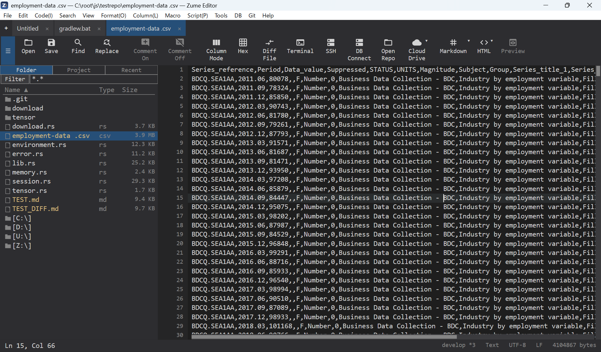
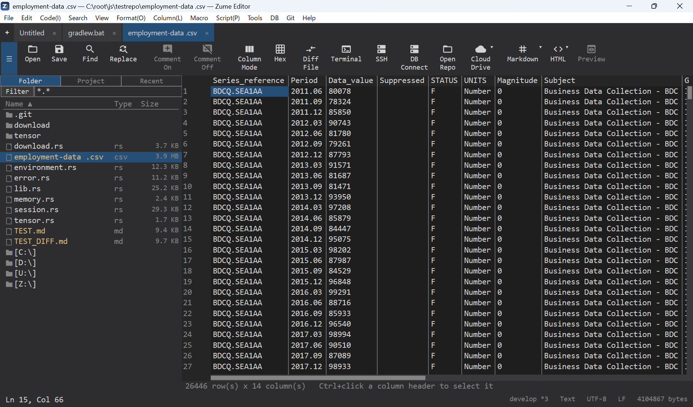

# CSV 与数据网格

打开 `.csv` 或 `.tsv` 文件即可将其作为**网格**编辑——以行和列而非
原始文本的形式呈现——同时磁盘上的文件仍保持纯 CSV 格式。

- 直接编辑单元格；添加和删除行与列。
- 自动检测分隔符；引号和转义遵循 RFC&nbsp;4180。
- 随时在网格视图与原始文本视图之间切换。

{ loading=lazy }

{ loading=lazy }
