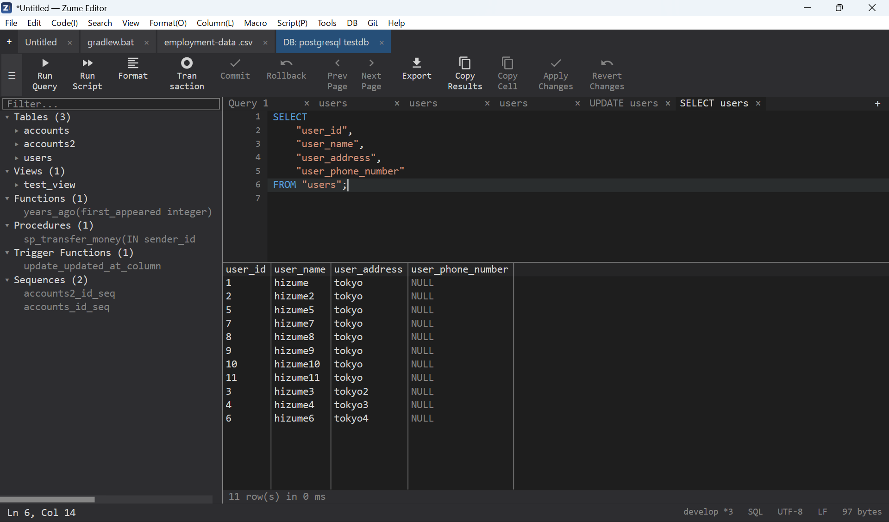

# 数据库

从编辑器内部连接数据库、浏览其架构并运行查询，结果以网格形式显示。

## 支持的数据库

**SQL**

| 引擎 | 说明 | 默认端口 |
| --- | --- | --- |
| **SQLite** | 本地数据库文件，或一个新建 / 内存数据库 | — （文件） |
| **MySQL / MariaDB** | 也支持兼容 MySQL 的服务器（例如 TiDB） | 3306 |
| **PostgreSQL** | 也支持兼容 PostgreSQL 的服务器 | 5432 |
| **Microsoft SQL Server** | 通过原生 TDS 协议 | 1433 |

**NoSQL**

| 引擎 | 说明 | 默认端口 |
| --- | --- | --- |
| **Redis** | RESP 协议 | 6379 |
| **MongoDB** | MongoDB wire 协议 | 27017 |

## 连接

- **SQLite** - 打开一个数据库文件（例如 `.db` / `.sqlite`），或创建一个新文件。
- **服务器引擎** - 提供主机、端口（保持默认即使用该引擎的标准端口）、
  用户、密码，以及可选的默认数据库。
  **联网引擎默认使用 TLS**。

!!! tip "凭据受到保护"
    连接密码保存在操作系统的安全凭据存储中（Windows Credential Manager、
    macOS Keychain、Linux Secret Service），绝不会存入明文设置或会话文件。
    参见[隐私与安全](privacy.md)。

## 使用连接

- **架构浏览器** - 表和视图及其列、类型、主键和索引；对于具备这些对象的引擎，
  还包括函数、存储过程、触发器和序列。
- **运行 SQL** - 编写一条语句并运行；结果显示在网格中（大型结果集会被截断并
  标记为 *truncated*）。对于会更改数据的语句，会报告**受影响**的行数和执行时间。
- **内联编辑** - 编辑结果单元格；写入使用参数化语句，因此
  值（文本、数字、blob、NULL）会被安全绑定，无需手动加引号。
- **NoSQL** - Redis 和 MongoDB 连接可运行命令 / 查询，并在同一面板中显示结果。

{ loading=lazy }
