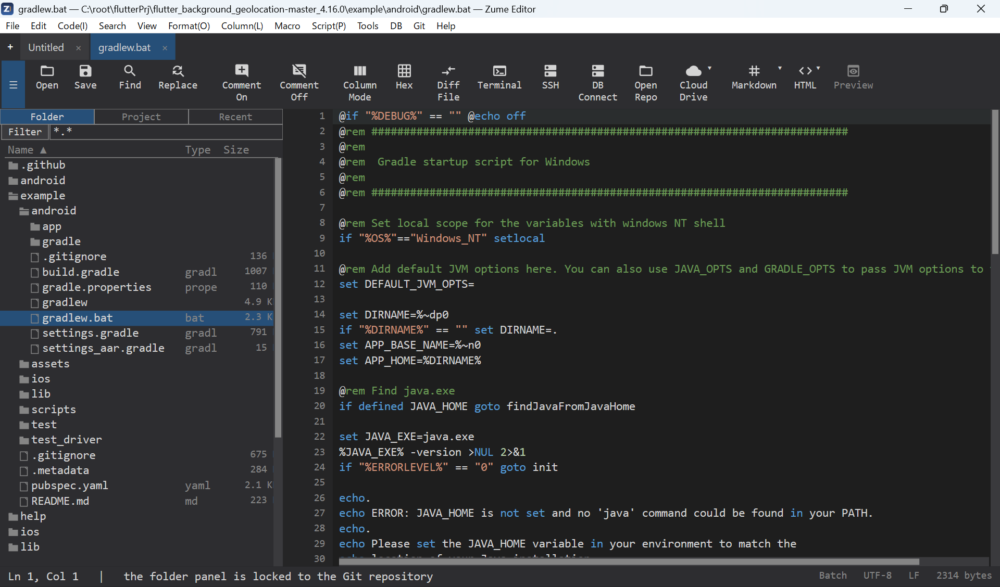
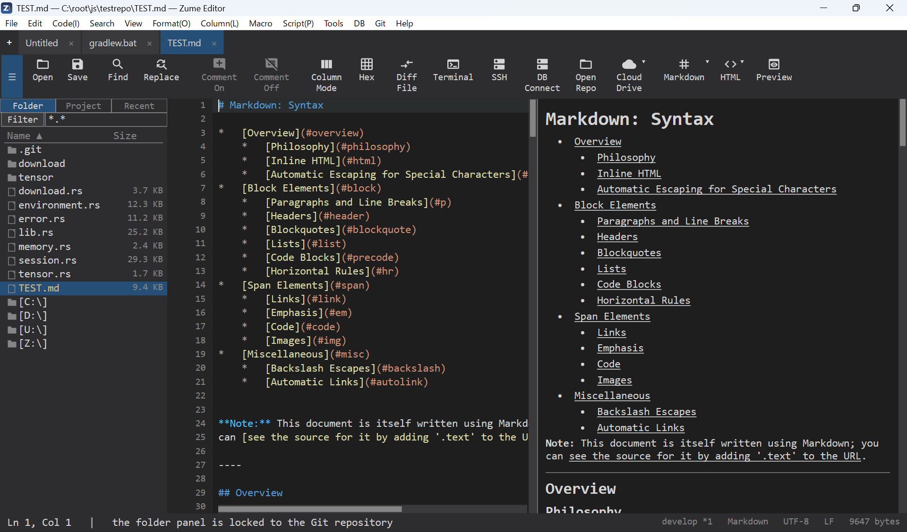

# はじめに

まずは画面の構成をかんたんに把握しましょう。

## 画面の構成

- **タブ** - 開いているファイルごとにタブになります。ドラッグで並べ替え、
  ++ctrl+t++ で新規タブ、++ctrl+w++ で閉じる。
- **ファイルパネル（サイドバー）** - ++ctrl+b++ で表示切替。フォルダー / 最近 /
  プロジェクトを参照でき、詳細列付きのエクスプローラー風ツリーです。
- **エディター領域** - タブを2ペインに分割（縦/横）したり、別々の2ファイルを
  並べて表示できます。
- **下部 / 右側パネル** - 検索結果、[ターミナル](terminal-ssh.md)、比較結果など。
  パネルはドッキングできます。
- **ステータスバー** - 行/列・言語・文字コード・改行コードなど。文字コードや
  言語をクリックすると変更できます。

{ loading=lazy }

## 最初の操作

1. **開く** - ++ctrl+o++、またはウィンドウへドラッグ＆ドロップ。
2. **編集** - 通常どおり入力。取り消し/やり直しは ++ctrl+z++ / ++ctrl+y++。
3. **検索** - ++ctrl+f++ で検索バー、++ctrl+r++ で検索と置換ダイアログ。
   詳しくは [検索と置換](editing/search.md)。
4. **保存** - ++ctrl+s++。

## コマンドパレット

++ctrl+shift+p++ でコマンドパレットを開きます。エディターのあらゆる操作を見つけて
実行する最短ルートです。コマンド名の一部を打つとあいまい一致で絞り込まれ
（"fif" で *Find in Files* が出ます）、**↑ / ↓** で選択、**Enter** で実行、
**Esc** で閉じます。各行にはショートカット（あれば）も表示されるので、
ショートカットを覚えるのにも使えます。最近実行したコマンドは上位に上がり、
よく使うものはお気に入りに固定できます（設定の `favorite_commands`。
[カスタマイズ](customization.md) を参照）。現在のタブに当てはまらないコマンドは
グレー表示です。本ガイドのほぼすべての機能にコマンドがあるので、メニュー項目が
見つからないときはパレットで検索してください。

## パネル: ドック・移動・切り離し

下部・右側の**ドック領域**には、検索結果・[ターミナル](terminal-ssh.md)・
FTP / SFTP / SSH ブラウザ・比較出力などのパネルが入ります。各パネルはその領域の
タブで、画面に合わせて並べ替えられます。

- **移動**: タブをドラッグして下部⇔右側を移動、またはタブを右クリックして
  **右へ移動** / **下へ移動**（**表示**メニューにも同じコマンドがあります）。
- **切り離し (フロート)**: **パネル: タブを切り離す**（タブの右クリック、表示
  メニュー、パレット）でパネルを独立ウィンドウに出します（例: ターミナルを別の
  モニタへ）。フロートウィンドウは内容の変化にライブで追従します。
- **再ドック**: フロートウィンドウを閉じる（タイトルバーの **×** で元の領域へ
  戻ります。パネルや接続は閉じません）か、**パネル: タブを埋め込む** で戻します。
- **閉じる**: パネルのタブの **×**（ターミナルはシェル終了、FTP / SFTP / SSH タブ
  は切断）。

エディターとドック領域の境界のディバイダをドラッグするとサイズを変更でき、
**表示 → パネルの自動非表示** でパネルを折りたたみ、表示・フォーカス時に再び
現れます。

## Markdown / HTML プレビュー

Markdown や HTML ファイルを開き、**表示 → Markdown / HTML プレビューの切替** を
オンにすると、エディターの隣にライブプレビューが表示されます。入力に追従して
更新されます。

{ loading=lazy }
