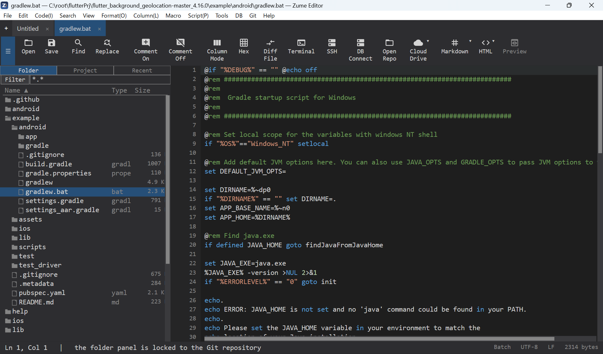
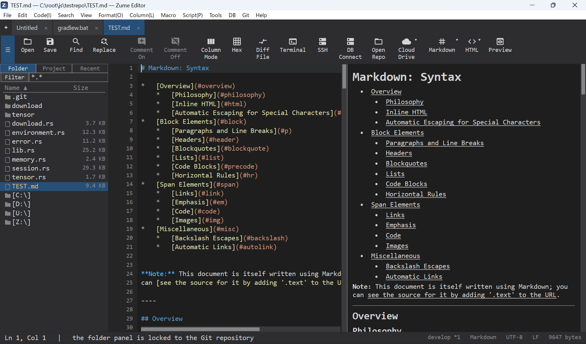

# 入门

快速浏览一遍，帮你熟悉界面。

## 窗口

- **标签页** - 每个打开的文件都是一个标签页。拖动可重新排序；++ctrl+t++ 新建标签页，
  ++ctrl+w++ 关闭当前标签页。
- **文件面板（侧边栏）** - 用 ++ctrl+b++ 切换显示。可浏览文件夹、最近文件和项目；
  它采用类似资源管理器的树形结构，并带有详细信息列。
- **编辑区** - 将一个标签页拆分为两个窗格（纵向/横向），或并排显示两个不同的文件。
- **底部 / 侧边面板** - 搜索结果、[终端](terminal-ssh.md)、
  比较输出等等。面板可停靠。
- **状态栏** - 行/列、语言、编码、行结束符等。点击编码或语言即可更改。

{ loading=lazy }

## 第一步

1. **打开**文件或文件夹 - ++ctrl+o++，或将文件拖到窗口上。
2. **编辑** - 像平常一样输入。撤销/重做为 ++ctrl+z++ / ++ctrl+y++。
3. **查找** - ++ctrl+f++ 打开查找栏；++ctrl+r++ 打开完整的查找与替换对话框。
   参见[搜索与替换](editing/search.md)。
4. **保存** - ++ctrl+s++。

## 命令面板

按 ++ctrl+shift+p++ 打开命令面板——这是查找并运行编辑器中任何功能的最快方式。开始输入命令
名称的一部分，列表就会按模糊匹配进行过滤（例如输入 "fif" 可找到 *Find in Files*）；**↑ / ↓**
移动选择，**Enter** 运行，**Esc** 关闭。每一行都会显示该命令的键盘快捷键（如果有），因此命令面板
也是学习快捷键的途径。最近运行过的命令会上浮到顶部，你还可以固定常用命令
（设置中的 `favorite_commands`——参见[自定义](customization.md)）。
不适用于当前标签页的命令会显示为灰色。本指南中几乎每个功能都有对应命令，所以当你找不到某个
菜单项时，就在命令面板里搜索它。

## 面板：停靠、移动与浮动 { #panels-docking-moving-and-floating }

底部和右侧的**停靠区**容纳各类面板——搜索结果、
[终端](terminal-ssh.md)、FTP / SFTP / SSH 浏览器、比较输出等等。
每个面板都是其所在区域中的一个标签页，你可以重新排列它们以适应你的屏幕：

- **移动**面板：拖动其标签页在底部区域与右侧区域之间移动，或
  右键点击标签页并选择 **Move to Right** / **Move to Bottom**（**View**
  菜单中也有相同的命令）。
- **浮动**面板：将面板分离到独立窗口中——比如把终端放到第二台显示器上——使用
  **Panel: Float Tab**（右键点击标签页，或通过 View 菜单 / 命令面板）。浮动窗口会
  随内容变化实时更新。
- **重新停靠**浮动面板：关闭其窗口（标题栏的 **×**
  会将其送回所在区域——这不会关闭面板或中断其连接），
  或使用 **Panel: Dock Tab**。
- **关闭**面板标签页：使用它自己的 **×**（终端会结束其 shell；
  FTP / SFTP / SSH 标签页会断开连接）。

拖动编辑器与停靠区之间的分隔条即可调整大小，
**View → Toggle Panel Auto-Hide** 会收起面板，直到某个面板再次被显示或聚焦。

## Markdown 与 HTML 预览

打开一个 Markdown 或 HTML 文件，并开启 **View → Toggle Markdown / HTML Preview**，
即可在编辑器旁看到实时预览。预览会随你的输入而更新。

{ loading=lazy }
