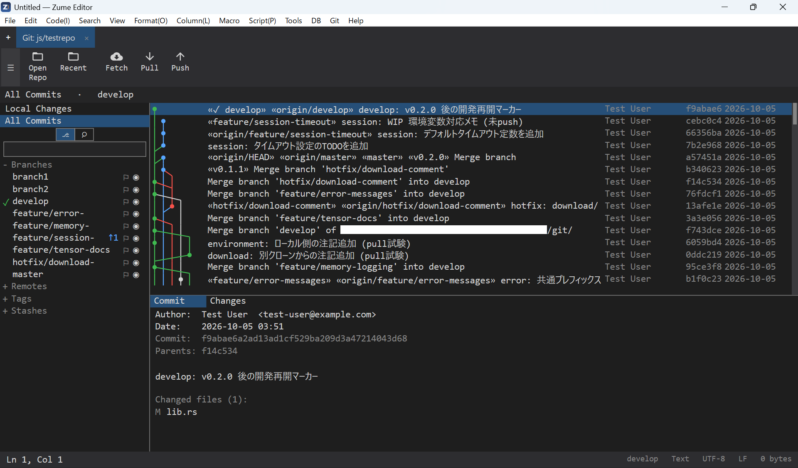

# Git クライアント

Zume Editor には、エディターを離れずに使える **Fork 風の本格的な Git クライアント**が
内蔵されています。差分・コミットグラフ・ブランチ操作をマウスで扱えるので、普段は
コマンドライン（CUI）で Git を使っている方でも、ログの確認やコンフリクトの解消などを
視覚的に行えます。

このページでは、`git add` / `git commit` / `git push` といった**おなじみのコマンドが
Git クライアントのどの操作に対応するか**を中心に紹介します。Git そのものの解説では
ないので、各コマンドの意味はお手元の入門資料も併せてご覧ください。

{ loading=lazy }

---

## Git タブについて

Git クライアントは**専用タブ**として開きます。

- **Git → Open Git Tab** でタブを開きます。
- タブには `親フォルダー/リポジトリ名` が表示され、ほかの編集タブと同じように
  切り替えられます。
- Git タブを開いている間は、**ファイルパネルがそのリポジトリに固定**されます。
- Git タブは**セッションに保存**され、次回起動時に同じリポジトリが再び開きます。

### 画面構成

| 領域 | 内容 |
| --- | --- |
| 左ナビゲーター | **Local Changes**（ローカルの変更）と **All Commits**（全コミット）の切り替え。その下にブランチ・リモート・タグ・スタッシュのツリー。現在のブランチにはチェックマーク、追跡ブランチには `↑ahead` / `↓behind` のバッジが付きます。 |
| 中央 | 選択に応じて、変更ファイルの一覧やコミットグラフ（レーングラフ）を表示。 |
| 右（詳細） | 選択したファイルの差分、またはコミットの情報とファイル一覧。 |
| ツールバー | Open / Recent Repositories、Fetch / Pull / Push（件数バッジ付き）。 |

!!! info "ローカルは libgit2、ネットワークは `git`"
    ステージ・コミット・差分などの**ローカル操作は libgit2** で高速に動作します。
    **Fetch / Pull / Push / Clone / Merge / Rebase / worktree / LFS** は、お使いの
    PC にインストール済みの **`git` コマンドを実行**します（認証プロンプトは無効化し、
    出力は結果パネルに表示されます）。そのため、資格情報ヘルパーや SSH 鍵などの
    既存の Git 設定がそのまま活きます。

---

## 基本操作

ここからは、CUI のコマンドと Git クライアントの操作を対応させて見ていきます。

### リポジトリを開く / クローン

- 既存のリポジトリ … ツールバーの **Open** からフォルダーを選択（最近使った
  リポジトリは **Recent Repositories**）。
- 新規クローン … **Git メニュー → Clone…** でクローンダイアログを開き、URL と
  保存先を指定します（`git clone` を実行）。

### ブランチ作成（`git branch` / `git checkout -b`）

1. 左ナビゲーターのブランチを**右クリック**し、**New Branch…** を選びます。
   （コミットを基点にする場合は、グラフ上のコミットを右クリックして
   **New Branch Here…**）
2. ブランチ名を入力して作成。そのまま新しいブランチへチェックアウトできます。

ブランチの**ダブルクリックでチェックアウト**（`git checkout`）です。作業ツリーが
クリーンなら、開いているファイルとファイルパネルも新しい内容に追従します。

### ステージ / コミット（`git add` / `git commit`）

1. 左ナビゲーターで **Local Changes** を選びます。
2. **Unstaged**（未ステージ）と **Staged**（ステージ済み）のペインが表示されます。
   チェックボックスで**複数選択**し、**Stage** / **Unstage** でまとめて移動できます。
3. ファイルを選ぶと、右側に**差分**が出ます。
4. 下部のコミットボックスに**件名（subject）**と、必要なら**説明（description）**を
   入力し、**Commit**（`Ctrl+Enter`）。
5. 直前のコミットを修正したいときは **Amend**（`git commit --amend`）にチェック。

### Push / Fetch / Pull（`git push` / `git fetch` / `git pull`）

- ツールバーの **Fetch** / **Pull** / **Push** ボタンで実行します。
- **Pull / Push のバッジ**が `↓behind` / `↑ahead`（取り込み・送信すべきコミット数）を
  示します。
- ブランチの右クリックメニューからも **Push** / **Pull** / **Set Tracking…**
  （上流ブランチの設定）が行えます。

### スタッシュ（`git stash`）

- 作業中の変更を退避したいときは、左ナビゲーターの **Stashes** まわりの操作、または
  Git メニューから作成します。退避したスタッシュは**ノードとしてコミットグラフ上**
  （その基点）に表示され、右クリックで適用・削除ができます。

### 差分の確認（`git diff` / `git log -p`）

- **Local Changes** … ファイルを選ぶと作業ツリーの差分が右ペインに出ます。
- **All Commits** … コミットグラフでコミットを選ぶと、そのコミットの**ファイル一覧と
  差分**（Commit / Changes）が表示されます。
- グラフは**全ブランチをまたぐレーングラフ**で、ブランチごとの **eye / filter
  アイコン**で表示を隠したり絞り込んだりできます。コミットは**メッセージ・作者・
  SHA で検索**できます。

### マージ（`git merge`）

1. 取り込みたいブランチを右クリックし、**Merge into current…**（現在のブランチへ
   マージ）を選びます。
2. 競合した場合は後述の[コンフリクトの解消](#resolve-conflicts)へ。

### リベース（`git rebase`）

- ブランチを右クリック → **Rebase onto…**（別ブランチの上に付け替え）。
- コミットを右クリック → **Rebase to Here** / **Interactive Rebase**（対話的リベース）。
- リベースやマージの実行中は、**継続バナー**が表示され、**Continue / Skip / Abort**
  （`--continue` / `--skip` / `--abort`）を選べます。

!!! tip "force push はリース付き"
    履歴を書き換えた後の送信には、Git メニューの **Force Push (with lease)**
    （`git push --force-with-lease`）を使います。リモートが想定どおりのときだけ
    上書きするので、他人のコミットを誤って消しにくくなります。

### 取り消し（`git revert`）

- コミットを右クリック → **Revert**。そのコミットを打ち消す新しいコミットを作ります
  （履歴は書き換えません）。

### リセット（`git reset`）

- コミットを右クリック → **Reset to Here**。現在のブランチの先端を、その
  コミットまで移動します。

### チェリーピック（`git cherry-pick`）

- 別ブランチのコミットを右クリック → **Cherry-pick**。そのコミットの変更だけを
  現在のブランチに取り込みます。

### タグ（`git tag`）

- コミットまたはブランチ先端を右クリック → **New Tag Here…**。
- タグは左ナビゲーターの **Tags** に一覧表示されます。

---

## コンフリクトの解消 { #resolve-conflicts }

マージ・リベース・チェリーピックで競合が起きると、該当ファイルが競合状態になります。

1. **Local Changes** でそのファイルを選びます。
2. 差分ペインの上部に **take ours / take theirs / take both**（自分側 / 相手側 /
   両方を採用）のバーが表示されます。ブロックごとに採用する側を選べます。
3. 必要に応じてエディターで直接編集し、保存します。
4. 解消したらファイルを **Stage** し、**Commit**。
5. リベース / マージ中のバナーから **Continue** で処理を続行します（やり直したい
   ときは **Abort**）。

---

## 便利なショートカット（Git タブ）

| キー | 操作 |
| --- | --- |
| `F5` | 再読み込み（リフレッシュ） |
| `Ctrl+Enter` | コミット |
| `Ctrl+Shift+N` | 新規ブランチ |
| `Ctrl+Shift+B` | ブランチ一覧 |
| `Ctrl+Shift+L` | ログ（All Commits） |
| `Ctrl+Shift+P` | Push |
| `Ctrl+Shift+F` | Fetch |
| `Ctrl+Shift+H` | スタッシュ |
| `Ctrl+Shift+T` | タグ |
| `Ctrl+F` | 検索（ブランチ / コミット） |

---

## まとめ

Zume Editor の Git クライアントは、`add` / `commit` / `push` / `pull` /
`merge` / `rebase` / `cherry-pick` / `revert` といった日常の操作を、**エディターの
中でそのまま**マウス操作で行えます。ローカル操作は libgit2 で高速に、ネットワークや
リベースは**お使いの `git`** を呼ぶので、既存の設定や認証をそのまま活かせます。

差分やコミットグラフを見ながら作業したい場面、コンフリクトを落ち着いて解消したい
場面で、コマンドラインと行き来せずに完結できます。

!!! note
    Fetch / Pull / Push / Clone / Merge / Rebase / worktree / LFS はシステムの `git`
    を使用します。Git 本体がインストールされている必要があります。
