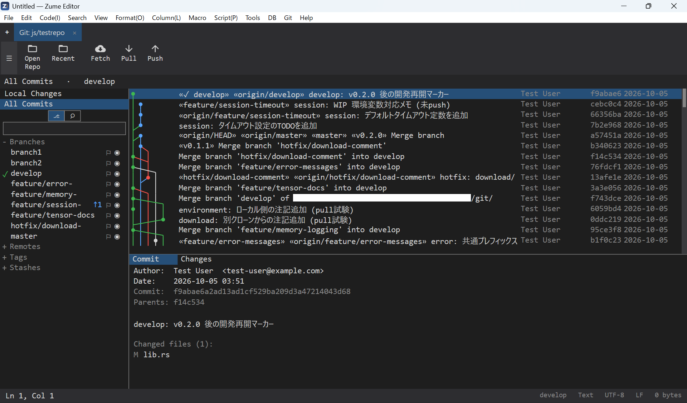

# Git client

Zume Editor has a full, **Fork-style Git client built in** — you work with diffs,
the commit graph and branch operations with the mouse, without leaving the
editor. If you normally drive Git from the command line (CUI), you can still use
the GUI for the things that are nicer visually: reading history, reviewing diffs
and resolving conflicts.

This page focuses on **how the familiar commands map to the client** —
`git add`, `git commit`, `git push` and friends. It is not a Git tutorial, so
keep an introductory Git guide handy for what each command means.

{ loading=lazy }

---

## The Git tab

The Git client opens as its **own tab**.

- Open it with **Git → Open Git Tab**.
- The tab is labelled `parent-folder/repo` and switches like any editor tab.
- While the Git tab is active, the **file panel is locked to that repository**.
- The Git tab is **saved with your session** and reopens on next launch.

### Layout

| Area | What it shows |
| --- | --- |
| Left navigator | Switch between **Local Changes** and **All Commits**, with a tree of branches, remotes, tags and stashes below. The current branch has a checkmark; tracking branches show `↑ahead` / `↓behind` badges. |
| Centre | The changed-file lists, or the commit graph (a lane graph), depending on the selection. |
| Right (detail) | The diff of the selected file, or a commit's info and file list. |
| Toolbar | Open / Recent Repositories, and Fetch / Pull / Push with count badges. |

!!! info "Local via libgit2, network via `git`"
    Staging, committing and diffs — the **local operations — use libgit2** and are
    fast. **Fetch / Pull / Push / Clone / Merge / Rebase / worktrees / LFS** run
    the **`git` already installed** on your machine (interactive prompts are
    disabled; output appears in the results panel). Your existing Git setup —
    credential helpers, SSH keys — is used as-is.

---

## Everyday operations

Below, each command-line operation is mapped to its GUI equivalent.

### Open / clone a repository

- Existing repo — **Open** on the toolbar and pick the folder (recent repos are
  under **Recent Repositories**).
- New clone — **Git menu → Clone…** opens the clone dialog for a URL and a
  destination (runs `git clone`).

### Create a branch (`git branch` / `git checkout -b`)

1. **Right-click** a branch in the navigator and choose **New Branch…**
   (to start from a specific commit, right-click it in the graph and choose
   **New Branch Here…**).
2. Enter the name. You can check it out at the same time.

**Double-click a branch to check it out** (`git checkout`). With a clean working
tree, the open files and the file panel follow the new contents.

### Stage / commit (`git add` / `git commit`)

1. Select **Local Changes** in the navigator.
2. The **Unstaged** and **Staged** panes appear. Use the checkboxes for
   **multi-select**, and **Stage** / **Unstage** to move files in bulk.
3. Select a file to see its **diff** on the right.
4. Type a **subject** (and an optional **description**) in the commit box and
   **Commit** (`Ctrl+Enter`).
5. To fix the previous commit, check **Amend** (`git commit --amend`).

### Push / Fetch / Pull (`git push` / `git fetch` / `git pull`)

- Use the toolbar **Fetch** / **Pull** / **Push** buttons.
- The **Pull / Push badges** show `↓behind` / `↑ahead` (commits to take in / send).
- A branch's context menu also offers **Push** / **Pull** / **Set Tracking…**
  (set the upstream branch).

### Stash (`git stash`)

- To shelve work in progress, use the **Stashes** actions in the navigator or the
  Git menu. A stash shows as a **node on the commit graph** (at its base) and can
  be applied or dropped from its context menu.

### Review diffs (`git diff` / `git log -p`)

- **Local Changes** — selecting a file shows the working-tree diff on the right.
- **All Commits** — selecting a commit in the graph shows its **file list and
  diffs** (Commit / Changes).
- The graph is a **lane graph across all branches**; per-branch **eye / filter**
  icons hide or focus branches, and commits can be **searched by message, author
  or SHA**.

### Merge (`git merge`)

1. Right-click the branch you want to bring in and choose **Merge into current…**.
2. If it conflicts, see [Resolving conflicts](#resolving-conflicts).

### Rebase (`git rebase`)

- Right-click a branch → **Rebase onto…** (replay onto another branch).
- Right-click a commit → **Rebase to Here** / **Interactive Rebase**.
- While a rebase or merge is in progress, an **in-progress banner** offers
  **Continue / Skip / Abort** (`--continue` / `--skip` / `--abort`).

!!! tip "Force push uses a lease"
    After rewriting history, send with the Git menu's **Force Push (with lease)**
    (`git push --force-with-lease`) — it overwrites only when the remote is where
    you expect, so you are far less likely to clobber someone else's commits.

### Revert (`git revert`)

- Right-click a commit → **Revert**. Creates a new commit that undoes that one
  (history is not rewritten).

### Reset (`git reset`)

- Right-click a commit → **Reset to Here**. Moves the current branch tip to that
  commit.

### Cherry-pick (`git cherry-pick`)

- Right-click a commit on another branch → **Cherry-pick**. Brings just that
  commit's change onto the current branch.

### Tag (`git tag`)

- Right-click a commit or a branch tip → **New Tag Here…**.
- Tags are listed under **Tags** in the navigator.

---

## Resolving conflicts

When a merge, rebase or cherry-pick conflicts, the affected file becomes
conflicted.

1. Select the file under **Local Changes**.
2. A bar at the top of the diff offers **take ours / take theirs / take both**.
   Choose a side per block.
3. Edit directly in the diff if needed, and save.
4. Once resolved, **Stage** the file and **Commit**.
5. Use **Continue** on the rebase / merge banner to carry on (or **Abort** to
   back out).

---

## Handy shortcuts (Git tab)

| Key | Action |
| --- | --- |
| `F5` | Refresh |
| `Ctrl+Enter` | Commit |
| `Ctrl+Shift+N` | New branch |
| `Ctrl+Shift+B` | Branches |
| `Ctrl+Shift+L` | Log (All Commits) |
| `Ctrl+Shift+P` | Push |
| `Ctrl+Shift+F` | Fetch |
| `Ctrl+Shift+H` | Stash |
| `Ctrl+Shift+T` | Tag |
| `Ctrl+F` | Search (branches / commits) |

---

## Summary

Zume Editor's Git client lets you do the everyday operations — `add`, `commit`,
`push`, `pull`, `merge`, `rebase`, `cherry-pick`, `revert` — **right inside the
editor**, with the mouse. Local operations run on libgit2 for speed, while
network and rebase operations call **your own `git`**, so your existing config
and credentials just work.

When you want to work while watching the diffs and the commit graph, or to
resolve a conflict calmly, you can stay in one place instead of switching back
and forth with the command line.

!!! note
    Fetch / Pull / Push / Clone / Merge / Rebase / worktrees / LFS use the system
    `git`, so Git must be installed.
