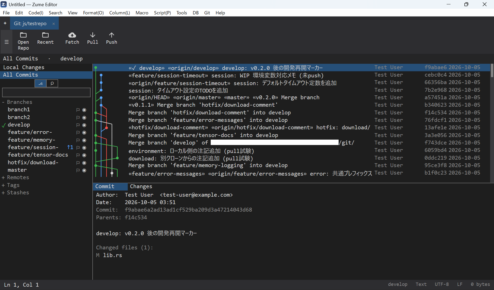

# Git 客户端

Zume Editor 内置了一个功能完整的 **Fork 风格 Git 客户端**——你可以用鼠标处理
差异、提交图和分支操作，而无需离开编辑器。如果你平时从命令行（CUI）驱动 Git，
仍然可以用图形界面来做那些在视觉上更舒服的事：阅读历史、审查差异和解决冲突。

本页着重介绍**熟悉的命令如何映射到客户端**——`git add`、`git commit`、
`git push` 等等。它不是 Git 教程，因此请备好一份入门级 Git 指南，以了解每个
命令的含义。

{ loading=lazy }

---

## Git 标签页

Git 客户端会作为**它自己的标签页**打开。

- 通过 **Git → Open Git Tab** 打开它。
- 该标签页标注为 `parent-folder/repo`，并且像任何编辑器标签页一样切换。
- 当 Git 标签页处于活动状态时，**文件面板会锁定到该仓库**。
- Git 标签页会**随你的会话一同保存**，并在下次启动时重新打开。

### 布局

| 区域 | 显示内容 |
| --- | --- |
| 左侧导航器 | 在 **Local Changes** 和 **All Commits** 之间切换，下方是分支、远程、标签和贮藏的树形结构。当前分支带有一个对勾；跟踪分支显示 `↑ahead` / `↓behind` 徽标。 |
| 中央 | 已更改文件的列表，或提交图（泳道图），取决于所选内容。 |
| 右侧（详情） | 所选文件的差异，或某次提交的信息和文件列表。 |
| 工具栏 | 打开 / 最近使用的仓库，以及带计数徽标的抓取 / 拉取 / 推送。 |

!!! info "本地操作经由 libgit2，网络操作经由 `git`"
    暂存、提交和差异——这些**本地操作使用 libgit2**，速度很快。
    **抓取 / 拉取 / 推送 / 克隆 / 合并 / 变基 / 工作树 / LFS** 则运行你机器上
    **已安装的 `git`**（交互式提示被禁用；输出会出现在结果面板中）。你现有的
    Git 配置——凭据助手、SSH 密钥——会被原样使用。

---

## 日常操作

下面将每个命令行操作映射到其图形界面的对应功能。

### 打开 / 克隆一个仓库

- 现有仓库——点击工具栏上的 **Open** 并选择文件夹（最近使用的仓库位于
  **Recent Repositories** 下）。
- 新克隆——**Git 菜单 → Clone…** 会打开克隆对话框，用于输入 URL 和目标位置
  （运行 `git clone`）。

### 创建分支（`git branch` / `git checkout -b`）

1. 在导航器中**右键单击**一个分支并选择 **New Branch…**
   （若要从某个特定提交开始，在图中右键单击它并选择
   **New Branch Here…**）。
2. 输入名称。你可以同时将其检出。

**双击一个分支以将其检出**（`git checkout`）。在工作树干净的情况下，打开的
文件和文件面板会随新内容更新。

### 暂存 / 提交（`git add` / `git commit`）

1. 在导航器中选择 **Local Changes**。
2. 会出现 **Unstaged** 和 **Staged** 窗格。使用复选框进行**多选**，并用
   **Stage** / **Unstage** 批量移动文件。
3. 选择一个文件以在右侧查看其**差异**。
4. 在提交框中输入一个**主题**（以及可选的**描述**），然后
   **Commit**（`Ctrl+Enter`）。
5. 要修正上一次提交，勾选 **Amend**（`git commit --amend`）。

### 推送 / 抓取 / 拉取（`git push` / `git fetch` / `git pull`）

- 使用工具栏上的 **Fetch** / **Pull** / **Push** 按钮。
- **拉取 / 推送徽标** 显示 `↓behind` / `↑ahead`（需要拉入 / 发送的提交数）。
- 分支的上下文菜单还提供 **Push** / **Pull** / **Set Tracking…**
  （设置上游分支）。

### 贮藏（`git stash`）

- 要暂时搁置进行中的工作，可使用导航器或 Git 菜单中的 **Stashes** 操作。贮藏
  会显示为**提交图上的一个节点**（位于其基点），并可从其上下文菜单中应用或
  丢弃。

### 审查差异（`git diff` / `git log -p`）

- **Local Changes**——选择一个文件时，右侧会显示工作树差异。
- **All Commits**——在图中选择一次提交时，会显示其**文件列表和
  差异**（Commit / Changes）。
- 该图是一个**跨所有分支的泳道图**；每个分支的**眼睛 / 过滤**图标可隐藏或聚焦
  分支，而提交可以**按消息、作者或 SHA 搜索**。

### 合并（`git merge`）

1. 右键单击你想要并入的分支并选择 **Merge into current…**。
2. 如果发生冲突，请参见 [解决冲突](#resolving-conflicts)。

### 变基（`git rebase`）

- 右键单击一个分支 → **Rebase onto…**（重放到另一个分支上）。
- 右键单击一次提交 → **Rebase to Here** / **Interactive Rebase**。
- 当变基或合并正在进行时，一个**进行中横幅**会提供
  **Continue / Skip / Abort**（`--continue` / `--skip` / `--abort`）。

!!! tip "强制推送使用租约"
    在重写历史之后，使用 Git 菜单中的 **Force Push (with lease)**
    （`git push --force-with-lease`）来发送——它只在远程处于你预期的位置时才
    覆盖，因此你覆盖他人提交的可能性要小得多。

### 还原（`git revert`）

- 右键单击一次提交 → **Revert**。会创建一次新的提交来撤销那次提交
  （历史不会被重写）。

### 重置（`git reset`）

- 右键单击一次提交 → **Reset to Here**。将当前分支顶端移动到那次提交。

### 挑选（`git cherry-pick`）

- 右键单击另一个分支上的一次提交 → **Cherry-pick**。只将那次提交的更改带到
  当前分支上。

### 标签（`git tag`）

- 右键单击一次提交或某个分支顶端 → **New Tag Here…**。
- 标签列在导航器的 **Tags** 下。

---

## 解决冲突 { #resolving-conflicts }

当合并、变基或挑选发生冲突时，受影响的文件会变为冲突状态。

1. 在 **Local Changes** 下选择该文件。
2. 差异顶部的一个栏会提供 **take ours / take theirs / take both**。
   为每个块选择一侧。
3. 如有需要，直接在差异中编辑，并保存。
4. 一旦解决，**Stage** 该文件并 **Commit**。
5. 在变基 / 合并横幅上使用 **Continue** 以继续（或 **Abort** 以退出）。

---

## 便捷快捷键（Git 标签页）

| 按键 | 操作 |
| --- | --- |
| `F5` | 刷新 |
| `Ctrl+Enter` | 提交 |
| `Ctrl+Shift+N` | 新建分支 |
| `Ctrl+Shift+B` | 分支 |
| `Ctrl+Shift+L` | 日志（All Commits） |
| `Ctrl+Shift+P` | 推送 |
| `Ctrl+Shift+F` | 抓取 |
| `Ctrl+Shift+H` | 贮藏 |
| `Ctrl+Shift+T` | 标签 |
| `Ctrl+F` | 搜索（分支 / 提交） |

---

## 小结

Zume Editor 的 Git 客户端让你可以用鼠标**在编辑器内**完成日常操作——`add`、
`commit`、`push`、`pull`、`merge`、`rebase`、`cherry-pick`、`revert`。本地操作
基于 libgit2 运行以求速度，而网络和变基操作则调用**你自己的 `git`**，因此你
现有的配置和凭据可以直接工作。

当你想一边盯着差异和提交图一边工作，或者想从容地解决一个冲突时，你可以待在
一个地方，而不必与命令行来回切换。

!!! note
    抓取 / 拉取 / 推送 / 克隆 / 合并 / 变基 / 工作树 / LFS 使用系统的
    `git`，因此必须安装 Git。
