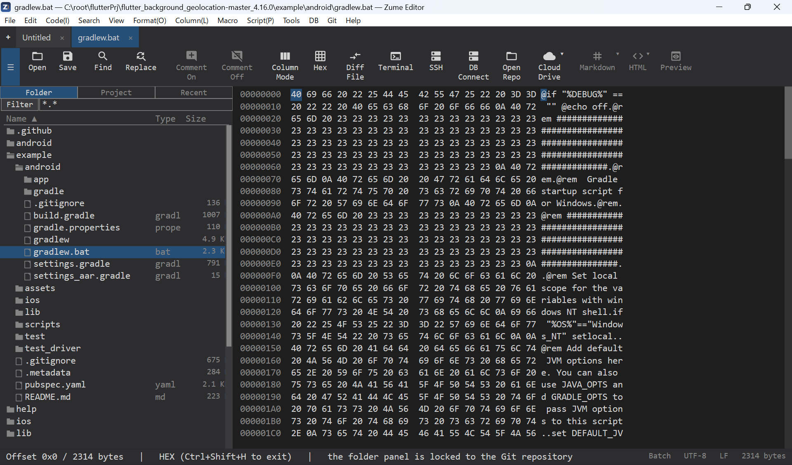

# 十六进制 / 二进制编辑器

使用 ++ctrl+shift+h++（或命令面板）可将任意标签页切换为十六进制视图。

- **偏移 / 十六进制 / ASCII** 列，光标在十六进制列和 ASCII 列中都会高亮显示。
- **选择**字节（Shift+移动键或拖动）、将它们**复制**为十六进制或原始字节，并
  **查找 / 替换**字节序列（输入 `48 65` 或 `4865`，或纯文本）。
- **插入 / 覆盖**字节；编辑与文本视图共享同一套撤销历史。
- 可选的 **EBCDIC** 列，以及可配置的**每行字节数**（8 / 16 / 32）。
- 可用于[大文件](editing/large-files.md)，并且你可以
  [逐字节比较两个文件](compare.md)。

{ loading=lazy }
