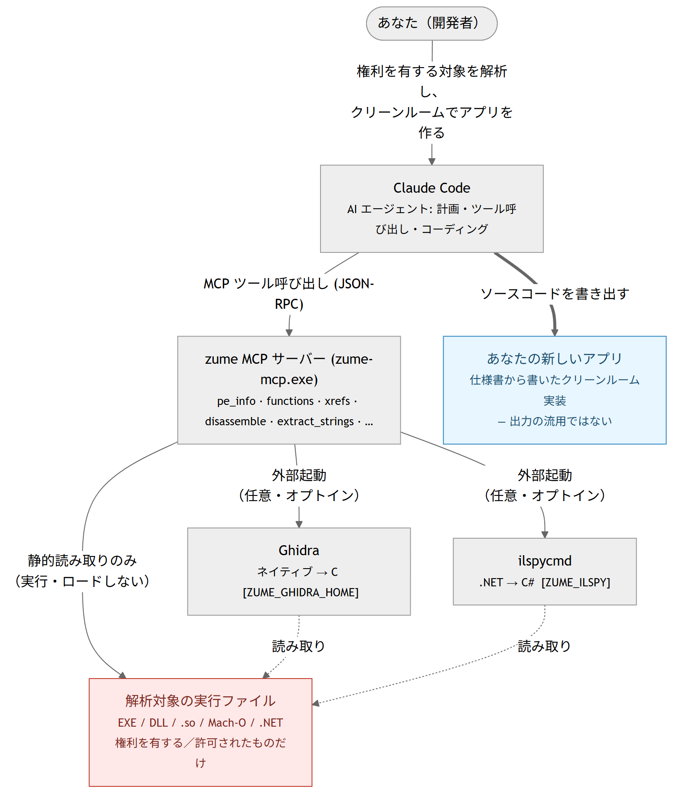

# MCP（AI連携）

Zume Editor は **`zume-mcp`** という別プログラムを同梱しています。これは
**MCP（Model Context Protocol）サーバー** として動作し、対応する AI クライアント
（Claude Desktop や Claude Code など）が起動して、ファイルの読み取り・**作成**・編集、
アプリで設定済みの**データベースへの問い合わせ**、保管した API キーでの外部サービスへの
HTTPS 到達を、すべてエディター本体の実績あるエンジン経由で行えます。

`zume-mcp` は stdio（標準入出力）上で JSON-RPC 2.0 を話します。ウィンドウは持たず、自身で
ネットワークポートを開くこともありません。アプリと同じ場所にインストールされます
（Windowsは実行ファイルの隣、Linuxは `bin/`、macOSはアプリフォルダー内）。

## 設定方法 {#setup}

MCP クライアントはサーバーを「コマンド」として起動します。`zume-mcp` を指定してください。

=== "Windows ― ポータブル ZIP"

    ZIP を好きなフォルダーに解凍し、`zume-mcp.exe` のフルパスをコマンドに指定します。

    ```json
    {
      "mcpServers": {
        "zume": { "command": "C:\\Tools\\Zume\\zume-mcp.exe", "args": [] }
      }
    }
    ```

=== "Windows ― Microsoft Store / MSIX"

    Store（MSIX）版は**実行エイリアス**を登録するので、インストール後は**パス不要**で
    `zume-mcp` という名前だけで起動できます。

    ```json
    {
      "mcpServers": {
        "zume": { "command": "zume-mcp", "args": [] }
      }
    }
    ```

    （エイリアスは `%LOCALAPPDATA%\Microsoft\WindowsApps` に置かれ `PATH` 上にあるため、
    更新をまたいでも使えます。`zume-cli` も同様にエイリアス化されています。）

=== "macOS / Linux"

    アプリフォルダー内（macOS）、またはインストール先の `bin/zume-mcp`（Linux）の
    フルパスを指定します。

    ```json
    {
      "mcpServers": {
        "zume": { "command": "/Applications/Zume Editor.app/Contents/MacOS/zume-mcp", "args": [] }
      }
    }
    ```

サーバー項目に `env` ブロックを足すと、触れる範囲を制限できます。下記
[AI が触れる範囲を制限する](#sandbox) を参照。

## ツール一覧 {#tools}

**ファイル / テキスト / Hex / 検索 / 差分**（ローカルディスク）:

| ツール | 内容 |
| --- | --- |
| `read_file_range` | ファイルの指定バイト範囲を読む（超大容量でも可） |
| `file_info` | ファイルの有無とバイトサイズ |
| `write_file` | 新規作成、または既存ファイルの上書き / 追記（テキスト or hex） |
| `search_in_file` | リテラル / 正規表現検索。オフセット・行付きで一致を返す |
| `extract_strings` | 印字可能ASCIIの連なりをバイトオフセット付きで抽出 |
| `hex_dump` | 指定バイト範囲の 16進 + ASCII ダンプ |
| `find_bytes` | 16進バイト列の全出現オフセット（先頭 64 MiB） |
| `patch_bytes` | 既存ファイルの指定オフセットをバイト上書き |
| `replace_in_file` | 既存ファイルのリテラル / 正規表現一致を全置換し保存 |
| `detect_encoding` | 文字コードと改行コードの判定 |
| `diff_files` | 2ファイルの行差分（追加 / 削除行） |
| `search_in_files` | ディレクトリ配下の全テキストファイルをリテラル / 正規表現検索 |
| `replace_in_files` | ディレクトリ横断の置換。既定はプレビュー、適用は1トランザクション |
| `search_large_file` | 任意サイズのファイルをストリーム検索（オフセット＋プレビュー） |
| `compare_folders` | 2つのフォルダーツリーを比較（同一 / 相違 / 左のみ / 右のみ） |
| `list_symbols` | ソースの定義（関数・型など）を行番号付きで一覧 |
| `markdown_to_html` | Markdown（GFM テーブル・インライン装飾）を HTML 文書に変換 |

**地理データ / 変換 / アーカイブ / パッチ / スクリプト:**

| ツール | 内容 |
| --- | --- |
| `geo_convert` | 地理データを GeoJSON / WKT / KML / GPX / CSV 間で変換 |
| `geo_measure` | GeoJSON / WKT の測地長（m）/ 面積（m²） |
| `geo_point` | geohash、地図タイル＋quadkey＋bbox、平面直角座標系、DMS ⇄ 十進 |
| `geo_reproject` | GeoJSON を EPSG 間で再投影（PROJ） |
| `convert_list` / `convert_run` | 変換ツールボックスの一覧 / 実行（base64、JSON ⇄ CSV、タイムスタンプ 等） |
| `archive_list` / `archive_extract` / `archive_create` | zip / tar / 7z の一覧・展開・作成 |
| `patch_bin` | バイナリパッチの適用 / 作成（IPS / BPS / UPS / bsdiff / VCDIFF） |
| `run_script` | サンドボックス Lua をファイルに実行（プレビュー、または `save` で書き戻し） |

**セキュリティ解析**（バイナリ診断 / 変換 / シグネチャ）:

| ツール | 内容 |
| --- | --- |
| `entropy` | Shannon エントロピー（全体＋窓ごとのスパークライン）とバイトヒストグラム — パック/暗号化領域の検出 |
| `transform` | CyberChef 風レシピ：XOR / ROT / RC4 / base58・85 / hex ＋ convert ツールボックスを 1 本に合成 |
| `yara_scan` | ファイル / ディレクトリ / インラインを、実用的な YARA ルールのサブセットで走査 |
| `pe_info` | Windows の EXE / DLL（PE32 / PE32+）の構造：マシン種別、サブシステム、タイムスタンプ、リンカー、ASLR / DEP / CFG フラグ、.NET と Authenticode の有無、セクションとそのエントロピー、インポート（遅延ロード含む）とエクスポート（フォワーダー含む）、リソースツリーとバージョン文字列・文字列テーブル・ダイアログのキャプションとコントロール・メニュー項目・マニフェスト、PDB パス、オーバーレイ。構造の読み取りのみで逆アセンブルはしません |
| `elf_info` | ELF 実行ファイル / 共有オブジェクト（ELF32 / ELF64、両エンディアン）の構造：種別、マシン、エントリ、インタープリター、セグメントとセクション（エントロピー付き）、動的セクション（必要なライブラリ、soname、rpath / runpath）、バージョン付きのインポート / エクスポートシンボル、GNU ビルド ID、ハードニング（PIE、NX スタック、RELRO、スタックカナリア、FORTIFY） |
| `macho_info` | Mach-O イメージまたは fat / ユニバーサルバイナリ（全スライスを列挙し `slice` で選択）の構造：CPU、ファイル種別、ヘッダーフラグ、全ロードコマンド、セグメント / セクション（エントロピー付き）、バージョン付き dylib、rpath、UUID、プラットフォーム / 最小 OS / SDK、エントリ、インポート / エクスポートシンボル、コード署名と暗号化の有無 |
| `decompile` | PE / ELF / Mach-O の関数（または全ファイル、上限あり）を、ローカルの Ghidra（ヘッドレス実行）で C に逆コンパイル。環境変数 `ZUME_GHIDRA_HOME` が Ghidra のインストール先を指すときだけ有効（Ghidra は同梱せず、JDK が必要）。各関数の名前・アドレス・シグネチャ・C を返す。`address` / `symbol` で 1 関数を指定（`functions` / `xrefs` のオフセットを渡せる）。結果はキャッシュ。Ghidra は対象を静的解析のみ。出力 C は派生物なのでライセンスの範囲で利用。**managed（.NET）** の対象は `il_decompile` に自動振り分け |
| `il_types` | .NET / managed アセンブリの型の目録（名前空間・型名・種別）を、ローカルの [ILSpy](https://github.com/icsharpcode/ILSpy)（`ilspycmd`）で取得。`functions` の managed 版。環境変数 `ZUME_ILSPY` が設定されているときだけ有効（`ilspycmd` のパス、または `PATH` から探す `1`）。静的解析のみ。逆コンパイルした IL は元ソースに近いのでライセンスの範囲で利用 |
| `il_decompile` | .NET の型 1 つを C#（`il` で IL）に逆コンパイル、または `out_dir` でアセンブリ全体を `.csproj` プロジェクトとして展開。環境変数 `ZUME_ILSPY` が設定されているときだけ有効。`type`（`il_types` の結果）または `out_dir` を指定。長い結果はファイルに退避。結果はキャッシュ（`ZUME_ILSPY_CACHE`） |
| `java_types` | Java の `.class` / `.jar` のクラス目録を、JDK の `jar` / `javap` で取得。`functions` の Java 版。JDK が必要（`JAVA_HOME` / `PATH`）。クラスファイルを読むだけ |
| `java_decompile` | Java のクラス 1 つを、ユーザー導入の **CFR**（`ZUME_CFR` に cfr.jar を指定）で Java ソースに、または `javap`（`bytecode: true`、CFR 不要）で JVM バイトコードに逆コンパイル。`out_dir` で jar 全体をソースツリー展開。`.jar` は `class`（`java_types` の結果）を指定。`decompile` は Java 対象をここへ案内。結果はキャッシュ（`ZUME_CFR_CACHE`） |
| `functions` | PE / ELF / Mach-O の関数境界と呼び出しグラフ：各関数のアドレス / ファイルオフセット / サイズと検出方法、呼び出すインポート / シンボル / 関数（回数付き）、読み込む文字列、データ参照数、その関数を呼ぶ関数を返す。`target`（名前、`sub_<hex>`、`entry`、アドレス）で絞り込める。静的・ヒューリスティック |
| `xrefs` | PE / ELF / Mach-O の静的な相互参照：実行属性セクションをデコードし、各命令が参照するアドレスをインポート（PE の IAT スロット、`dll!関数名`）、エクスポート / 名前付きシンボル、PLT / スタブ、文字列（本文付き）、別のコードアドレス、データに分類。参照先ごとの集計と、参照している命令の一覧を返し、`target`（名前、文字列の一部、アドレス）で絞り込める。静的解析のみ |
| `disassemble` | ファイルのバイト範囲、またはインラインの hex バイトを Capstone で逆アセンブル（x86 16/32/64、ARM、Thumb、AArch64）。PE / ELF / Mach-O ではアーキテクチャ、開始位置（エントリポイント、または `symbol` で指定したエクスポート関数）、仮想アドレスをヘッダーから取るので、`pe_info` / `elf_info` / `macho_info` が報告するオフセットをそのまま渡せる。生バイトには `arch` が必要。デコードのみで、ロード・実行・逆コンパイルは行わない |

**データベース**（アプリで設定済みの接続、または SQLite ファイル）:

| ツール | 内容 |
| --- | --- |
| `db_list_connections` | 保存済み SQL 接続の一覧（名前のみ・パスワードなし） |
| `db_schema` | 接続のテーブル / ビューと列を一覧 |
| `db_query` | 接続に対して SQL を実行し結果行を返す |
| `nosql_list_connections` | 保存済み Redis / MongoDB 接続を一覧（名前のみ） |
| `nosql_command` | Redis / MongoDB のコマンドを実行し結果を JSON で返す |

**Git**（ローカルリポジトリ・読み取り専用）:

| ツール | 内容 |
| --- | --- |
| `git_status` | 現在のブランチとステージ済み / 未ステージの変更 |
| `git_log` | コミット履歴（id・要約・作者・日時）を新しい順に |
| `git_branches` | ローカルブランチ（現在ブランチ・ahead / behind） |
| `git_diff` | 1ファイルの差分（ステージ済み / 未ステージ） |

**リモートファイル（FTP / FTPS / SFTP）**（アプリで設定済みの接続）:

| ツール | 内容 |
| --- | --- |
| `remote_list_connections` | 保存済み FTP / FTPS / SFTP 接続を一覧（名前のみ） |
| `remote_ls` | リモートディレクトリの一覧 |
| `remote_get` | リモートファイルをダウンロード（ローカル保存 or 内容を返す） |
| `remote_put` | ローカルファイル or インラインテキストをアップロード |
| `remote_delete` | リモートのファイル / 空ディレクトリを削除 |
| `remote_rename` | リモートファイルのリネーム / 移動 |
| `remote_mkdir` | リモートにディレクトリ作成 |

**クラウドストレージ**（アプリ、または `zume-cli` でサインイン済みのアカウント）:

| ツール | 内容 |
| --- | --- |
| `cloud_ls` | Dropbox / Google Drive / OneDrive / Box のフォルダーを一覧 |
| `cloud_get` | 接続済みクラウドからファイルをダウンロード |
| `cloud_put` | ローカルファイル or インラインテキストをアップロード |

**生成AIハブ:**

| ツール | 内容 |
| --- | --- |
| `list_credentials` | ローカル保存された API キーの**名前**一覧 |
| `http_request` | 任意の HTTPS API へリクエスト。保存キーで認証も可 |

## AI が触れる範囲を制限する（サンドボックス） {#sandbox}

`zume-mcp` プロセスに設定する 2 つの環境変数で、ファイル系ツールの範囲を絞れます。
どちらも任意で、未設定なら従来どおり全アクセス可能（既定）です。エージェントを
限定したいときは、MCP クライアントのサーバー設定（`env` ブロック）で指定します。

| 変数 | 効果 |
| --- | --- |
| `ZUME_MCP_ROOTS` | 許可ディレクトリの一覧（区切りは Windows `;`、その他 `:`）。パスがいずれかのフォルダー配下でなければ拒否。シンボリックリンクや `..` は先に解決するため、外へは抜けられません。 |
| `ZUME_MCP_READONLY` | `1` / `true` / `yes` / `on` でサーバーを読み取り専用に。ファイルを変更するツール（書き込み・patch・replace・展開・作成・アップロード、`save` 付き `run_script`）を拒否。読み取りは可能。 |

```json
{
  "mcpServers": {
    "zume": {
      "command": "C:\\Tools\\Zume\\zume-mcp.exe",
      "env": { "ZUME_MCP_ROOTS": "C:\\work\\project", "ZUME_MCP_READONLY": "1" }
    }
  }
}
```

拒否は通常のツールエラーとして返り、クラッシュしません。サンドボックスはローカル
ファイル系ツールに適用され、データベース / リモート / クラウド / `http_request`
はそれぞれ独自の規則（保存済み接続、読み取り専用 DB プロファイル、HTTPS 限定）を
持ちます。

## AI にできること・できないこと

AI は上記ツール経由で**のみ**動作します。

**できること:**

- あなたのアカウントが読めるファイルの**読み取り・調査**（テキスト・ログ・バイナリ）。
- ファイルの**作成・上書き・追記・バイト書き換え**（`write_file` / `replace_in_file` /
  `patch_bytes`）。実際の書き込みです。
- **データベースへの問い合わせ**。アプリで設定済みの SQL 接続を一覧
  （`db_list_connections`）、スキーマ参照（`db_schema`）、SQL 実行（`db_query`）できます。
  保存済み接続は名前で、SQLite はファイルパスで指定します。パスワードは OS の資格情報
  ストアから取得され、AI には見えません。
- **FTP / FTPS / SFTP でのリモートファイル操作**。アプリで設定済みの接続を使い、
  `remote_ls` / `remote_get` / `remote_put` / `remote_delete` / `remote_rename` /
  `remote_mkdir` が可能です。パスワードは OS の資格情報ストアから取得します。**SFTP** は、
  サーバーのホスト鍵が既に信頼済みである必要があり（エディターで一度接続）、未知・変更
  された鍵は拒否されます（ヘッドレスではフィンガープリントを確認できないため）。
- **HTTPS で外部へ送信・取得**（`http_request`、GET/POST/PUT/PATCH/DELETE/HEAD）。
  **ローカル保管の API キーで認証**でき、キーは**名前指定**（秘密値は `zume-mcp` が付与し、
  AI 側には返りません）。

**できないこと（仕様）:**

- **アプリに未設定の DB へ任意接続すること** - `db_query` は保存済み接続か、指定された
  SQLite パスのみを使います。
- **SQL 以外の経路での DB 到達** - `http_request` は HTTPS API 用で、DB ツールはエディターの
  SQL エンジン（SQLite / MySQL・MariaDB / PostgreSQL / SQL Server）を使います。
- **専用のクラウドドライブ操作** - クラウドの upload / download は
  [`zume-cli cloud`](cli.md#cloud) コマンドやエディターの
  [クラウドドライブ](clouddrive.md)、または各社 HTTPS API を `http_request` で叩く形で行います。
- **`http://`・ループバック・ローカルネットワーク URL への到達** - `https://` のみ許可。

## セットアップ

MCP クライアントの起動コマンドに `zume-mcp` を指定します。JSON 設定を使うクライアント
（Claude Desktop など）の場合:

```json
{
  "mcpServers": {
    "zume-editor": {
      "command": "zume-mcp"
    }
  }
}
```

Windows で `zume-mcp` が `PATH` に無い場合はフルパスを指定します。例:
`"command": "C:\\Program Files\\Zume Editor\\zume-mcp.exe"`

!!! warning "Microsoft Store（MSIX）版について"
    **Microsoft Store 版**は MCP サーバーとして利用できません。`zume-mcp` は
    保護された `C:\Program Files\WindowsApps\…` 配下（更新のたびに変わる
    バージョン別パスで、`PATH` にも登録されません）にインストールされるため、
    MCP クライアントから起動できません。Windows で MCP サーバー（や
    [CLI](cli.md)）を使うには、代わりに**ポータブル ZIP**（またはインストーラー版）
    を導入し、任意の安定フォルダーに展開して、そこの `zume-mcp.exe` をクライアントに
    指定してください。例:

    ```json
    { "mcpServers": { "zume": { "command": "C:\\Tools\\Zume\\zume-mcp.exe" } } }
    ```

    Claude Code CLI の場合:

    ```text
    claude mcp add zume -s user -- "C:\Tools\Zume\zume-mcp.exe"
    ```

DB ツールは、アプリの [データベース](database.md) ワークスペースで設定した接続を参照します。
`http_request` 用の API キーは `zume-cli aikey set <name>` で保存します（[CLI](cli.md#aikey)）。
AI 側は `list_credentials` で名前を確認できます。

## 業務ワークフローの例 {#business-workflow}

いずれも AI への1つの依頼で、AI 自身がツールを組み合わせて実行します。

**1. コードベース全体の検索と修正**

> 「`src` 配下で `legacy_init(` を呼んでいるファイルをすべて見つけて、`init(` に変えて」

`search_in_file` + `replace_in_file` を使用。

**2. DB のテーブルを CSV に出力**

> 「`reporting` データベースに接続して、今月の `orders` を `orders.csv` に出力して」

AI は保存済みの `reporting` 接続に `db_query`（パスワードは資格情報ストアから）を実行し、
`write_file` で `orders.csv` を作成します。アプリで**読み取り専用**に設定した接続では、
読み取りクエリ以外は拒否されます。

**3. Web API でファイルを補完**

> 「`orders.csv` の各行について REST API からステータスを取得し、`orders_enriched.csv` に書いて」

AI はファイルを読み、保存キーで認証した `http_request` で API を呼び、`write_file` で新しい
ファイルを書き出します。

**4. クラウドドライブへアップロード**

> 「`report.pdf` を Dropbox の `/reports` にアップロードして」

AI はファイルを読み、Dropbox のコンテンツ API へ保存トークン付きで `http_request` します。
（対話的な参照は [`zume-cli cloud`](cli.md#cloud) やエディターの
[クラウドドライブ](clouddrive.md) で。）

**5. 保管キーで外部 LLM / API を呼ぶ**

> 「`notes.md` を OpenAI で要約して `summary.md` に保存して」

一度キーを保存（`zume-cli aikey set openai`）すれば、AI は `http_request` で LLM を呼び、
`write_file` で結果を書き出します。キーの値はローカルの資格情報ストアに留まり、AI には
見えません。

**6. サーバー上のファイルを扱う**

> 「`staging` の SFTP 接続から `/var/log/app.log` を取得し、エラーを抽出して、整形版を
> `/var/log/app.clean.log` としてアップロードして」

AI は保存済み `staging` 接続で `remote_get` し、テキストを処理して `remote_put` で書き戻します。
`staging` のホスト鍵はエディターで事前に信頼済みである必要があります（SFTP）。

### AI に Lua スクリプトを書かせる（エディターのカスタマイズ） {#ai-lua}

強力な使い方: 繰り返し作業用の **Zume [Luaスクリプト](automation.md) を AI に書かせ**、
エディターで実行します。

> 「選択行の `=` を揃える Zume の Lua スクリプトを書いて、`align_equals.lua` に保存して」

AI は `zume` API を使ってスクリプトを作成し、`write_file` で `align_equals.lua` を作成します。
あとは **Script → Run Lua File** で実行し、思いどおりになるまで AI と調整します。

!!! note
    `zume-mcp` は Lua を**実行しません**。実行するのはエディター（編集はすべて取り消し
    可能）です。スクリプトはあなたが確認して実行するため、AI にエディターを拡張させつつ、
    主導権はあなたに残ります。

## リバースエンジニアリングによるアプリ開発 {#re-app-dev}

静的解析ツール（`pe_info` / `elf_info` / `macho_info`、`extract_strings`、
`functions`、`xrefs`、`disassemble`、および任意の `decompile` / `il_types` /
`il_decompile`）を使うと、AI エージェントが既存のプログラムを調べ、同等の振る舞いを持つ
**あなた自身の**アプリ開発を支援できます。人間のリバースエンジニアが行う
*目録 → 特定 → 読解 → 仕様化 → 再実装* と同じ流れです。

!!! danger "解析する権利があるソフトウェアにのみ使用し、成果物の責任は利用者にあります"
    これらのツールは、ライセンス / EULA がリバースエンジニアリングを許可し、**かつ**あなたに
    解析する権利がある実行ファイル — 自作物・OSS・規約で明示的に許可されたソフトウェア — に
    **のみ**使用してください。多くの商用 EULA はリバースエンジニアリングを**禁止**しており、
    そうしたソフトの解析は契約や適用法令に違反するおそれがあります。権利の有無の確認は
    **利用者の責任**です。

    逆コンパイル・逆アセンブルの出力は元バイナリの**派生物**です。アプリは**クリーンルーム**で
    作成してください。すなわち、あなたが作成した*振る舞いの仕様書*から実装し、出力された
    C / C# / IL / アセンブリを**コードに流用しない**こと。

    **免責。** 本機能を用いて作成されたものについては、すべて利用者自身の責任です。法が許す
    最大限の範囲において、Zume の作者および配布者は、本機能の利用や本機能で作成された
    いかなる成果物についても、**一切の責任を負いません**。

### 構成図（関連図）

{ loading=lazy }

Zume・Ghidra・ilspycmd は対象を**静的に読み取るだけ**で、実行もロードもしません。Ghidra と
ilspycmd は同梱されておらず、導入して `ZUME_GHIDRA_HOME` / `ZUME_ILSPY` を設定したときのみ
動作します。

### Claude Code 用のプロンプト例

zume MCP サーバーを接続した Claude Code セッションに、対象パスと再実装したい機能を書き換えて
貼り付けます:

```text
zume MCP サーバー（静的バイナリ解析ツール群）が接続されています。
対象: C:\path\to\target.exe — このバイナリを解析する権利があることを確認済みです
（自作物 / OSS / リバースエンジニアリングを許可するライセンス）。
クリーンルームで進めてください。振る舞いの仕様書を作成し、そこから再実装すること。
逆コンパイルした C/C#/IL や逆アセンブルを新コードに流用しないこと。

各段階の要約を報告しながら、順に実施してください:
1. 目録: pe_info（または elf_info / macho_info）と extract_strings を実行。
   機能一覧、使用している OS/ライブラリ API、ファイル形式・URL・エラーメッセージ、
   UI（ダイアログ/メニュー）を要約。pe_info が managed: true を返したら .NET
   アセンブリなので functions の代わりに il_types を使う。
2. 特定: 再実装したい機能はこれです: <機能を記述>。extract_strings /
   search_in_file で関連文字列を探し、functions と xrefs（または il_types）で
   それらを使う関数/型を特定。
3. 読解: 主要関数を functions / xrefs が示したオフセットで disassemble。必要に応じ
   decompile（ネイティブ）や il_decompile（.NET）で特定の関数/型を逆コンパイル。
   入力・出力・副作用・エラー処理を説明。
4. 仕様化: 入力・出力・形式・境界条件・エラー条件を観測事実のみで仕様書に。
5. 再実装: その仕様書だけから、<対象の言語/プロジェクト> で新規実装。静的解析で
   確定できなかった点は明記（実行時観測が必要なものは本ツールでは扱わない）。

すべて静的に行い、対象を実行・ロードしないこと。再実装がライセンスで制限される
サードパーティライブラリを埋め込んでいる場合は、その懸念も報告すること。
```

エージェントは各段階で報告します。あなたは**振る舞いの仕様書**と**新しいコード**を保持し、
逆コンパイラ／逆アセンブラの生出力は破棄します。

## 利用上の注意

!!! warning "一部のツールはディスク上のファイルを変更します"
    `write_file` / `patch_bytes` / `replace_in_file` はファイルを**作成・上書き・変更**します。
    これらの書き込みは MCP 側からは**取り消せません**（エディター画面での編集とは異なります）。
    信頼できるフォルダーでのみ使い、バックアップやバージョン管理を併用してください。

!!! warning "DB・リモート・ネットワークはあなたの名義で実行されます"
    `db_query` は設定済み DB の読み取りと（読み取り専用でなければ）**書き込み**ができ、
    `remote_*` は設定済みの FTP / SFTP サーバー上のファイルの読み取り・**アップロード・削除・
    リネーム**ができ、`http_request` は保存キーを使って任意の HTTPS エンドポイントへの送受信
    ができます。パスワードやキーの値が AI に渡ることはありませんが、操作はあなたの資格情報で
    実行されます。到達させたい接続とキーだけを設定し、信頼できるクライアントにのみ MCP を
    接続し、AI の動作を確認してください。

- **あなたの権限で動作します。** `zume-mcp` は、あなたのアカウントが読み書きできるファイルを
  すべて操作でき、設定済みの DB に到達できます。
- **HTTPS 専用・ボディ上限。** `http_request` は `https://` 以外を拒否し、応答ボディは
  1 MiB で打ち切られます（`body_truncated` で通知）。
