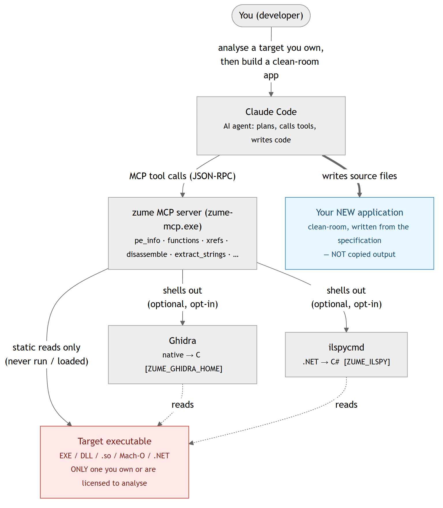

# MCP (AI Integration)

Zume Editor ships a separate program, **`zume-mcp`**, that acts as an
**MCP (Model Context Protocol) server**. A compatible AI client (such as Claude
Desktop or Claude Code) launches it and can then read, create and edit files,
query the databases you have configured in the app, and reach external services
over HTTPS using API keys you keep inside the app - all through the editor's own,
tested engines.

`zume-mcp` speaks JSON-RPC 2.0 over stdio (standard input / output) - it has no
window and opens no network port of its own. It is installed alongside the app
(next to the executable on Windows, in `bin/` on Linux, inside the app folder on
macOS).

## Tools {#tools}

**Files, text, hex, search, diff** (local disk):

| Tool | What it does |
| --- | --- |
| `read_file_range` | Read a bounded byte range of a file (works on very large files) |
| `file_info` | Whether a file exists, and its size in bytes |
| `write_file` | Create a new file, or overwrite / append an existing one (text or hex) |
| `search_in_file` | Literal or regex search; returns matches with offsets / lines |
| `extract_strings` | Printable-ASCII runs with their byte offsets |
| `hex_dump` | A hex + ASCII dump of a byte range |
| `find_bytes` | Every offset of a hex byte pattern (first 64 MiB) |
| `patch_bytes` | Overwrite bytes at an offset in an existing file |
| `replace_in_file` | Replace all literal / regex matches in an existing file and save |
| `detect_encoding` | A file's text encoding and line ending |
| `diff_files` | A line diff of two files (added / removed lines per hunk) |
| `search_in_files` | Literal or regex search across every text file under a directory |
| `replace_in_files` | Replace across a directory; previews by default, applies in one transaction |
| `search_large_file` | Streamed search over a file of any size (byte offsets + preview) |
| `compare_folders` | Compare two directory trees (same / different / left-only / right-only) |
| `list_symbols` | The definitions (functions, types, …) of a source file, with line numbers |
| `markdown_to_html` | Render Markdown (GFM tables, inline formatting) to an HTML document |

**Map data, conversion, archives, patches, scripting:**

| Tool | What it does |
| --- | --- |
| `geo_convert` | Convert map data between GeoJSON / WKT / KML / GPX / CSV |
| `geo_measure` | Geodesic length (m) / area (m²) of a GeoJSON or WKT document |
| `geo_point` | geohash, map tile + quadkey + bbox, Japan Plane Rectangular CS, DMS ⇄ decimal |
| `geo_reproject` | Reproject GeoJSON between EPSG CRSs (PROJ) |
| `convert_list` / `convert_run` | List / run the file-conversion toolbox (base64, JSON ⇄ CSV, timestamps, …) |
| `archive_list` / `archive_extract` / `archive_create` | List, extract or create zip / tar / 7z archives |
| `patch_bin` | Apply or create a binary patch (IPS / BPS / UPS / bsdiff / VCDIFF) |
| `run_script` | Run a sandboxed Lua script against a file (preview, or `save` to write it back) |

**Security analysis** (binary triage / transform / signatures):

| Tool | What it does |
| --- | --- |
| `entropy` | Shannon entropy (overall + a windowed sparkline) and the byte histogram — spot packed / encrypted regions |
| `transform` | A CyberChef-style recipe: XOR / ROT / RC4 / base58·85 / hex + the convert toolbox, composed in one pipeline |
| `yara_scan` | Scan a file, a directory or inline bytes with a practical YARA-rule subset |
| `pe_info` | The structure of a Windows EXE / DLL (PE32 / PE32+): machine, subsystem, timestamp, linker, ASLR / DEP / CFG flags, .NET and Authenticode presence, sections with entropy, imports (incl. delay-load) and exports (incl. forwarders), the resource tree with the version strings, string tables, dialog captions + controls, menu items and the manifest, the PDB path, and any overlay. Structure only — no disassembly |
| `elf_info` | The structure of an ELF executable / shared object (ELF32 / ELF64, either byte order): type, machine, entry, interpreter, segments and sections with entropy, the dynamic section (needed libraries, soname, rpath / runpath), imported / exported symbols with versions, the GNU build id and hardening (PIE, NX stack, RELRO, stack canary, FORTIFY) |
| `macho_info` | The structure of a Mach-O image or fat / universal binary (every slice listed, `slice` picks one): CPU, file type, header flags, every load command, segments / sections with entropy, dylibs with versions, rpaths, UUID, platform / minimum OS / SDK, the entry, imported / exported symbols, code-signature and encryption presence |
| `decompile` | Decompile a function (or the whole file, capped) of a PE / ELF / Mach-O to C using a local Ghidra, via its headless runner. Off unless `ZUME_GHIDRA_HOME` points at a Ghidra install (Ghidra is not bundled and needs a JDK). Returns each function's name, address, signature and C; `address` / `symbol` picks one (pass an offset from `functions` / `xrefs`). Results are cached. Ghidra statically analyses the target; the C is derivative, so reuse only what the licence permits. A **managed (.NET)** target is routed to `il_decompile` |
| `il_types` | The type inventory of a .NET / managed assembly (namespace, type name, kind) via a local [ILSpy](https://github.com/icsharpcode/ILSpy) (`ilspycmd`) — the managed counterpart of `functions`. Off unless `ZUME_ILSPY` is set (the path of `ilspycmd`, or `1` to find it on `PATH`). Static only; the decompiled IL is close to the source, so reuse only what the licence permits |
| `il_decompile` | Decompile one .NET type to C# (or IL with `il`), or expand the whole assembly as a `.csproj` project with `out_dir`, via ILSpy. Off unless `ZUME_ILSPY` is set. Pass `type` (from `il_types`) or `out_dir`; a long result spills to a file. Results are cached (`ZUME_ILSPY_CACHE`) |
| `java_types` | The class inventory of a Java `.class` / `.jar`, via the JDK's `jar` / `javap` — the Java counterpart of `functions`. Needs a JDK (`JAVA_HOME` / `PATH`). Reads the class files only |
| `java_decompile` | Decompile one Java class to source via a user-provided **CFR** (set `ZUME_CFR` to a cfr.jar), or to JVM bytecode via `javap` (`bytecode: true`, no CFR needed), or expand a whole jar to a source tree with `out_dir`. Pass `class` (from `java_types`) for a `.jar`. `decompile` points a Java target here. Results are cached (`ZUME_CFR_CACHE`) |
| `functions` | Function boundaries and the call graph of a PE / ELF / Mach-O: each function's address / file offset / size and how it was found, the imports / symbols / functions it calls (with counts), the strings it loads, the data references and the functions that call it; narrowed by `target` (a name, `sub_<hex>`, `entry` or an address). Static and heuristic |
| `xrefs` | Static cross-references of a PE / ELF / Mach-O: every executable section is decoded and each address an instruction uses is classified as an import (PE IAT slot, `dll!function`), an exported / named symbol, a PLT / stub, a string (with its text), another code address or data; a summary per target plus the referencing instructions, narrowed by `target` (a name, a string fragment or an address). Static only |
| `disassemble` | A Capstone listing (x86 16/32/64, ARM, Thumb, AArch64) of a byte range of a file or of inline hex bytes. Over a PE / ELF / Mach-O the architecture, the start (the entry point, or the export named by `symbol`) and the virtual addresses come from the headers, so the offsets `pe_info` / `elf_info` / `macho_info` report can be passed straight in; raw bytes need `arch`. A decoder only: nothing is loaded, executed or decompiled |

**Databases** (the connections configured in the app, or a SQLite file):

| Tool | What it does |
| --- | --- |
| `db_list_connections` | List the saved SQL connections (names only; no passwords) |
| `db_schema` | List a connection's tables / views and their columns |
| `db_query` | Run SQL on a connection and return the result rows |
| `nosql_list_connections` | List the saved Redis / MongoDB connections (by name) |
| `nosql_command` | Run a Redis / MongoDB command and return the result as JSON |

**Git** (a local repository, read-only):

| Tool | What it does |
| --- | --- |
| `git_status` | The current branch and the staged / unstaged changes |
| `git_log` | The commit history (id, summary, author, time), newest first |
| `git_branches` | The local branches, with the current one and ahead / behind |
| `git_diff` | The diff of one file (staged or unstaged half) |

**Remote files (FTP / FTPS / SFTP)** (the connections configured in the app):

| Tool | What it does |
| --- | --- |
| `remote_list_connections` | List the saved FTP / FTPS / SFTP connections (by name) |
| `remote_ls` | List a remote directory |
| `remote_get` | Download a remote file (to a local file, or return its content) |
| `remote_put` | Upload a local file or inline text to a remote path |
| `remote_delete` | Delete a remote file or empty directory |
| `remote_rename` | Rename / move a remote file |
| `remote_mkdir` | Create a remote directory |

**Cloud storage** (the account you signed in to in the app, or with `zume-cli`):

| Tool | What it does |
| --- | --- |
| `cloud_ls` | List a folder on Dropbox / Google Drive / OneDrive / Box |
| `cloud_get` | Download a file from a connected cloud account |
| `cloud_put` | Upload a local file or inline text to a cloud account |

**Gen-AI hub:**

| Tool | What it does |
| --- | --- |
| `list_credentials` | List the **names** of API keys stored locally |
| `http_request` | Make an HTTPS request to any API, optionally authenticated with a stored key |

## Restrict what the AI can touch (sandbox)

Two environment variables, set on the `zume-mcp` process, scope what the file
tools may do. Both are optional — if you set neither, the tools have full access
(the default). Set them in your MCP client's server configuration (an `env`
block) to confine an agent.

| Variable | Effect |
| --- | --- |
| `ZUME_MCP_ROOTS` | A list of allowed directories (separated by `;` on Windows, `:` elsewhere). A tool is refused unless its path is inside one of these folders. Symbolic links and `..` are resolved first, so a path cannot escape. |
| `ZUME_MCP_READONLY` | `1` / `true` / `yes` / `on` makes the server read-only: every tool that would change a file (write, patch, replace, extract, create, upload, and `run_script` with `save`) is refused. Reads still work. |

```json
{
  "mcpServers": {
    "zume": {
      "command": "C:\\Tools\\Zume\\zume-mcp.exe",
      "env": { "ZUME_MCP_ROOTS": "C:\\work\\project", "ZUME_MCP_READONLY": "1" }
    }
  }
}
```

A refused request comes back as a normal tool error, not a crash. The sandbox
covers the local-file tools; the database, remote-file, cloud and `http_request`
tools have their own rules (saved connections, read-only DB profiles, HTTPS
only).

## What the AI can and cannot do

The AI acts **only** through the tools above.

**It can:**

- **Read and inspect** any file your account can read - text, logs, binaries.
- **Create, overwrite, append and byte-patch files** (`write_file`,
  `replace_in_file`, `patch_bytes`). These are real writes.
- **Query your databases.** It can list the SQL connections you configured in the
  app (`db_list_connections`), inspect a schema (`db_schema`) and run SQL
  (`db_query`) - against a saved connection by name, or a SQLite file by path.
  Passwords come from the OS credential store and are never shown to the AI.
- **Operate on remote files over FTP / FTPS / SFTP** using the connections you
  configured in the app (`remote_ls` / `remote_get` / `remote_put` /
  `remote_delete` / `remote_rename` / `remote_mkdir`). Passwords come from the OS
  credential store. For **SFTP**, the server's host key must already be trusted
  (connect once in the editor); an unknown or changed key is refused, since there
  is no way to confirm a fingerprint headlessly.
- **Send data out and pull data in over HTTPS** (`http_request`,
  GET/POST/PUT/PATCH/DELETE/HEAD), **authenticated with an API key you store
  locally**, referenced **by name** (the secret is injected by `zume-mcp` and
  never returned to the AI).

**It cannot (by design):**

- **Open a direct database connection the app has not been configured with** -
  `db_query` only uses your saved connections or a SQLite path you give it.
- **Reach a database over a non-SQL path** - `http_request` is for HTTPS APIs;
  the DB tools use the editor's SQL engines (SQLite, MySQL / MariaDB, PostgreSQL,
  SQL Server).
- **Use a dedicated cloud-drive tool** - cloud upload / download is done with the
  [`zume-cli cloud`](cli.md#cloud) command or the editor's
  [CloudDrive](clouddrive.md) browser, or by calling the provider's HTTPS API
  through `http_request`.
- **Reach `http://`, loopback or local-network URLs** - only `https://` is allowed.

## Setup

Point your MCP client at the `zume-mcp` command. For a client that uses a JSON
config (such as Claude Desktop):

```json
{
  "mcpServers": {
    "zume-editor": {
      "command": "zume-mcp"
    }
  }
}
```

On Windows, if `zume-mcp` is not on your `PATH`, use the full path, e.g.
`"command": "C:\\Program Files\\Zume Editor\\zume-mcp.exe"`.

!!! warning "Microsoft Store (MSIX) build"
    The **Microsoft Store** build cannot be used as an MCP server. Its
    `zume-mcp` is installed under the protected
    `C:\Program Files\WindowsApps\…` folder — a version-specific path that
    changes with every update and is not on your `PATH` — so an MCP client
    cannot launch it. To run the MCP server (or the [CLI](cli.md)) on Windows,
    install the **portable ZIP** (or the installer build), extract it to a
    stable folder, and point your client at that `zume-mcp.exe`, for example:

    ```json
    { "mcpServers": { "zume": { "command": "C:\\Tools\\Zume\\zume-mcp.exe" } } }
    ```

    With the Claude Code CLI:

    ```text
    claude mcp add zume -s user -- "C:\Tools\Zume\zume-mcp.exe"
    ```

The database tools read the connections you set up in the app's
[Database](database.md) workspace. Store API keys for `http_request` with
`zume-cli aikey set <name>` (see [CLI](cli.md#aikey)); the AI lists them with
`list_credentials`.

## Business workflow examples {#business-workflow}

Each example is one request you make to the AI; it chains the tools itself.

**1. Find-and-fix across a code base**

> "Find every file under `src` that still calls `legacy_init(` and change it to
> `init(`."

Uses `search_in_file` + `replace_in_file`.

**2. Export a database table to CSV**

> "Connect to the `reporting` database and export this month's `orders` to
> `orders.csv`."

The AI calls `db_query` on your saved `reporting` connection (password from the
credential store), then `write_file` to create `orders.csv` with the rows. A
connection you marked **read-only** in the app will refuse anything but a read
query.

**3. Enrich a file from a web API**

> "For each row in `orders.csv`, look up the status from our REST API and write
> the result to `orders_enriched.csv`."

The AI reads the file, calls your API with `http_request` (authenticated with a
stored key), and writes a new file with `write_file`.

**4. Upload a file to a cloud drive**

> "Upload `report.pdf` to my Dropbox `/reports` folder."

The AI reads the file and `http_request`s the Dropbox content API with a stored
token. (For interactive browsing, use [`zume-cli cloud`](cli.md#cloud)
or the editor's [CloudDrive](clouddrive.md).)

**5. Call an external LLM / API with a managed key**

> "Summarise `notes.md` with OpenAI and save the summary as `summary.md`."

Store the key once (`zume-cli aikey set openai`); the AI calls the LLM with
`http_request` and writes the result with `write_file`. The key value stays in
your local credential store and is never shown to the AI.

**6. Work with files on a server**

> "Download `/var/log/app.log` from the `staging` SFTP connection, find the
> errors, and upload a cleaned copy back as `/var/log/app.clean.log`."

The AI uses `remote_get` to download (over your saved `staging` connection),
processes the text, and `remote_put` to upload the result. The `staging` host
must already be trusted in the editor (SFTP).

### Let the AI write a Lua script (customise the editor) {#ai-lua}

A powerful pattern: have the AI **write a Zume [Lua script](automation.md)** for
a repetitive edit, then run it in the editor.

> "Write a Zume Lua script that aligns the `=` signs in the selected lines, and
> save it as `align_equals.lua`."

The AI drafts the script with the `zume` API and creates `align_equals.lua` with
`write_file`. You then run it with **Script → Run Lua File**, and iterate with
the AI until it does exactly what you want.

!!! note
    `zume-mcp` does **not** execute Lua - the editor does, where every edit is
    undoable - so you review and run the script yourself. This keeps you in
    control while still letting the AI extend the editor for you.

## Reverse-engineering for app development {#re-app-dev}

The static-analysis tools (`pe_info` / `elf_info` / `macho_info`,
`extract_strings`, `functions`, `xrefs`, `disassemble`, and the optional
`decompile` / `il_types` / `il_decompile`) let an AI agent study an existing
program and help you build your **own** application with similar behaviour -
the same *inventory → locate → read → specify → reimplement* workflow a human
reverse engineer uses.

!!! danger "Use only on software you are entitled to analyse — and you own what you make"
    Run these tools **only** on executables whose licence / EULA permits reverse
    engineering **and** that you have the right to analyse — your own builds,
    open-source binaries, or software whose terms explicitly allow it. Many
    commercial EULAs **prohibit** reverse engineering; analysing such software
    may breach that contract or applicable law. Confirming you have that right
    is **your** responsibility.

    Decompiled and disassembled output is **derivative** of the original. Build
    your application **clean-room**: work from a written *behavioural
    specification* you produce, **not** by copying the emitted C / C# / IL /
    assembly into your code.

    **No liability.** Anything you create with this feature is entirely your own
    responsibility. To the fullest extent permitted by law, the authors and
    distributors of Zume accept **no liability whatsoever** for how this feature
    is used or for anything produced with it.

### How the pieces fit together

{ loading=lazy }

Zume, Ghidra and ilspycmd only **read** the target statically — it is never
executed or loaded. Ghidra and ilspycmd are not bundled; they run only when you
install them and set `ZUME_GHIDRA_HOME` / `ZUME_ILSPY`.

### Example prompt for Claude Code

Paste this into a Claude Code session that has the zume MCP server connected,
replacing the target path and the feature you want:

```text
You have the zume MCP server connected (static binary-analysis tools). 
Target: C:\path\to\target.exe — I confirm I have the right to analyse this
binary (my own build / OSS / a licence that permits reverse engineering).
Work clean-room: produce a behavioural specification and reimplement from it;
do NOT copy decompiled C/C#/IL or disassembly into the new code.

Do this step by step, reporting findings at each stage:
1. Inventory: run pe_info (or elf_info / macho_info) and extract_strings.
   Summarise the feature set, the OS/library APIs it uses, the file formats,
   URLs and error messages, and the UI (dialogs / menus). If pe_info reports
   managed: true, it is a .NET assembly — use il_types instead of functions.
2. Locate: I want to reimplement this feature: <describe the feature>. Use
   extract_strings / search_in_file to find related strings, then functions
   and xrefs (or il_types) to find the functions/types that use them.
3. Read: for the key functions, use disassemble at the offsets functions /
   xrefs reported; optionally decompile (native) or il_decompile (.NET) a
   specific function/type. Explain inputs, outputs, side effects and errors.
4. Specify: write a precise behavioural specification (inputs, outputs,
   formats, edge cases, error conditions) — observed behaviour only.
5. Reimplement: from that specification alone, implement the feature as new
   code in <your language/project>, clean-room. Note anything you could not
   determine statically (it may need runtime observation, which these tools
   do not do).

Keep everything static — never run or load the target. Flag any licensing
concern if the binary embeds third-party libraries whose reimplementation
their licence restricts.
```

The agent reports at each step; you keep the **behavioural specification** and
the **new code**, and discard the raw decompiler / disassembler output.

## Usage notes & cautions

!!! warning "Some tools change files on disk"
    `write_file`, `patch_bytes` and `replace_in_file` **create, overwrite or
    modify files**, and these writes are **not undoable** from the MCP side
    (unlike edits made in the editor window). Only let the AI work in folders you
    trust, and keep backups or use version control.

!!! warning "Database, remote and network access act on your behalf"
    `db_query` can read and (unless the connection is read-only) **write** to your
    configured databases; the `remote_*` tools can read, **upload, delete and
    rename** files on your configured FTP / SFTP servers; `http_request` can send
    data to and fetch data from any HTTPS endpoint using your stored keys.
    Passwords and key values never reach the AI, but the actions run with your
    credentials. Configure only the connections and keys you want reachable,
    connect MCP only to clients you trust, and review what the AI does.

- **It runs with your permissions.** `zume-mcp` can read and write any file your
  user account can, and reach any database you configured.
- **HTTPS only, body capped.** `http_request` rejects non-`https://` URLs, and a
  response body is truncated at 1 MiB (reported via `body_truncated`).
