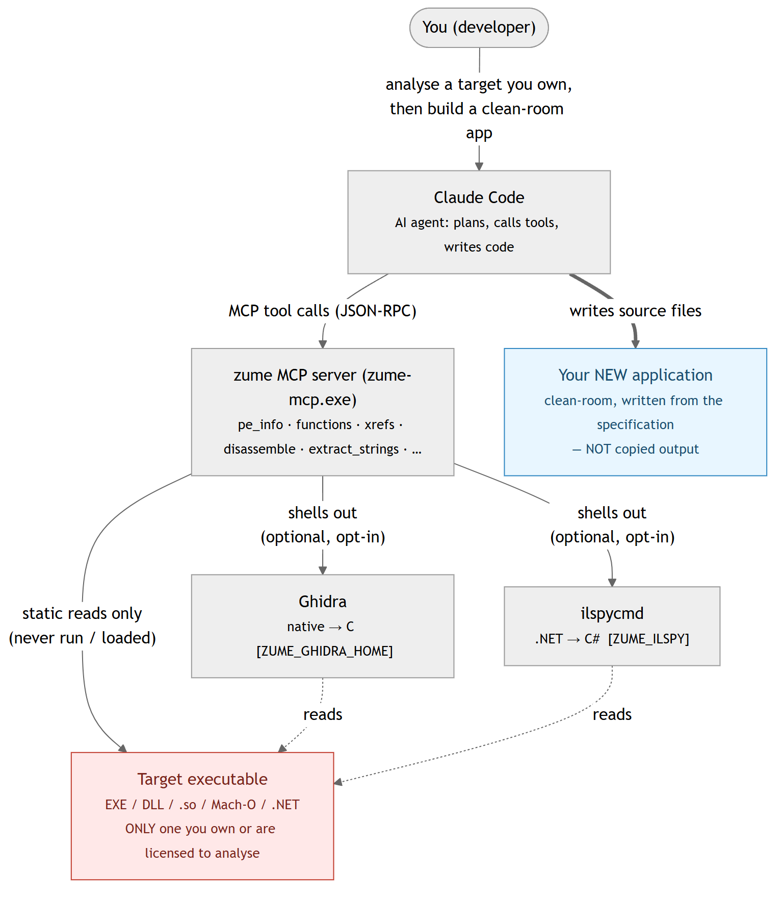

# MCP（AI 集成）

Zume Editor 附带一个独立的程序 **`zume-mcp`**，它充当
**MCP（Model Context Protocol）服务器**。兼容的 AI 客户端（例如 Claude
Desktop 或 Claude Code）会启动它，随后便可读取、创建和编辑文件，
查询你在应用中配置的数据库，并使用你保存在应用内的 API 密钥通过 HTTPS
访问外部服务——全部都经由编辑器自身的、经过测试的引擎完成。

`zume-mcp` 通过 stdio（标准输入 / 输出）使用 JSON-RPC 2.0 通信——它没有
窗口，也不会自行开放任何网络端口。它随应用一同安装（在 Windows 上位于
可执行文件旁边，在 Linux 上位于 `bin/`，在 macOS 上位于应用文件夹内部）。

## 设置方法 {#setup}

MCP 客户端以命令的形式启动服务器。将其指向 `zume-mcp`：

=== "Windows — 便携版 ZIP"

    将 ZIP 解压到一个你会保留的文件夹，并使用
    `zume-mcp.exe` 的完整路径作为命令：

    ```json
    {
      "mcpServers": {
        "zume": { "command": "C:\\Tools\\Zume\\zume-mcp.exe", "args": [] }
      }
    }
    ```

=== "Windows — Microsoft Store / MSIX"

    Store（MSIX）软件包会注册一个**应用执行别名**，因此安装后
    你可以直接使用裸名称 `zume-mcp` —— 无需路径：

    ```json
    {
      "mcpServers": {
        "zume": { "command": "zume-mcp", "args": [] }
      }
    }
    ```

    （该别名位于你的 `PATH` 中的
    `%LOCALAPPDATA%\Microsoft\WindowsApps` 下，因此它在多次更新后依然有效。
    `zume-cli` 也以同样的方式设置了别名。）

=== "macOS / Linux"

    使用应用文件夹内部 `zume-mcp` 的完整路径（macOS），或已安装的
    `bin/zume-mcp`（Linux）：

    ```json
    {
      "mcpServers": {
        "zume": { "command": "/Applications/Zume Editor.app/Contents/MacOS/zume-mcp", "args": [] }
      }
    }
    ```

在服务器条目中添加一个 `env` 块以开启可选工具，并限定服务器可触及的范围
——参见下文的[环境变量](#env)和
[限制 AI 可触及的范围](#sandbox)。

## 环境变量 {#env}

每一项可选能力在你用服务器 `env` 块中的环境变量开启之前都是**关闭**的。
这些外部工具均未捆绑——你需自行安装并让变量指向它们。

| 变量 | 它开启什么 | 示例值 |
| --- | --- | --- |
| `ZUME_GHIDRA_HOME` | `decompile` 工具——通过本地 [Ghidra](https://ghidra-sre.org/) headless 安装进行原生（C）反编译。需要 JDK（`JAVA_HOME`）。 | `C:\ghidra_12.1.4_PUBLIC` |
| `JAVA_HOME` | Ghidra（及 CFR）运行所依赖的 JDK。当无法自动找到 JDK 时设置它。 | `C:\Program Files\Eclipse Adoptium\jdk-25.0.4.101-hotspot` |
| `ZUME_ILSPY` | `il_types` / `il_decompile` 工具（.NET / 托管）。`ilspycmd` 的路径，或填 `1` 让其在 `PATH` 中查找。 | `1` |
| `ZUME_ILSPY_CACHE` | ILSpy 结果的缓存位置（可选；加快重复反编译）。 | `C:\Tools\zume\ilspy-cache` |
| `ZUME_CFR` | `java_decompile` 工具（Java → 源代码）——你下载的 CFR `.jar` 的路径。（`javap` 字节码模式不需要 CFR。） | `C:\Tools\cfr\cfr-0.152.jar` |
| `ZUME_CFR_CACHE` | CFR 结果的缓存位置（可选）。 | `C:\Tools\zume\cfr-cache` |
| `ZUME_ANALYZER_TOOLS` | `analyze_run` 工具——外部安全分析器，以 `name = command` 行的形式（参见[外部安全分析器](security.md#external-security-analyzer)）。 | 见下文 |
| `ZUME_MCP_ROOTS` / `ZUME_MCP_READONLY` | 为服务器设置沙箱——[限制 AI 可触及的范围](#sandbox)。 | — |

`ZUME_ANALYZER_TOOLS` **每行**接受一个 `name = command` 条目（在 JSON 中换行
写作 `\n`）；`{target}` 是你传入的范围或文件，`{out}` 是工具写入其 JSON
结果的路径。一个完整的 `env` 块——此处开启了
Ghidra、ILSpy、CFR 和 [sanctum](security.md#companion-tool-sanctum)
分析器（请将路径替换为你自己的）：

```json
{
  "mcpServers": {
    "zume": {
      "type": "stdio",
      "command": "C:\\Tools\\zume\\zume-mcp.exe",
      "args": [],
      "env": {
        "ZUME_GHIDRA_HOME": "C:\\ghidra_12.1.4_PUBLIC",
        "JAVA_HOME": "C:\\Program Files\\Eclipse Adoptium\\jdk-25.0.4.101-hotspot",
        "ZUME_ILSPY": "1",
        "ZUME_ILSPY_CACHE": "C:\\Tools\\zume\\ilspy-cache",
        "ZUME_CFR": "C:\\Tools\\cfr\\cfr-0.152.jar",
        "ZUME_ANALYZER_TOOLS": "recon = sanctum --scope \"{target}\" --json \"{out}\" --i-am-authorized\nfile = sanctum --file \"{target}\" --json \"{out}\"\nweb = sanctum --web \"{target}\" --crawl --active --i-am-authorized --json \"{out}\""
      }
    }
  }
}
```

对每个可执行文件使用完整路径（例如 `C:\\Tools\\sanctum\\sanctum.exe`），
除非它已在你的 `PATH` 中。在 macOS / Linux 上同样的键适用于 POSIX 路径。

## 工具 {#tools}

**文件、文本、十六进制、搜索、差异比较**（本地磁盘）：

| 工具 | 它的作用 |
| --- | --- |
| `read_file_range` | 读取文件的有界字节范围（可用于超大文件） |
| `file_info` | 文件是否存在、其字节大小，以及识别出的类型（格式、MIME、类别） |
| `identify` | 从文件内容（魔数签名）识别其类型：格式、MIME、类别、置信度、容器（docx / epub / jar / apk …），以及对于文档 / 图像的 `creator`（从 PDF / EXIF / PNG / OOXML / ODF 元数据读取的生产者 / 创建者）。有界读取；接受 `path` 或内联 `text` |
| `write_file` | 创建新文件，或覆盖 / 追加已有文件（文本或十六进制） |
| `search_in_file` | 字面量或正则搜索；返回带偏移 / 行号的匹配项 |
| `extract_strings` | 可打印 ASCII 串及其字节偏移 |
| `hex_dump` | 字节范围的十六进制 + ASCII 转储 |
| `find_bytes` | 十六进制字节模式的每个偏移（前 64 MiB） |
| `patch_bytes` | 在已有文件的某偏移处覆写字节 |
| `replace_in_file` | 替换已有文件中的所有字面量 / 正则匹配并保存 |
| `detect_encoding` | 文件的文本编码和行尾 |
| `diff_files` | 两个文件的行差异（每个 hunk 的添加 / 删除行） |
| `search_in_files` | 对某目录下的每个文本文件进行字面量或正则搜索 |
| `replace_in_files` | 跨目录替换；默认预览，在一个事务中应用 |
| `search_large_file` | 对任意大小的文件进行流式搜索（字节偏移 + 预览） |
| `compare_folders` | 比较两个目录树（相同 / 不同 / 仅左侧 / 仅右侧） |
| `list_symbols` | 源文件的定义（函数、类型……）及其行号 |
| `markdown_to_html` | 将 Markdown（GFM 表格、内联格式）渲染为 HTML 文档 |

**地图数据、转换、归档、补丁、脚本：**

| 工具 | 它的作用 |
| --- | --- |
| `geo_convert` | 在 GeoJSON / WKT / KML / GPX / CSV 之间转换地图数据 |
| `geo_measure` | GeoJSON 或 WKT 文档的大地测量长度（m）/ 面积（m²） |
| `geo_point` | geohash、地图瓦片 + quadkey + bbox、日本平面直角坐标系、DMS ⇄ 十进制 |
| `geo_reproject` | 在 EPSG CRS 之间重新投影 GeoJSON（PROJ） |
| `convert_list` / `convert_run` | 列出 / 运行文件转换工具箱（base64、JSON ⇄ CSV、时间戳……） |
| `archive_list` / `archive_extract` / `archive_create` | 列出、提取或创建 zip / tar / 7z 归档 |
| `patch_bin` | 应用或创建二进制补丁（IPS / BPS / UPS / bsdiff / VCDIFF） |
| `run_script` | 对文件运行沙箱化的 Lua 脚本（预览，或以 `save` 写回） |

**安全分析**（二进制分流 / 变换 / 签名）：

| 工具 | 它的作用 |
| --- | --- |
| `entropy` | 香农熵（总体 + 滑动窗口 sparkline）和字节直方图——发现打包 / 加密区域 |
| `transform` | CyberChef 风格的配方：XOR / ROT / RC4 / base58·85 / hex + 转换工具箱，在一条流水线中组合（对含糊的裸 `xor:`/`rc4:` 密钥返回 `warnings`；`strict: true` 则拒绝此类密钥） |
| `yara_scan` | 使用实用的 YARA 规则子集扫描文件、目录或内联字节 |
| `pe_info` | Windows EXE / DLL（PE32 / PE32+）的结构：机器类型、子系统、时间戳、链接器、ASLR / DEP / CFG 标志、.NET 和 Authenticode 的存在情况、带熵的节、导入（含延迟加载）和导出（含转发器）、带版本字符串的资源树、字符串表、对话框标题 + 控件、菜单项和清单、PDB 路径、MSVC Rich header（带校验和标志的构建来源 `@comp.id` 条目），以及任何 overlay。仅结构——不含反汇编 |
| `elf_info` | ELF 可执行文件 / 共享对象（ELF32 / ELF64，任一字节序）的结构：类型、机器类型、入口、解释器、带熵的段和节、动态节（所需库、soname、rpath / runpath）、带版本的导入 / 导出符号、GNU build id 和加固措施（PIE、NX stack、RELRO、栈金丝雀、FORTIFY） |
| `macho_info` | Mach-O 映像或 fat / universal 二进制（列出每个 slice，`slice` 选取其一）的结构：CPU、文件类型、header 标志、每条 load command、带熵的段 / 节、带版本的 dylib、rpath、UUID、平台 / 最低 OS / SDK、入口、导入 / 导出符号、代码签名和加密的存在情况 |
| `decompile` | 使用本地 Ghidra 通过其 headless 运行器，将 PE / ELF / Mach-O 的某个函数（或整个文件，有上限）反编译为 C。除非 `ZUME_GHIDRA_HOME` 指向某个 Ghidra 安装，否则关闭（Ghidra 未捆绑且需要 JDK）。返回每个函数的名称、地址、签名和 C；`address` / `symbol` 选取其一（传入来自 `functions` / `xrefs` 的偏移）。结果会被缓存。Ghidra 对目标做静态分析；生成的 C 是衍生物，因此只复用许可证允许的部分。**托管（.NET）** 目标会被路由到 `il_decompile` |
| `il_types` | 通过本地 [ILSpy](https://github.com/icsharpcode/ILSpy)（`ilspycmd`）给出 .NET / 托管程序集的类型清单（命名空间、类型名、种类）——`functions` 的托管对应物。除非设置了 `ZUME_ILSPY`（`ilspycmd` 的路径，或填 `1` 让其在 `PATH` 中查找），否则关闭。仅静态；反编译出的 IL 接近源代码，因此只复用许可证允许的部分 |
| `il_decompile` | 将单个 .NET 类型反编译为 C#（或用 `il` 反编译为 IL），或用 `out_dir` 将整个程序集展开为 `.csproj` 项目，通过 ILSpy 完成。除非设置了 `ZUME_ILSPY`，否则关闭。传入 `type`（来自 `il_types`）或 `out_dir`；过长的结果会溢出到文件中。结果会被缓存（`ZUME_ILSPY_CACHE`） |
| `java_types` | 通过 JDK 的 `jar` / `javap` 给出 Java `.class` / `.jar` 的类清单——`functions` 的 Java 对应物。需要 JDK（`JAVA_HOME` / `PATH`）。仅读取类文件 |
| `java_decompile` | 通过用户提供的 **CFR**（将 `ZUME_CFR` 设为某个 cfr.jar）将单个 Java 类反编译为源代码，或通过 `javap` 反编译为 JVM 字节码（`bytecode: true`，不需要 CFR），或用 `out_dir` 将整个 jar 展开为源代码树。对 `.jar` 传入 `class`（来自 `java_types`）。`decompile` 会将 Java 目标指向此处。结果会被缓存（`ZUME_CFR_CACHE`） |
| `functions` | PE / ELF / Mach-O 的函数边界和调用图：每个函数的地址 / 文件偏移 / 大小及其发现方式、它调用的导入 / 符号 / 函数（带计数）、它加载的字符串、数据引用以及调用它的函数；可用 `target`（名称、`sub_<hex>`、`entry` 或地址）缩小范围。静态且基于启发式 |
| `xrefs` | PE / ELF / Mach-O 的静态交叉引用：解码每个可执行节，并将指令使用的每个地址分类为导入（PE IAT 槽，`dll!function`）、导出 / 命名符号、PLT / stub、字符串（含其文本）、另一个代码地址或数据；给出每个目标的汇总以及引用指令，可用 `target`（名称、字符串片段或地址）缩小范围。仅静态 |
| `disassemble` | 对文件的某字节范围或内联十六进制字节生成 Capstone 列表（x86 16/32/64、ARM、Thumb、AArch64）。对 PE / ELF / Mach-O，其架构、起点（入口点，或 `symbol` 命名的导出）和虚拟地址取自 header，因此 `pe_info` / `elf_info` / `macho_info` 报告的偏移可直接传入；原始字节需要 `arch`。仅解码器：不加载、不执行、不反编译任何内容 |

**数据库**（在应用中配置的连接，或一个 SQLite 文件）：

| 工具 | 它的作用 |
| --- | --- |
| `db_list_connections` | 列出已保存的 SQL 连接（仅名称；不含密码） |
| `db_schema` | 列出某连接的表 / 视图及其列 |
| `db_query` | 在某连接上运行 SQL 并返回结果行 |
| `nosql_list_connections` | 列出已保存的 Redis / MongoDB 连接（按名称） |
| `nosql_command` | 运行 Redis / MongoDB 命令并以 JSON 返回结果 |

**Git**（本地仓库，只读）：

| 工具 | 它的作用 |
| --- | --- |
| `git_status` | 当前分支以及已暂存 / 未暂存的更改 |
| `git_log` | 提交历史（id、摘要、作者、时间），最新在前 |
| `git_branches` | 本地分支，含当前分支以及领先 / 落后情况 |
| `git_diff` | 单个文件的差异（已暂存或未暂存的那一半） |

**远程文件（FTP / FTPS / SFTP）**（在应用中配置的连接）：

| 工具 | 它的作用 |
| --- | --- |
| `remote_list_connections` | 列出已保存的 FTP / FTPS / SFTP 连接（按名称） |
| `remote_ls` | 列出远程目录 |
| `remote_get` | 下载远程文件（到本地文件，或返回其内容） |
| `remote_put` | 将本地文件或内联文本上传到远程路径 |
| `remote_delete` | 删除远程文件或空目录 |
| `remote_rename` | 重命名 / 移动远程文件 |
| `remote_mkdir` | 创建远程目录 |

**云存储**（你在应用中或通过 `zume-cli` 登录的账户）：

| 工具 | 它的作用 |
| --- | --- |
| `cloud_ls` | 列出 Dropbox / Google Drive / OneDrive / Box 上的某个文件夹 |
| `cloud_get` | 从已连接的云账户下载文件 |
| `cloud_put` | 将本地文件或内联文本上传到云账户 |

**Gen-AI 枢纽：**

| 工具 | 它的作用 |
| --- | --- |
| `list_credentials` | 列出本地存储的 API 密钥的**名称** |
| `http_request` | 向任意 API 发起 HTTPS 请求，可选择用存储的密钥进行认证 |

## 限制 AI 可触及的范围（沙箱） {#sandbox}

在 `zume-mcp` 进程上设置的两个环境变量，可限定文件工具的可操作范围。
两者皆可选——如果都不设置，工具拥有完全访问权限（默认）。在你的 MCP
客户端的服务器配置（一个 `env` 块）中设置它们，以约束某个代理。

| 变量 | 作用 |
| --- | --- |
| `ZUME_MCP_ROOTS` | 允许的目录列表（Windows 上以 `;` 分隔，其他平台以 `:` 分隔）。除非工具的路径位于其中某个文件夹内，否则该工具会被拒绝。符号链接和 `..` 会先被解析，因此路径无法逃逸。 |
| `ZUME_MCP_READONLY` | `1` / `true` / `yes` / `on` 会使服务器变为只读：凡是会更改文件的工具（write、patch、replace、extract、create、upload，以及带 `save` 的 `run_script`）都会被拒绝。读取仍然有效。 |

```json
{
  "mcpServers": {
    "zume": {
      "command": "C:\\Tools\\Zume\\zume-mcp.exe",
      "env": { "ZUME_MCP_ROOTS": "C:\\work\\project", "ZUME_MCP_READONLY": "1" }
    }
  }
}
```

被拒绝的请求会以普通的工具错误形式返回，而非崩溃。沙箱涵盖本地文件工具；
数据库、远程文件、云和 `http_request` 工具各有其自身规则（已保存的连接、
只读数据库配置、仅 HTTPS）。

## AI 能做什么、不能做什么

AI **仅**通过上述工具行动。

**它能够：**

- **读取和检查**你的账户可以读取的任何文件——文本、日志、二进制。
- **创建、覆盖、追加和按字节打补丁文件**（`write_file`、
  `replace_in_file`、`patch_bytes`）。这些是真实的写入操作。
- **查询你的数据库。** 它可以列出你在应用中配置的 SQL 连接
  （`db_list_connections`）、检查某个 schema（`db_schema`）并运行 SQL
  （`db_query`）——针对已保存的按名称指定的连接，或按路径指定的 SQLite 文件。
  密码来自操作系统凭据存储，绝不会展示给 AI。
- **通过 FTP / FTPS / SFTP 操作远程文件**，使用你在应用中配置的连接
  （`remote_ls` / `remote_get` / `remote_put` /
  `remote_delete` / `remote_rename` / `remote_mkdir`）。密码来自操作系统
  凭据存储。对于 **SFTP**，服务器的主机密钥必须已被信任
  （在编辑器中连接一次）；未知或已更改的密钥会被拒绝，因为无法在无界面
  的情况下确认指纹。
- **通过 HTTPS 发送和获取数据**（`http_request`，
  GET/POST/PUT/PATCH/DELETE/HEAD），**使用你在本地存储的 API 密钥进行认证**，
  **按名称**引用（密钥由 `zume-mcp` 注入，绝不会返回给 AI）。

**它不能（这是设计使然）：**

- **打开一个应用未曾配置过的直接数据库连接**——
  `db_query` 只使用你已保存的连接或你提供的 SQLite 路径。
- **通过非 SQL 路径访问数据库**——`http_request` 用于 HTTPS API；
  数据库工具使用编辑器的 SQL 引擎（SQLite、MySQL / MariaDB、PostgreSQL、
  SQL Server）。
- **使用专门的云盘工具**——云端上传 / 下载通过
  [`zume-cli cloud`](cli.md#cloud) 命令或编辑器的
  [CloudDrive](clouddrive.md) 浏览器完成，或通过 `http_request` 调用
  提供商的 HTTPS API。
- **访问 `http://`、回环或本地网络 URL**——仅允许 `https://`。

## 设置

将你的 MCP 客户端指向 `zume-mcp` 命令。对于使用 JSON 配置的客户端
（例如 Claude Desktop）：

```json
{
  "mcpServers": {
    "zume-editor": {
      "command": "zume-mcp"
    }
  }
}
```

在 Windows 上，如果 `zume-mcp` 不在你的 `PATH` 中，请使用完整路径，例如
`"command": "C:\\Program Files\\Zume Editor\\zume-mcp.exe"`。

!!! warning "Microsoft Store（MSIX）构建"
    **Microsoft Store** 构建无法用作 MCP 服务器。它的
    `zume-mcp` 安装在受保护的
    `C:\Program Files\WindowsApps\…` 文件夹下——这是一个随每次更新而变化、
    且不在你 `PATH` 中的版本专属路径——因此 MCP 客户端无法启动它。
    要在 Windows 上运行 MCP 服务器（或 [CLI](cli.md)），
    请安装**便携版 ZIP**（或安装程序构建），将其解压到一个稳定的文件夹，
    并将你的客户端指向那个 `zume-mcp.exe`，例如：

    ```json
    { "mcpServers": { "zume": { "command": "C:\\Tools\\Zume\\zume-mcp.exe" } } }
    ```

    使用 Claude Code CLI：

    ```text
    claude mcp add zume -s user -- "C:\Tools\Zume\zume-mcp.exe"
    ```

数据库工具读取你在应用的 [Database](database.md) 工作区中设置的连接。
用 `zume-cli aikey set <name>` 存储用于 `http_request` 的 API 密钥
（参见 [CLI](cli.md#aikey)）；AI 用 `list_credentials` 列出它们。

## 业务工作流示例 {#business-workflow}

每个示例都是你向 AI 发出的一个请求；它会自行串联各工具。

**1. 跨代码库查找并修复**

> “找出 `src` 下仍然调用 `legacy_init(` 的每个文件，并将其改为
> `init(`。”

使用 `search_in_file` + `replace_in_file`。

**2. 将数据库表导出为 CSV**

> “连接到 `reporting` 数据库，并将本月的 `orders` 导出到
> `orders.csv`。”

AI 在你已保存的 `reporting` 连接上调用 `db_query`（密码取自
凭据存储），然后用 `write_file` 创建含这些行的 `orders.csv`。
你在应用中标记为**只读**的连接会拒绝读取查询以外的任何操作。

**3. 用 Web API 丰富文件**

> “对 `orders.csv` 中的每一行，从我们的 REST API 查询状态并将结果写入
> `orders_enriched.csv`。”

AI 读取文件，用 `http_request` 调用你的 API（使用存储的密钥认证），
并用 `write_file` 写入一个新文件。

**4. 将文件上传到云盘**

> “将 `report.pdf` 上传到我的 Dropbox `/reports` 文件夹。”

AI 读取文件，并用存储的令牌对 Dropbox 内容 API 发起 `http_request`。
（如需交互式浏览，请使用 [`zume-cli cloud`](cli.md#cloud)
或编辑器的 [CloudDrive](clouddrive.md)。）

**5. 使用托管密钥调用外部 LLM / API**

> “用 OpenAI 总结 `notes.md`，并将摘要保存为 `summary.md`。”

一次性存储密钥（`zume-cli aikey set openai`）；AI 用
`http_request` 调用 LLM 并用 `write_file` 写入结果。密钥值保留在
你的本地凭据存储中，绝不会展示给 AI。

**6. 在服务器上处理文件**

> “从 `staging` SFTP 连接下载 `/var/log/app.log`，找出其中的
> 错误，并将清理后的副本作为 `/var/log/app.clean.log` 上传回去。”

AI 用 `remote_get` 下载（通过你已保存的 `staging` 连接），
处理文本，再用 `remote_put` 上传结果。`staging` 主机
必须已在编辑器中被信任（SFTP）。

### 让 AI 编写 Lua 脚本（定制编辑器） {#ai-lua}

一个强大的模式：让 AI 为重复性编辑**编写一个 Zume [Lua 脚本](automation.md)**，
然后在编辑器中运行它。

> “编写一个 Zume Lua 脚本，用于对齐选中行中的 `=` 号，并将其
> 保存为 `align_equals.lua`。”

AI 用 `zume` API 起草脚本，并用 `write_file` 创建 `align_equals.lua`。
随后你用 **Script → Run Lua File** 运行它，并与 AI 迭代
直到它完全符合你的期望。

!!! note
    `zume-mcp` **不**执行 Lua——执行由编辑器完成，在那里每次编辑
    都可撤销——因此你自己审查并运行脚本。这让你保持掌控，
    同时仍然让 AI 为你扩展编辑器。

## 为应用开发做逆向工程 {#re-app-dev}

静态分析工具（`pe_info` / `elf_info` / `macho_info`、
`extract_strings`、`functions`、`xrefs`、`disassemble`，以及可选的
`decompile` / `il_types` / `il_decompile`）让 AI 代理能够研究现有
程序，并帮助你构建具有类似行为的**你自己的**应用——
这正是人类逆向工程师采用的同一套 *清点 → 定位 → 阅读 → 规约 → 重实现* 工作流。

!!! danger "仅对你有权分析的软件使用——你对自己的成果负责"
    **仅**对那些其许可证 / EULA 允许逆向工程**并且**你有权分析的
    可执行文件运行这些工具——你自己的构建、开源二进制，
    或条款明确允许的软件。许多商业 EULA **禁止**逆向工程；
    分析此类软件可能违反该合同或适用法律。确认你拥有该权利
    是**你的**责任。

    反编译和反汇编的输出是原件的**衍生物**。请以**净室（clean-room）**
    方式构建你的应用：依据你自己产出的书面*行为规约*工作，
    **而不是**把生成的 C / C# / IL / 汇编复制到你的代码中。

    **免责。** 你用此功能创建的任何东西完全由你自己负责。
    在法律允许的最大范围内，Zume 的作者和分发者对此功能的
    使用方式或由其产出的任何东西**概不承担任何责任**。

### 各部分如何协同

{ loading=lazy }

Zume、Ghidra 和 ilspycmd 只对目标做静态**读取**——它绝不会被执行
或加载。Ghidra 和 ilspycmd 未捆绑；只有在你安装它们并设置
`ZUME_GHIDRA_HOME` / `ZUME_ILSPY` 后它们才会运行。

### 面向 Claude Code 的示例提示词

将此粘贴到已连接 zume MCP 服务器的 Claude Code 会话中，
替换目标路径和你想要的功能：

```text
You have the zume MCP server connected (static binary-analysis tools). 
Target: C:\path\to\target.exe — I confirm I have the right to analyse this
binary (my own build / OSS / a licence that permits reverse engineering).
Work clean-room: produce a behavioural specification and reimplement from it;
do NOT copy decompiled C/C#/IL or disassembly into the new code.

Do this step by step, reporting findings at each stage:
1. Inventory: run pe_info (or elf_info / macho_info) and extract_strings.
   Summarise the feature set, the OS/library APIs it uses, the file formats,
   URLs and error messages, and the UI (dialogs / menus). If pe_info reports
   managed: true, it is a .NET assembly — use il_types instead of functions.
2. Locate: I want to reimplement this feature: <describe the feature>. Use
   extract_strings / search_in_file to find related strings, then functions
   and xrefs (or il_types) to find the functions/types that use them.
3. Read: for the key functions, use disassemble at the offsets functions /
   xrefs reported; optionally decompile (native) or il_decompile (.NET) a
   specific function/type. Explain inputs, outputs, side effects and errors.
4. Specify: write a precise behavioural specification (inputs, outputs,
   formats, edge cases, error conditions) — observed behaviour only.
5. Reimplement: from that specification alone, implement the feature as new
   code in <your language/project>, clean-room. Note anything you could not
   determine statically (it may need runtime observation, which these tools
   do not do).

Keep everything static — never run or load the target. Flag any licensing
concern if the binary embeds third-party libraries whose reimplementation
their licence restricts.
```

代理在每一步都会报告；你保留**行为规约**和
**新代码**，并丢弃原始的反编译器 / 反汇编器输出。

## 使用注意事项与警示

!!! warning "部分工具会更改磁盘上的文件"
    `write_file`、`patch_bytes` 和 `replace_in_file` 会**创建、覆盖或
    修改文件**，而且这些写入从 MCP 一侧是**不可撤销**的
    （不同于在编辑器窗口中所做的编辑）。只让 AI 在你信任的文件夹中工作，
    并保留备份或使用版本控制。

!!! warning "数据库、远程和网络访问以你的身份代为行事"
    `db_query` 可以读取、并（除非该连接为只读）**写入**你
    配置的数据库；`remote_*` 工具可以读取、**上传、删除和
    重命名**你配置的 FTP / SFTP 服务器上的文件；`http_request` 可以向
    任意 HTTPS 端点发送数据并从中获取数据，使用你存储的密钥。
    密码和密钥值绝不会到达 AI，但这些操作以你的凭据运行。
    只配置你希望可被触及的连接和密钥，仅将 MCP 连接到你信任的客户端，
    并审查 AI 的所作所为。

- **它以你的权限运行。** `zume-mcp` 能读写你的用户账户所能读写的
  任何文件，并能访问你配置的任何数据库。
- **仅 HTTPS，响应体有上限。** `http_request` 拒绝非 `https://` 的 URL，
  且响应体在 1 MiB 处被截断（通过 `body_truncated` 报告）。
