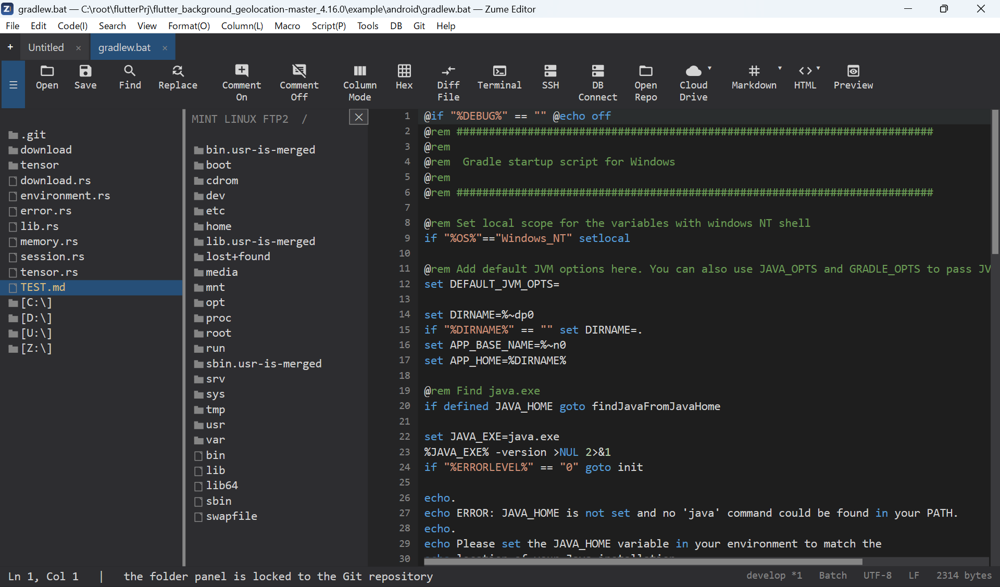

# 远程文件（SFTP / FTP / FTPS）

直接在远程服务器上编辑文件。

1. **远程 → 连接**——选择协议（**SFTP**、**FTP** 或 **FTPS**），并
   输入主机、端口、用户名和密码（SFTP 可使用 SSH 密钥）。
2. 侧边栏会变成远程浏览器——点击文件夹进行导航，点击文件
   即可在标签页中打开它。
3. **保存**（++ctrl+s++）会将文件上传回服务器。

- **主机密钥信任**——SFTP 采用首次使用即信任（trust-on-first-use）；你需要确认一次未知密钥的
  指纹。遇到 FTPS 证书问题时会在继续之前先询问。
- **已保存的连接**——存储连接配置（除非你选择保存密码，否则绝不保存密码，
  即使保存也仅存放在操作系统的安全存储中）。
- 可同时打开多个连接，每个连接各占一个标签页。

另请参阅 [终端与 SSH](terminal-ssh.md) 了解 SSH shell，以及
[CloudDrive](clouddrive.md) 了解云存储。

{ loading=lazy }
