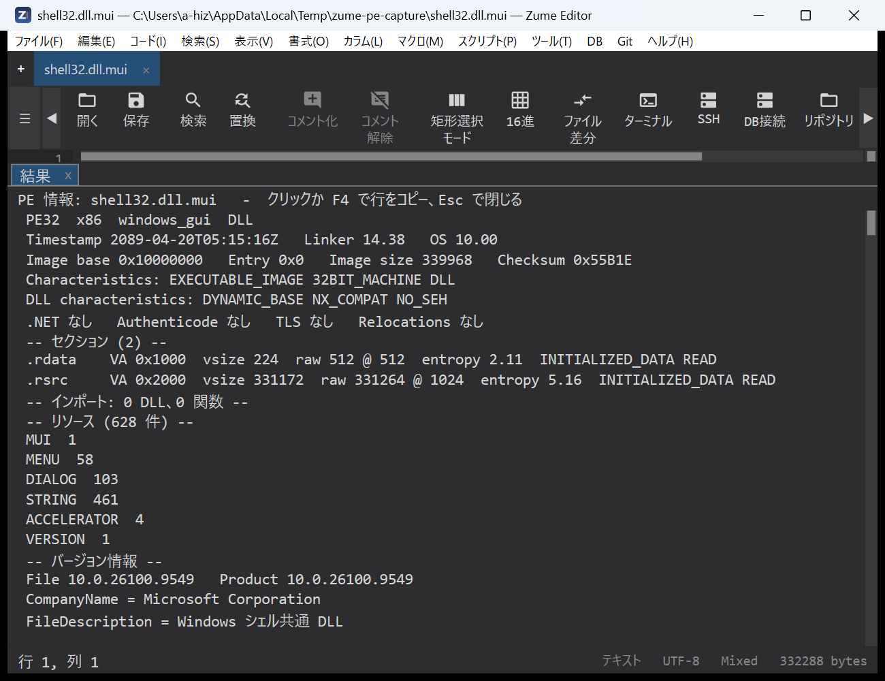
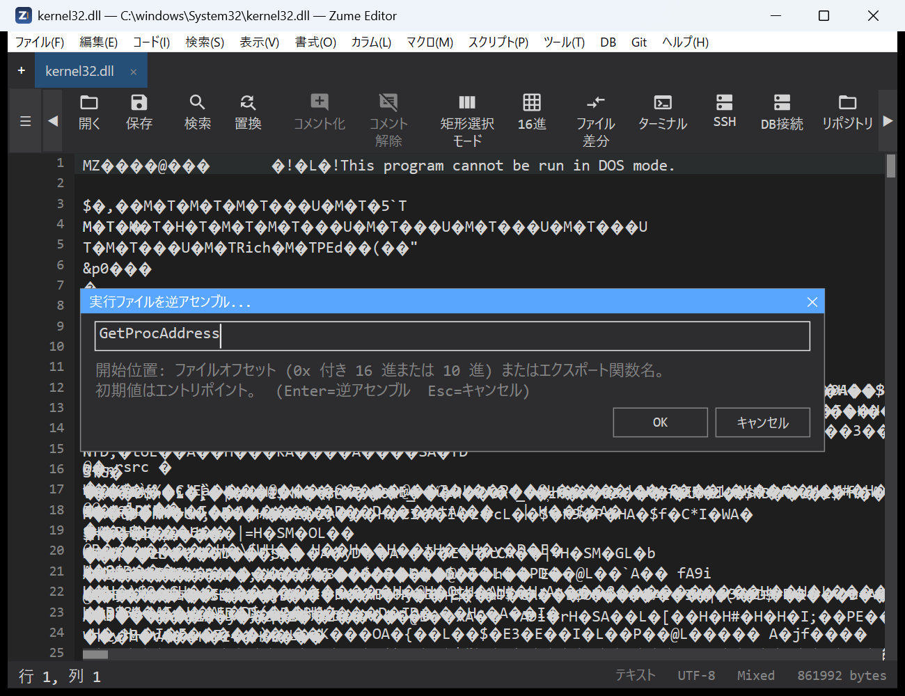
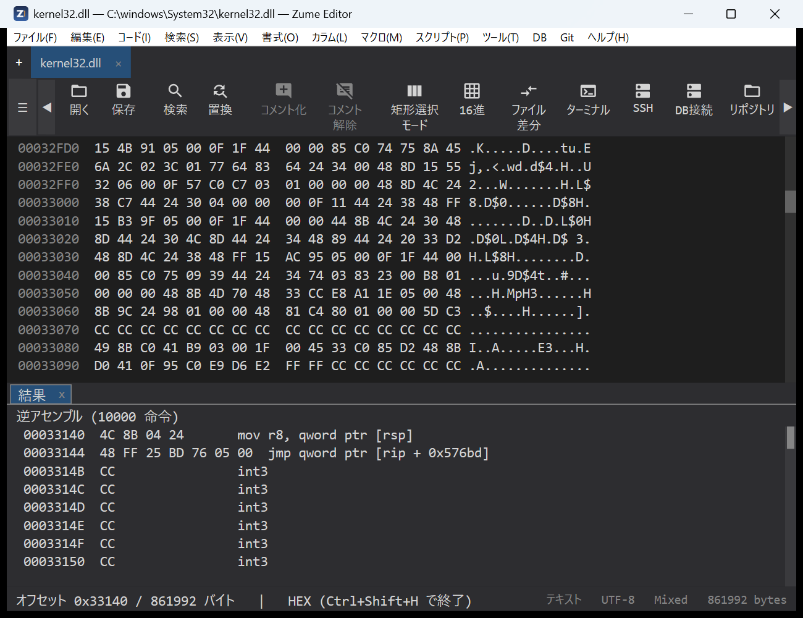
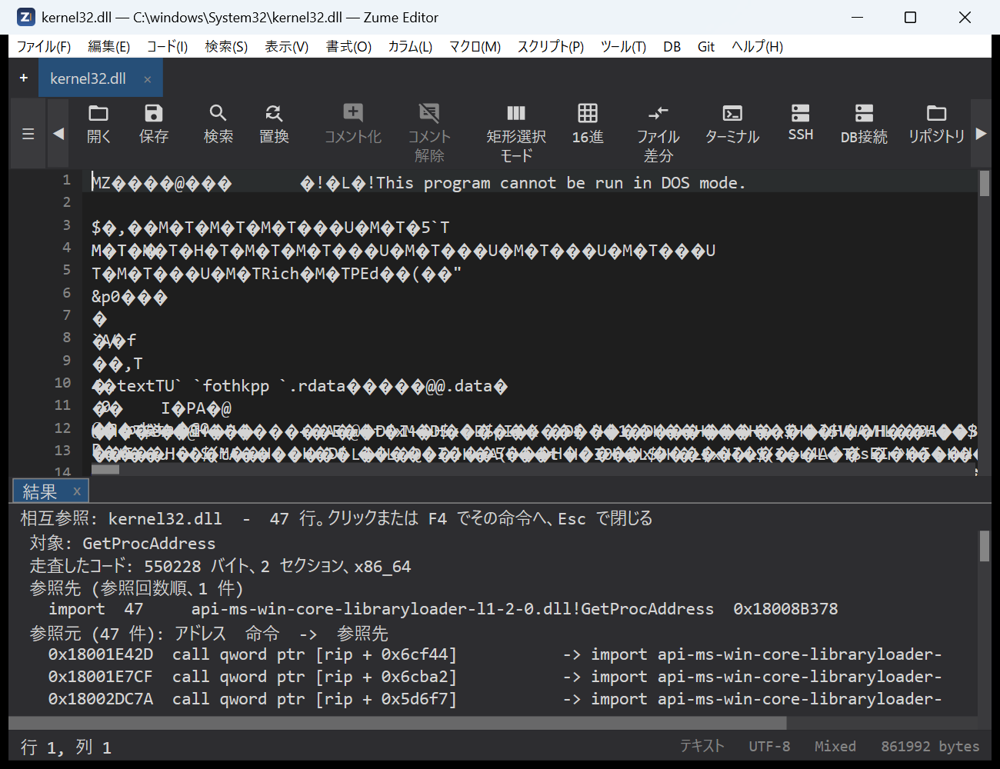
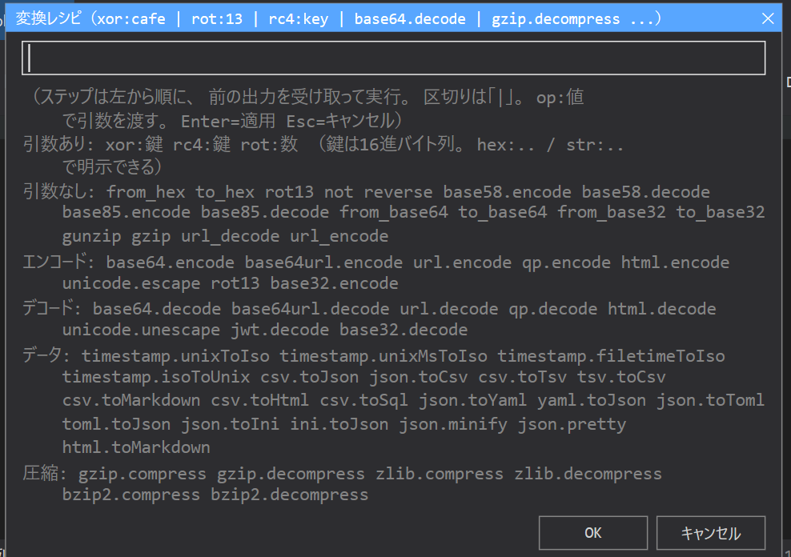

# セキュリティ解析

Zume Editor には、バイナリ診断・データ変換・シグネチャ走査のツールがあり、
リバースエンジニアリング、CTF、認可されたセキュリティ作業に役立ちます。いずれも
[MCP サーバー](mcp.md#tools)経由で AI エージェントからヘッドレスに利用できます
（`identify`・`entropy`・`transform`・`yara_scan`・`pe_info`・`elf_info`・`macho_info` ツール）。

## ファイルの種別を判定

**コード → ファイルの種別を判定…** は、**そのファイルが何か**を、そして多くの
ドキュメント／画像形式については**どのソフトで作成されたか**を教えてくれます。
実行ファイル情報の汎用版にあたる診断ツールです。

拡張子ではなくファイルの内容（マジックシグネチャ）から判定し、結果パネルに
一覧します：

- **format**（形式）と説明、**MIME タイプ**、**カテゴリ**（画像／ドキュメント／
  アーカイブ／実行ファイル／音声／動画／フォント…）、**信頼度**、一般的な
  **拡張子**、そして実体が包まれている場合の**コンテナ**（例: `.docx` は ZIP
  コンテナ）。
- ドキュメント／画像なら、それを書き出したアプリや機器を示す
  **Producer** / **Creator** 行。

約 50 形式を認識します — 画像（PNG, JPEG, GIF, TIFF, WebP, HEIC/AVIF, BMP, ICO）、
ドキュメント（PDF, RTF, PostScript, OOXML・OpenDocument のオフィス形式, EPUB）、
アーカイブと圧縮（ZIP, 7z, RAR, tar, gzip, xz, zstd …）、メディア（MP4/MOV,
WebM/Matroska, WAV, FLAC, OGG, MP3）、フォント、SQLite データベース、WebAssembly、
Java クラスファイル、そして PE / ELF / Mach-O 実行ファイル。ZIP ベースのファイルは
実体の種別（docx / xlsx / pptx / odt / epub / jar / apk）まで絞り込みます。

「作成元」はファイル自身のメタデータから読み取り、推測はしません：

| 形式 | 取得元 |
| --- | --- |
| PDF | Info 辞書の `/Producer`・`/Creator`（および XMP の `pdf:Producer` / `xmp:CreatorTool`）。ファイル末尾も読むので、大きな PDF でも作成元が見つかります |
| JPEG / TIFF | EXIF — Software、Make + Model、および Exif サブ IFD の DateTimeOriginal・レンズのメーカー／型番 |
| PNG | `Software` テキストチャンク |
| OOXML（docx / xlsx / pptx） | `docProps/app.xml` の `<Application>`（および `core.xml` の作成者） |
| OpenDocument（odt / ods / odp） | `meta.xml` の `<meta:generator>` |

アクティブなタブがファイルならそれを判定し、そうでなければファイル選択ダイアログで
指定します。読み取るのは先頭の一定量（PDF は末尾も）だけなので、巨大なファイルでも
読み込まずに判定します。行をクリック（または **F4**）でコピー、**Esc** で閉じます。
認識できないファイルは推測せず「不明なデータ」と報告します。

同じ判定は MCP の [`identify`](mcp.md#tools) ツール（`file_info` も種別を返します）、
およびコマンドライン [`zume-cli identify`](cli.md#identify) からも使えます。

## 実行ファイル情報 (PE / ELF / Mach-O)

**コード → 実行ファイル情報…** は実行ファイルを構造として読み取り、結果パネルに
一覧します。形式はファイルのマジックから判別します：

- **PE**（Windows の EXE / DLL）：ヘッダーとセキュリティフラグ（ASLR / DEP / CFG）、
  各セクションとそのエントロピー、インポートする DLL と関数、エクスポート、そして
  機能の目録を作るのに必要なリソース — バージョン文字列、文字列テーブル、各
  ダイアログのキャプションとコントロール、メニュー項目、マニフェスト — に加えて
  PDB パスと最終セクション以降に付加されたデータ。MSVC でリンクされたバイナリでは
  **Rich ヘッダー**（各コンパイラ／リンカー／アセンブラのコンポーネントとビルド番号・
  オブジェクト数を記録する非公開の `@comp.id` ブロック、チェックサムの正否付き。
  「どのツールチェーンでビルドされたか」の強力な指紋）も読み取ります。
- **ELF**（Linux の実行ファイルと共有オブジェクト）：種別、マシン、エントリ、
  インタープリター、セグメントとセクション（エントロピー付き）、動的セクション
  （必要なライブラリ、soname、rpath / runpath）、バージョン付きのインポート /
  エクスポートシンボル、ストリップされていなければローカルシンボル、GNU ビルド
  ID、そしてバイナリのハードニング（PIE、NX スタック、RELRO、スタックカナリア、
  FORTIFY）。
- **Mach-O**（macOS / iOS のイメージ。fat / ユニバーサルバイナリはスライスを列挙して
  先頭を読みます）：CPU、ファイル種別、ヘッダーフラグ、全ロードコマンド、
  セグメントとセクション（エントロピー付き）、バージョン付きのリンク先 dylib、
  rpath、UUID、プラットフォーム / 最小 OS / SDK、エントリポイント、インポート /
  エクスポートシンボル、コード署名と暗号化の有無。

アクティブなタブ自体がそうしたファイルなら（16 進ビューで開いたバイナリなど）その
ファイルを読み、そうでなければファイル選択ダイアログで指定します。読み込みは
ワーカースレッドで行うので、大きなバイナリでもエディターは止まりません（先頭
256 MiB を読み、それより大きいファイルは警告行でその旨を示します）。行を
クリック（または **F4**）するとその行をクリップボードにコピーし、**Esc** で
パネルを閉じます。

コードを指す行はコピーではなく逆アセンブル表示へジャンプします：エントリポイントの
行、エクスポートされた関数、実行属性を持つセクションやセグメントです。
クリックするとそのファイルを 16 進ビューで該当オフセットに開き、ファイルが宣言する
アーキテクチャ（x64 / x86 / ARM64 / ARM / Thumb）で **16進 → 逆アセンブル** を
実行するので、結果パネルがそのオフセットからの逆アセンブルに切り替わります。
16 進ビューはそのまま残るので、続けて参照できます。

{ loading=lazy }

!!! tip "学習モード：フィールド解説"
    **ツール → 設定…** で **解説**（`explain_annotations` 設定、既定はオフ）をオンにすると、
    実行ファイル情報のトリアージで重要なフィールドの下に「これは何か」の一行解説が付きます
    — エントリポイント、サブシステム、セクションのエントロピー、インポート／エクスポート、
    オーバーレイ、Rich ヘッダー（ビルド由来）、そして存在する各ハードニングビット
    （ASLR / DEP / CFG、ELF の PIE / NX / RELRO / スタックカナリア / FORTIFY、Mach-O の
    署名／暗号化／chained fixups）。学習向けの
    機能で、熟練者はオフのままにしておけばレポートがすっきりします。

### 実行ファイルを逆アセンブル

**コード → 実行ファイルを逆アセンブル…** は一覧を経由せず直接リスティングへ進みます。
アクティブなタブが PE / ELF / Mach-O ならそのファイルを（そうでなければファイル選択
ダイアログで指定したファイルを）読み、開始位置を尋ねる小さなダイアログを開きます。
初期値はエントリポイントのファイルオフセットです。ファイルオフセット（`0x2D5F0` または
10 進）か、エクスポート関数名（`GetProcAddress`。Mach-O の名前は先頭の `_` があっても
なくても可）を入力して **Enter** を押すと、そのファイルが 16 進ビューでそのオフセットに
開き、結果パネルにそこからの命令列が、ファイルが宣言するアーキテクチャで並びます。
エクスポートにない名前やファイル末尾を超えるオフセットはメッセージで拒否します。同じ
デコーダーが MCP ツール `disassemble` です。結果パネルをクリックするとキーボードで
移動できます：**↑ / ↓**、**PageUp / PageDown**、**Home / End** で強調行を移動、
**Enter** でその行を実行（16 進ビューのキャレットがその命令へ移動）、**Esc** で
パネルを閉じます。

{ loading=lazy }

{ loading=lazy }

### 相互参照

**コード → 相互参照…** は「これを使っているコードはどこか」に答えます。アクティブなタブの
実行ファイル（なければファイル選択）に対して小さなダイアログで対象を尋ね — インポート /
シンボル名（`CreateFileW`、`KERNEL32.dll!CreateFileW`）、文字列の一部、`0x` 付きアドレス、
空ならすべての参照 — 実行属性セクションをすべて走査します。結果パネルには参照先を参照回数順に
（インポート / シンボル / PLT・スタブ / 文字列 / コード / データ）、続いて参照している命令を
アドレス付きで並べます。参照行をクリック（または **F4**）するとそのファイルが 16 進ビューで
その命令の位置に開き、そこから逆アセンブルします。同じ走査が MCP ツール `xrefs` です。

{ loading=lazy }

同じ読み取りエンジンが MCP ツール `pe_info`・`elf_info`・`macho_info` です
（[MCP](mcp.md#tools) 参照）。ロード・実行は一切行わず、`disassemble` もバイト列を
デコードするだけです。解析はライセンスで許されたバイナリに限ってください。

### 制御フローグラフ

**コード → 制御フローグラフ…** は、アクティブタブの実行ファイル（なければ選択を要求）の
**エントリ関数**を基本ブロック（分岐の入口でのみ入り、末尾でのみ出る直線的な命令列）に
分解します。結果パネルは各ブロックをアドレス・命令数・フラグ（entry / returns / 間接ジャンプ）・
次に到達しうるブロック（`-> B1, B2`、分岐成立先が先頭）とともに並べ、続けてそのブロックの
命令を表示するので、関数の分岐とループが順に把握できます。MCP ツール `cfg` は**任意の関数**を
（`symbol` または `address` で）同じようにグラフ化でき、エントリ以外を見たいときはこちらです。
静的かつヒューリスティックで、実行は行いません。

### 逆コンパイラ外部ツールの導入

逆コンパイルは**任意機能**で、ユーザー自身が導入したツールを使います。Zume はいずれも同梱せず、
ダウンロードもせず、あなたが場所を教えたときだけ起動します。必要なものだけ入れてください:

| ツール | 逆コンパイル対象 | 入手 | 有効化 |
| --- | --- | --- | --- |
| **JDK**（Temurin / OpenJDK） | Java **および** Ghidra の前提 | [adoptium.net](https://adoptium.net/)（Java 17 以上） | `JAVA_HOME` を設定、または `java` / `javap` を `PATH` に |
| **Ghidra** | ネイティブ **PE / ELF / Mach-O → C** | [ghidra-sre.org](https://ghidra-sre.org/)（任意の場所に展開。JDK が必要） | エディタ: *ツール → 設定 → 逆コンパイラ (Ghidra)*／MCP: `ZUME_GHIDRA_HOME`（インストール先） |
| **ilspycmd**（ILSpy） | **.NET アセンブリ → C# / IL** | `dotnet tool install -g ilspycmd`（.NET ランタイムが必要） | エディタ: *ツール → 設定 → 逆コンパイラ (.NET / ILSpy)*／MCP: `ZUME_ILSPY`（`ilspycmd` のパス、または `1` で PATH 探索） |
| **CFR** | **Java `.class` / `.jar` → Java ソース** | Maven Central から [https://repo1.maven.org/maven2/org/benf/cfr/0.152/cfr-0.152.jar](https://repo1.maven.org/maven2/org/benf/cfr/0.152/cfr-0.152.jar) を取得（単体 jar。JDK が必要） | MCP: `ZUME_CFR`（jar のパス） |

補足:

- **javap**（JVM バイトコード）と **jar**（クラス一覧）は JDK 付属なので、Java のクラス一覧と
  バイトコードは JDK だけで動きます。CFR は Java **ソース**復元を追加します。
- `ZUME_*` 変数は **MCP サーバーの環境**から読まれます。Claude Code CLI の場合は
  `~/.claude.json` の `zume` エントリの `env` ブロックです（編集後はクライアントを再起動）。
  任意のキャッシュ先: `ZUME_GHIDRA_CACHE` / `ZUME_ILSPY_CACHE` / `ZUME_CFR_CACHE`。
- Ghidra と ilspycmd はエディタの**設定ダイアログ**からも指定できます（エディタ自身の
  *コード → 逆コンパイル…* 用）。`ZUME_*` は Claude Code から使う MCP ツール用で、両者は独立です。
- いずれのツールも**対象を静的に読むだけで、実行はしません**。ライセンスは Ghidra が Apache-2.0、
  ilspycmd と CFR が MIT で、Zume は再配布しません。逆コンパイル出力は派生物です。利用前に
  各ツールの節とライセンス／クリーンルームの注意を確認してください。

### 逆コンパイル (Ghidra)

Zume 自体は逆コンパイラを内蔵しませんが、既にインストール済みの逆コンパイラを呼び出せます。
**コード → 逆コンパイル (Ghidra)…** は、ローカルの [Ghidra](https://ghidra-sre.org/) を
使って関数の機械語を C 風の擬似コードに戻します。**任意機能で既定では無効**です。Zume に
Ghidra の場所を教えるまでメニュー項目はグレーアウトしています。

**有効化。** **ツール → 設定…** を開き、*逆コンパイラ (Ghidra)* セクションの
*Ghidra のインストール先:* の行をクリックして Ghidra のフォルダー（`support/analyzeHeadless`
を含むフォルダー）を選びます。Ghidra には Java 17 以上のランタイムが必要ですが、Zume が
`PATH` や `JAVA_HOME` から自動検出するので、通常は追加設定は不要です。パスをクリアすると
再び無効になります。

**使い方。** アクティブなタブが実行ファイルの状態で（またはファイル選択で）**コード →
逆コンパイル (Ghidra)…** を選び、対象の関数を入力します — アドレス（`0x180001020`。
`functions` や `xrefs` が報告したものなど）、関数名、または空ならファイル全体（上限あり）。
Zume はバックグラウンドで Ghidra をヘッドレス実行し（初回は数分かかることがあります）、
逆コンパイルした C を**読み取り専用**のタブで開きます。結果はファイルのサイズ・更新時刻・
リクエスト内容で**キャッシュ**されるので、同じ未変更の関数を再度逆コンパイルすると即座に
返ります。

同じ逆コンパイラが MCP ツール `decompile` です。環境変数 `ZUME_GHIDRA_HOME` が Ghidra の
インストール先を指しているときだけ有効になります（キャッシュ先は `ZUME_GHIDRA_CACHE` で
指定できます）。

!!! warning "ライセンスとクリーンルーム"
    Ghidra は対象バイナリを実行せず静的に解析しますが、逆コンパイル結果は元のバイナリの
    **派生物**であり、元のソースに似ることがあります。逆コンパイルはライセンスで許された
    バイナリに限り、機能を再実装する場合は出力された C ではなく観測した振る舞いの仕様から
    行ってください。

### .NET の逆コンパイル (ILSpy)

.NET アセンブリの実体は メタデータ内の CIL なので、Ghidra では実用的に逆コンパイルできません。
**managed（.NET）** バイナリに対しては、Zume は代わりに
[ILSpy](https://github.com/icsharpcode/ILSpy) のコマンドラインツール **ilspycmd** を呼び出します。
**コード → 逆コンパイル (.NET / ILSpy)…** で型を C# に戻します。Ghidra 連携と同様に
**任意機能で既定では無効**です。Zume に `ilspycmd` の場所を教えるまでメニュー項目はグレーアウトしています。

**ilspycmd の導入。** これは .NET のグローバルツールです（ILSpy のデスクトップアプリは不要）。

```
dotnet tool install -g ilspycmd
```

.NET ランタイムが必要で、`ilspycmd`（通常は
`%USERPROFILE%\.dotnet\tools\ilspycmd.exe`）がインストールされ、`PATH` にも載ります。

**有効化。** **ツール → 設定…** を開き、*逆コンパイラ (.NET / ILSpy)* セクションの
*ilspycmd:* の行をクリックして `ilspycmd.exe` を選びます。任意の *IL キャッシュ:* の行で
結果のキャッシュ先を選べます（未設定なら既定の場所を使用。フォルダーは初回実行時に自動作成）。
パスをクリアすると再び無効になります。

**使い方。** アクティブなタブが .NET アセンブリの状態で（またはファイル選択で）**コード →
逆コンパイル (.NET / ILSpy)…** を選び、完全修飾の型名（例: `Acme.Core.Engine`）を入力します。
空のまま実行すると、まずアセンブリの型一覧をタブに出力するので、その中の名前で再実行できます。
Zume はバックグラウンドで ilspycmd を実行し、逆コンパイルした C# を**読み取り専用**のタブで
開きます。結果は Ghidra と同様にキャッシュされます。

同じ逆コンパイラは MCP クライアントからも `il_types`（型の目録。`functions` の managed 版）と
`il_decompile`（型 1 つを C# に、または `out_dir` でアセンブリ全体をプロジェクト展開）として
使えます。環境変数 `ZUME_ILSPY` が設定されているときだけ有効です — `ilspycmd` のパス、または
`PATH` から探す `1`（キャッシュ先は `ZUME_ILSPY_CACHE`）。`decompile` ツールは managed な対象を
自動的にこちらへ振り分けます。

!!! warning "ライセンスとクリーンルーム"
    逆コンパイルした C# は**元のソースに非常に近い**（IL が名前や構造を保持しているため）ので、
    ネイティブコード以上にライセンス／クリーンルームの注意が重要です。逆コンパイルはライセンスで
    許されたアセンブリに限り、再実装は出力された C# ではなく振る舞いの仕様から行ってください。

### Java の逆コンパイル (javap + CFR)

Java の `.class` / `.jar` は JVM バイトコードで、Ghidra でも ILSpy でも扱えません。Zume は
JDK の **javap**（バイトコード）と、ユーザー導入の **CFR**（Java ソース）を使います。MCP ツール
`java_types`（jar 内のクラス一覧）と `java_decompile`（クラス 1 つを Java ソース、または
`javap -c` のバイトコード、あるいは jar 全体をソースツリー）として提供します。**オプトイン**です:

- **javap / jar** は JDK 付属で、`JAVA_HOME` / `PATH` から検出します（Ghidra 連携で必要な JDK と
  同じ）。バイトコードとクラス一覧は JDK だけで動きます。
- **CFR**（Java ソース復元）はユーザーが用意する単体 jar です。`ZUME_CFR` 環境変数（MCP サーバー側）に
  そのパスを設定します。キャッシュ先は `ZUME_CFR_CACHE`。CFR は MIT ライセンスで、Ghidra / ilspycmd と
  同様に同梱・取得・リンクはせず、ユーザーが導入したツールを起動するだけです。

**CFR の入手。** 単体 jar なのでインストール不要です。Maven Central（または
[CFR のリリース](https://github.com/leibnitz27/cfr/releases)）から 1 回ダウンロードします:

```
https://repo1.maven.org/maven2/org/benf/cfr/0.152/cfr-0.152.jar
```

任意の場所に保存します（例: `C:\Users\<あなた>\zume-app\cfr\cfr-0.152.jar`）。CFR の実行（`java`）と
バイトコード（`javap`）のために **JDK** も必要です（Ghidra 連携で使うものと同じ）。

**有効化。** 以下を **MCP サーバーの環境**（CLI なら `~/.claude.json` の `zume` エントリの `env`
ブロック）に設定し、クライアントを再起動します:

```json
"env": {
  "JAVA_HOME": "C:\\Program Files\\Eclipse Adoptium\\jdk-25...-hotspot",
  "ZUME_CFR": "C:\\Users\\<あなた>\\zume-app\\cfr\\cfr-0.152.jar",
  "ZUME_CFR_CACHE": "C:\\Users\\<あなた>\\zume-app\\cfr-cache"
}
```

`java` / `javap` が既に `PATH` にあれば `JAVA_HOME` は省略できます。その場合でもクラス一覧と
バイトコード（`javap`）は JDK だけで動き、`ZUME_CFR` を足すと Java ソース出力（CFR）が有効に
なります。非 ASCII の文字列リテラルは `\uXXXX` エスケープで返りますが、これは CFR の通常の
（ロスレスな）出力です。

いずれもクラスファイルを読み取るだけで、実行はしません。

!!! warning "ライセンスとクリーンルーム"
    逆コンパイルした Java は元のバイナリの**派生物**です。リバースエンジニアリングがライセンス /
    EULA で許可され、かつ解析する権利があるソフトウェアにのみ使用し、再実装は出力された Java の
    流用ではなく振る舞いの仕様から行ってください。本機能で作成したものは利用者自身の責任です。

## インターフェース復元 (Objective-C / Swift)

**コード → Objective-C / Swift インターフェース…** は、macOS / iOS の
**Mach-O** が Objective-C / Swift ランタイムのメタデータとして保持している
クラスインターフェースを、逆コンパイラ無しで復元します。`__objc_*` /
`__swift5_*` セクションを読み、`<アプリデータ>/interfaces/<名前>.h` に
ヘッダを書き出して読み取り専用で開きます。内容:

- **Objective-C**: スーパークラスと採用プロトコル付きのクラス、インスタンス /
  クラスメソッド（`-` / `+`・セレクタ・メタデータがあれば引数と戻り値の型）、
  インスタンス変数、属性付きの宣言済みプロパティ、クラスを拡張するカテゴリ。
- **Swift**: `__swift5_types` / `__swift5_protos` から復元した型と、シンボル
  テーブルの Swift シンボルを可読シグネチャにデマングルしたもの
  （`Module.Type.method(label:) async throws -> T`）。デマングラは
  **フェイルクローズ**設計で、正しくデマングルできるか、生の `_$s…` のまま
  残すかのどちらかで、誤った推測はしません。

アクティブタブがその種のファイルならそれを、そうでなければファイル選択で
読みます。fat / ユニバーサルバイナリは読んだスライスに解決し、`.app` /
`.framework` バンドルを指定すると中の Mach-O に解決します。各メソッド行は
実装のアドレスを持つので、実行（クリック / **F4**）すると Executable Info の
コード行と同様に逆アセンブリ上のそのメソッド本体へジャンプします。同じエンジンが
**相互参照**や MCP の `functions` ツールでも呼び出し箇所に名前を付けます
（`objc_msgSend` 箇所には送っている `@selector(...)`、クラス参照にはクラス名）。

読むのは Objective-C / Swift がランタイム用にバイナリへ残すメタデータだけで、
メソッド本体ではなく、対象を実行することもありません。メタデータが最も豊富な
macOS / iOS バイナリで特に有用です。

## YARA スキャン

**コード → YARA スキャン…** は、YARA ルールでアクティブ文書を走査します。

ダイアログに入力するのは、**YARA ルールファイルのパス**（`.yar` / `.yara`）です
— ルール本文そのものではありません。先にルールをファイルに書いて保存し、その場所を
ダイアログで指定します。

1. ルールファイルを作成して保存（下の例を参照）。例：`C:\rules\malware.yar`、
   `~/rules/strings.yara`。
2. 走査したい文書を開き、**コード → YARA スキャン…** を実行（コマンドパレットにも
   あります）。
3. ルールファイルのフルパスを入力して Enter。
4. 一致は結果パネルに `rule  $string  line N @ offset` の形で一覧表示されます。
   行をクリック（または F4）でその行へジャンプします。

対象は通常のテキスト / コードタブです（大容量・HEX・Git タブでは無効）。

### ルールファイルの例

```yara
rule suspicious_strings
{
    strings:
        $a  = "cmd.exe /c" nocase
        $b  = "powershell" nocase wide
        $mz = { 4D 5A ?? 00 }              // PE ヘッダ（?? は任意バイト）
        $url = /https?:\/\/[a-z0-9.\-]+/ nocase
    condition:
        $mz and (2 of ($a, $b, $url))
}
```

### 対応している記法

YARA の実用的なサブセット：

- **文字列** — テキスト（`"..."`）、hex（`{ 4D 5A ?? 00 }`、`??`=任意バイト、
  `?`=ニブルのワイルドカード）、正規表現（`/regex/`）。
- **文字列修飾子** — `nocase` / `wide` / `ascii` / `fullword`。
- **条件** — 文字列名（`$a`）、`all of them` / `any of them` / `N of them`、
  `N of ($a*)`、`#a <op> N`（出現回数）、`$a at N`（オフセット一致）、
  `filesize <op> N`、`and` / `or` / `not`、括弧、`//` … `/* … */` コメント。

**完全な libyara エンジンではありません**：モジュール（`pe` / `hash` / `math` 等）、
hex の jump（`[4-6]`）やオルタネーション（`( A | B )`）は非対応で、使用すると
一致ではなく型付きエラーになります。

!!! tip "ルールの直接入力 / 一括スキャン"
    ルールを直接貼り付けたい、またはファイルやディレクトリをまとめて走査したい場合は、
    [MCP](mcp.md#tools) の `yara_scan` ツールを使ってください。ルールをテキストで渡し、
    対象にファイル・ディレクトリ・インラインのバイト列を指定できます。

## 変換レシピ { #transform-recipes }

**コード → 変換レシピの適用…** は、選択範囲（または文書全体）に対して変換を
左から右へ連結して適用します。ステップは `|`（またはスペース / カンマ）で区切り、
引数はコロンの後に書きます。例：

```
from_base64 | xor:cafe | gunzip
```

開くダイアログの 1 行の入力欄にレシピを書きます。欄の下のヒントに、エンジンが
受け付けるすべてのステップが下表と同じ分類で並ぶので、名前を覚えておく必要は
ありません。ステップを入力して **Enter**（または OK）で適用、**Esc** で
キャンセルです。

{ loading=lazy }

### 使えるステップの一覧

| 分類 | ステップ |
| --- | --- |
| 引数あり | `xor:<鍵>`（繰り返し鍵で各バイトを XOR）、`rc4:<鍵>`（RC4 暗号化 / 復号）、`rot:<n>`（n 文字のシーザーシフト） |
| 引数なし | `from_hex`、`to_hex`、`rot13`、`not`（全ビット反転）、`reverse`（バイト順を反転）、`base58.encode` / `base58.decode`、`base85.encode` / `base85.decode` |
| 短い別名 | `from_base64` = `base64.decode`、`to_base64` = `base64.encode`、`from_base32` / `to_base32`、`gunzip` = `gzip.decompress`、`gzip` = `gzip.compress`、`url_decode` / `url_encode` |
| エンコード | `base64.encode`、`base64url.encode`、`url.encode`、`qp.encode`、`html.encode`、`unicode.escape`、`rot13`、`base32.encode` |
| デコード | `base64.decode`、`base64url.decode`、`url.decode`、`qp.decode`、`html.decode`、`unicode.unescape`、`jwt.decode`、`base32.decode` |
| データ | `timestamp.unixToIso`、`timestamp.unixMsToIso`、`timestamp.filetimeToIso`、`timestamp.isoToUnix`、`csv.toJson`、`json.toCsv`、`csv.toTsv`、`tsv.toCsv`、`csv.toMarkdown`、`csv.toHtml`、`csv.toSql`、`json.toYaml`、`yaml.toJson`、`json.toToml`、`toml.toJson`、`json.toIni`、`ini.toJson`、`json.minify`、`json.pretty`、`html.toMarkdown` |
| 圧縮 | `gzip.compress`、`gzip.decompress`、`zlib.compress`、`zlib.decompress`、`bzip2.compress`、`bzip2.decompress` |

エンコード / デコード / データ / 圧縮の行は[ファイル変換](convert.md)の
コンバーターで、どのコンバーター ID もそのままステップとして使えます。鍵の引数
（`xor:` / `rc4:`）は、`cafe` や `deadbeef` のように 16 進に見える場合は 16 進
バイト列、それ以外は文字列として扱います。`hex:cafe` / `str:cafe` と書けば明示
できます。

!!! warning "16 進に見える文字列の鍵に注意"
    鍵は **16 進数字だけなら 16 進バイト列**として読まれるため、`cafe`・`decade`・
    `7a756d65` のような文字列パスワードは「文字」ではなく「バイト」として扱われ
    ます。`rc4:zume` は（16 進でない文字を含むので）文字列鍵 `zume` を使いますが、
    `rc4:cafe` は文字列 `cafe` を使い**ません**。曖昧さをなくすには、文字列／ASCII
    鍵は `rc4:str:<鍵>`（例 `rc4:str:zume`）、バイト鍵は `rc4:hex:<バイト>` または
    そのまま 16 進（例 `rc4:7a756d65` = `zume` の 16 進）と書きます。両者はキー
    ストリームが変わるため、バイナリ内の鍵チェック（生の鍵バイトを使う）に合わせる
    には、その正確なバイト列を 16 進形式で渡します。

!!! tip "推測ではなくエラーにする（厳格モード）"
    素の鍵を一切禁止したい場合は、**ツール ▸ 設定…** の **変換レシピの鍵**
    セクションで厳格モード（`strict_transform_keys` 設定）をオンにします。
    すると `xor:`/`rc4:` の鍵は
    必ず `hex:` か `str:` を付ける必要があり、素の鍵は拒否されてレシピは適用され
    ません。厳格モードがオフ（既定）のときは、16 進に見える素の鍵もそのまま適用
    されますが、ステータス行が警告し `str:`/`hex:` 形式を案内します。`transform`
    MCP ツールも同様で、応答に常に `warnings` 配列（曖昧な素の鍵を通知）を含み、
    `strict: true` 引数で素の鍵を拒否します。

### 例

エンコードされたテキストを選択して（または文書全体に）適用します：

| レシピ | 内容 |
| --- | --- |
| `from_base64` | Base64 をデコード |
| `from_base64 \| gunzip` | Base64 デコード後に gzip 解凍 |
| `from_hex \| xor:5a` | 16 進デコード後、各バイトを `0x5A` で XOR |
| `from_hex \| xor:hex:deadbeef` | 16 進デコード後、繰り返し鍵 `DE AD BE EF` で XOR |
| `from_base64 \| rc4:str:s3cret` | Base64 デコード後、文字列鍵 `s3cret` で RC4 復号 |
| `from_hex \| rc4:7a756d65` | 16 進デコード後、バイト鍵 `7A 75 6D 65`（`zume` の 16 進）で RC4 |
| `rot13` | ROT13（`rot:3` はシーザー暗号の 3 シフト） |
| `base58.decode` | Base58 文字列をデコード（ウォレットアドレス／鍵など） |
| `jwt.decode` | JWT をデコード済みヘッダー／ペイロードの JSON に展開 |
| `from_base64 \| xor:cafe \| from_base64` | 二重エンコード＋XOR のペイロードを剥がす |

結果は選択範囲（または文書）を**1 回の undo 単位**で置き換えるので、`Ctrl+Z` で
レシピ全体を取り消せます。途中のステップが失敗した場合（例：不正な Base64）は、
どのステップで失敗したかを表示し、テキストは変更しません。

## エントロピー

[HEX / バイナリエディタ](hex.md)のエントロピーマップとオーバービューストリップが、
ファイルを領域ごとに Shannon エントロピー（0–8 bit/byte）で表示するため、パックや
暗号化された領域が目立ちます。

**コード → エントロピーマップ…** は、任意のファイルについて同じ情報を結果パネルに
一覧します：全体のエントロピー、ファイル全体のブロックスパークライン、窓ごとの行
（オフセット・値・字形）。8 bit/byte に近い値は圧縮・暗号化の疑い（多くはパッカー）です。
MCP ツール `entropy` も同じ系列を返します。

## シークレットの検出

**コード → シークレットを検出** は、文書内の疑わしいシークレット（API キー、
トークン、秘密鍵、資格情報）を行番号付きで一覧し、行をクリックするとジャンプします。
**編集 → 選択範囲をマスク** は選択テキストを伏せ字にします。
