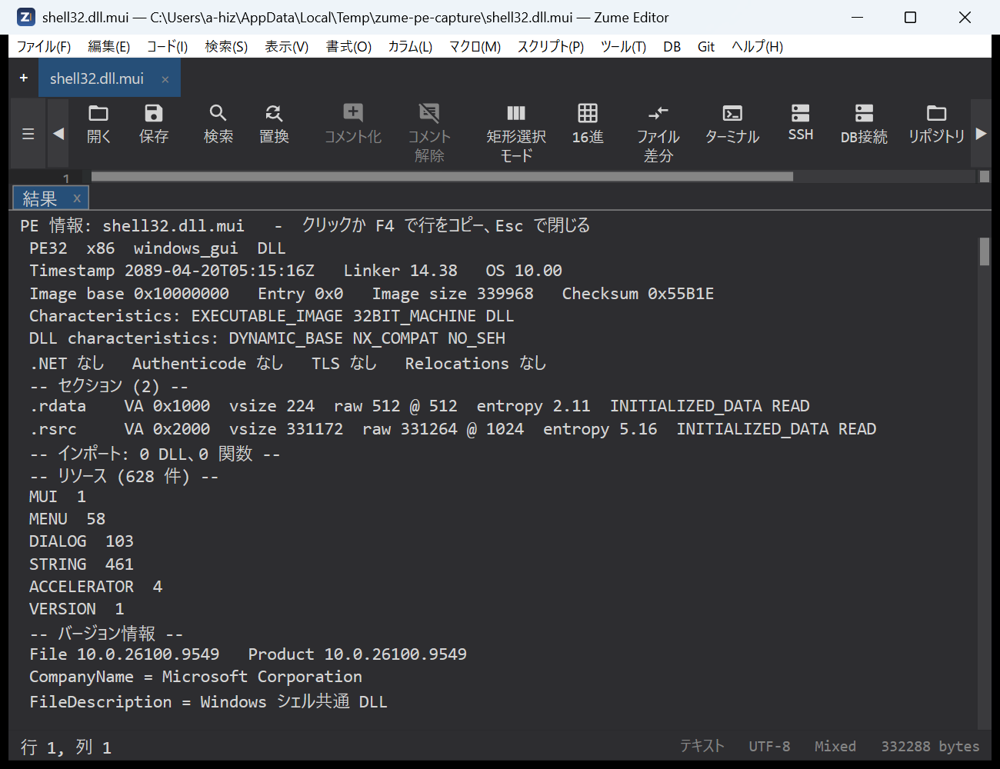
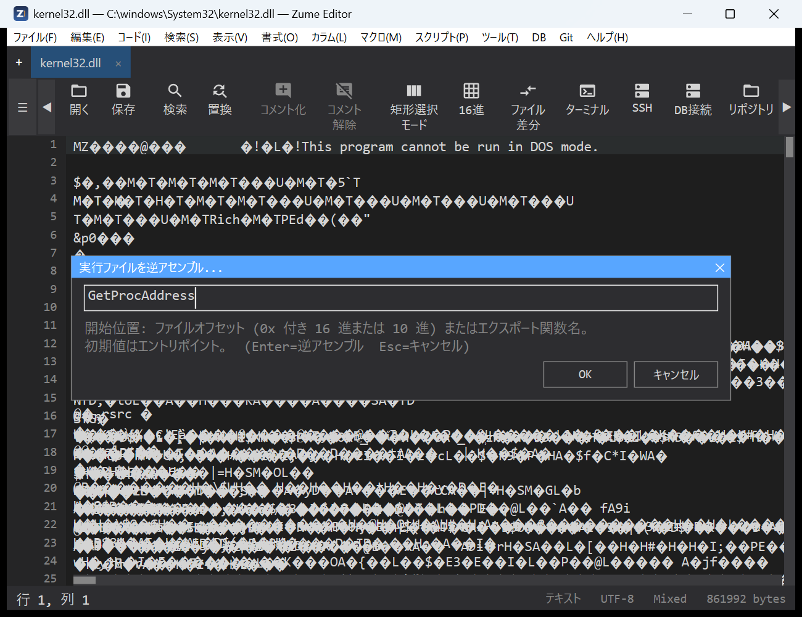
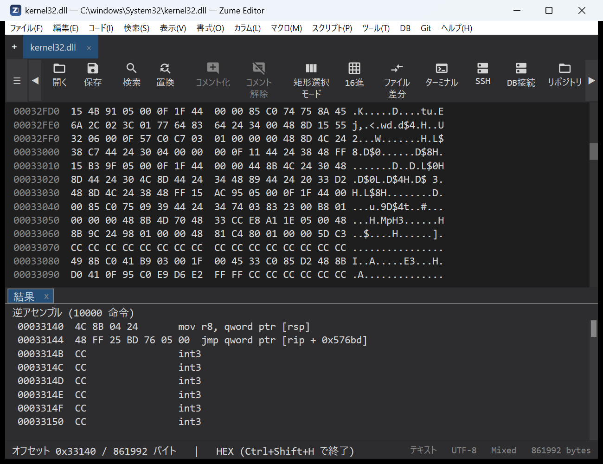
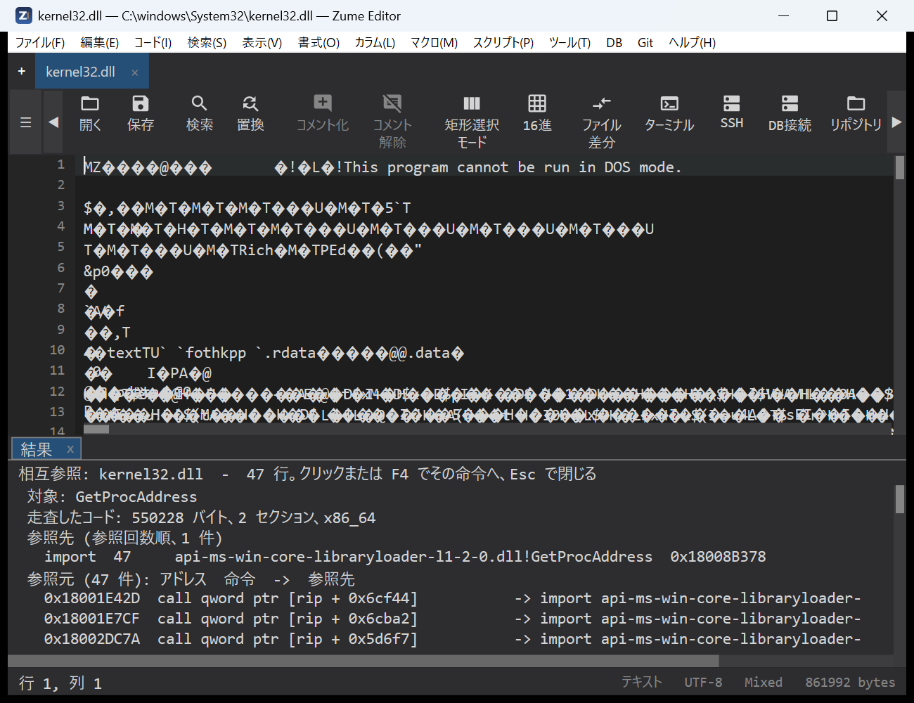
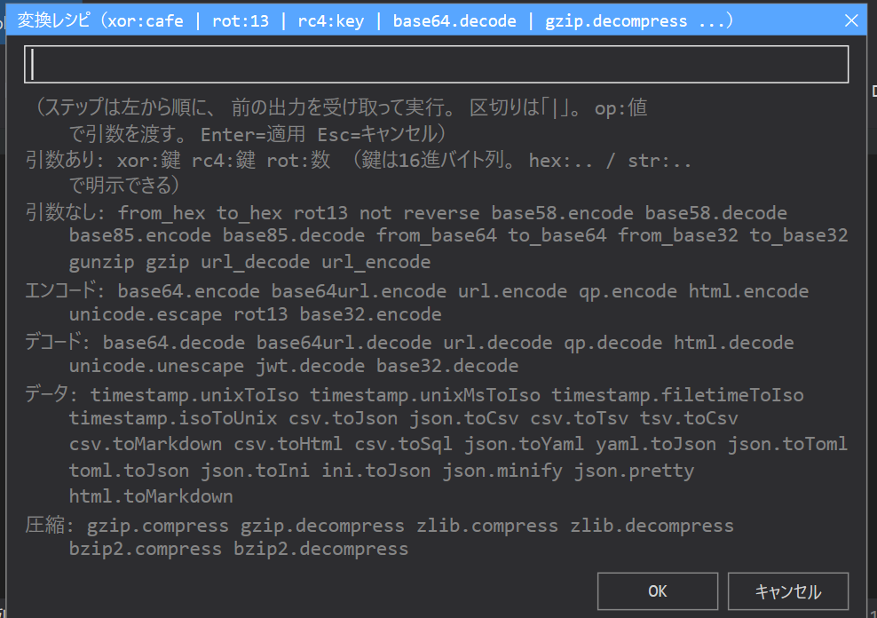

# 安全分析

Zume Editor 提供用于二进制分类、数据转换和签名扫描的工具——适用于逆向工程、CTF
和授权的安全工作。每个工具也可以通过
[MCP 服务器](mcp.md#tools) 无界面地提供给 AI 智能体使用（`identify`、`entropy`、
`transform`、`yara_scan`、`pe_info`、`elf_info` 和 `macho_info` 这些工具）。

## 识别文件

**Code → Identify File…** 会告诉你**某个文件是什么**，并且对许多文档和图像格式，
还会告诉你**创建它的软件是什么**——它是 Executable Info 的通用分类伴侣。

它读取文件的内容（magic 签名，而不是扩展名），并在结果面板中列出：

- **格式**和描述、**MIME type**、**类别**
  （图像 / 文档 / 归档 / 可执行文件 / 音频 / 视频 / 字体 / …）、**置信度**、常见
  **扩展名**，以及当真正的载荷被包装时的**容器**（例如 `.docx` 就是一个 ZIP
  容器）。
- 对于文档或图像，还有 **Producer** / **Creator** 行——即写入该文件的应用程序
  或设备。

可识别约 50 种格式——图像（PNG、JPEG、GIF、TIFF、WebP、
HEIC/AVIF、BMP、ICO），文档（PDF、RTF、PostScript、OOXML 和
OpenDocument 办公格式、EPUB），归档与压缩（ZIP、7z、RAR、
tar、gzip、xz、zstd、…），媒体（MP4/MOV、WebM/Matroska、WAV、FLAC、OGG、MP3），
字体、SQLite 数据库、WebAssembly 和 Java class 文件，以及 PE / ELF /
Mach-O 可执行文件。基于 ZIP 的文件会被细化为真正的类型（docx / xlsx /
pptx / odt / epub / jar / apk）。

“Created by”读取自文件自身的元数据，绝不猜测：

| 格式 | 来源 |
| --- | --- |
| PDF | Info 字典的 `/Producer` 和 `/Creator`（以及 XMP `pdf:Producer` / `xmp:CreatorTool`）；文件的尾部也会被读取，因此大型 PDF 的 producer 仍能被找到 |
| JPEG / TIFF | EXIF——Software、Make + Model，以及来自 Exif 子 IFD 的 DateTimeOriginal 和镜头 make / model |
| PNG | `Software` 文本 chunk |
| OOXML（docx / xlsx / pptx） | `docProps/app.xml` 的 `<Application>`（以及来自 `core.xml` 的作者） |
| OpenDocument（odt / ods / odp） | `meta.xml` 的 `<meta:generator>` |

当活动标签页是一个文件时，识别的就是该文件；否则会弹出文件选择器要求选一个。
只读取有界的前缀（对于 PDF，还读取尾部），因此无需加载即可识别巨大的文件。
点击某一行（或 **F4**）可复制它；**Esc** 关闭。无法识别的文件会被报告为未知数据，
而不是作出猜测。

同样的识别功能也可通过 MCP
[`identify`](mcp.md#tools) 工具提供给 AI 智能体使用（`file_info` 也会报告它），
并可通过命令行使用 [`zume-cli identify`](cli.md#identify)。

## Executable Info（PE / ELF / Mach-O）

**Code → Executable Info…** 会从结构上读取一个可执行文件，并将结果列在结果面板中。
格式会根据文件的 magic 检测：

- **PE**（Windows EXE / DLL）：各头部和安全标志（ASLR / DEP /
  CFG）、每个带有熵值的节、导入的 DLL 和函数、导出，以及功能清单所需的资源——
  版本字符串、字符串表、每个对话框的标题和控件、菜单项和清单——
  再加上 PDB 路径和追加在最后一个节之后的任何数据。对于
  MSVC 链接的二进制文件，它还会读取 **Rich header**：未公开的
  `@comp.id` 构建溯源块，它命名每个编译器 / 链接器 /
  汇编器组件、其构建号和对象数量，并带有一个校验和
  有效性标志（一个强有力的“这是哪条工具链构建的”指纹）。
- **ELF**（Linux 可执行文件和共享对象）：type、machine、entry、
  解释器、带有熵值的 segment 和 section、dynamic section（所需的
  库、soname、rpath / runpath）、带版本的导入和导出符号、
  未剥离时的本地符号、GNU build id，以及该二进制文件所携带的
  加固特性（PIE、NX stack、RELRO、stack canary、FORTIFY）。
- **Mach-O**（macOS / iOS 映像，包括 fat / universal 二进制文件，其
  slice 会被列出并读取第一个）：CPU、file type、header 标志、
  每个 load command、带有熵值的 segment 和 section、带版本的链接 dylib、
  rpath、UUID、platform / minimum OS / SDK、entry point、
  导入和导出符号，以及该映像是否带签名或被加密。

当活动标签页本身就是这样一个文件时（一个在十六进制视图中打开的二进制文件），
读取的就是该文件；否则会弹出文件选择器要求选一个。文件在工作线程上读取，
因此大型二进制文件不会阻塞编辑器（读取前 256 MiB；更大的文件会在一个警告行中
说明）。点击某一行（或按 **F4**）可将该行复制到剪贴板；**Esc** 关闭面板。

命名代码的行则会跳转到反汇编：entry-point 行、
导出的函数，以及可执行的段或节。点击其中之一会
在该文件偏移处以十六进制视图打开文件，并用该文件声明的架构（x64、
x86、ARM64、ARM / Thumb）在该处运行 **Hex → Disassemble**，于是反汇编面板会从
该偏移处取代报告；十六进制视图保持打开以供浏览。

{ loading=lazy }

!!! tip "学习模式：字段说明"
    在 **Tools → Settings…** 中打开 **Explanations**（`explain_annotations`
    设置，默认关闭），Executable Info 报告便会在对分类重要的字段下方加上一条简短的
    “这是什么意思”注释——entry
    point、subsystem、节熵值、imports/exports、overlay、Rich
    header（构建溯源），以及存在的每一个加固位（ASLR / DEP / CFG，
    ELF PIE / NX / RELRO / stack canary / FORTIFY，Mach-O signature /
    加密 / chained fixups）。它旨在
    用于学习；专家会将其关闭以获得整洁的报告。

### 反汇编可执行文件

**Code → Disassemble Executable…** 直接进入列表。当活动标签页的文件是
PE / ELF / Mach-O 时它会取用该文件（否则会弹出文件选择器
要求选一个），读取各头部，并打开一个小对话框询问从何处开始，
预填 entry point 的文件偏移。输入一个文件偏移（`0x2D5F0`
或十进制）或一个导出函数的名称（`GetProcAddress`；Mach-O
名称无论带不带前导 `_` 都可以），然后按 **Enter**：文件
会在该偏移处以十六进制视图打开，反汇编面板从那里列出指令，
按该文件声明的架构解码。一个不是导出项的
名称，或一个超出文件范围的偏移，都会被拒绝并给出
提示。同一个解码器就是 MCP 工具 `disassemble`。点击进入
结果面板后，键盘即可在其中移动：**↑ / ↓**、**PageUp / PageDown**、
**Home / End** 移动高亮行，**Enter** 激活它（十六进制
光标移动到该指令），**Esc** 关闭面板。

{ loading=lazy }

{ loading=lazy }

### 交叉引用

**Code → Cross-References…** 回答“哪些代码使用了这个”：它取用
活动标签页的可执行文件（或要求选一个），为目标打开一个小对话框
——一个导入项或符号名称（`CreateFileW`、`KERNEL32.dll!CreateFileW`）、
一个字符串片段、一个 `0x` 地址，或留空以列出每一处引用——并
扫描每一个可执行节。结果面板按引用次数列出各目标
（import / symbol / PLT 或 stub / string / code / data），然后
列出每一条引用指令及其地址；点击某一条引用
行（或按 **F4**）会在该指令处以十六进制视图打开文件
并从那里开始反汇编。同一次扫描就是 MCP 工具 `xrefs`。

{ loading=lazy }

同样的读取器就是 MCP 工具 `pe_info`、`elf_info` 和 `macho_info`
（见 [MCP](mcp.md#tools)）。它们从不加载或运行文件；`disassemble`
只解码字节，别无其他。只分析其许可证允许分析的二进制文件。

### 控制流图

**Code → Control-Flow Graph…** 取用活动标签页的可执行文件（或要求选
一个），并将其 **entry function** 绘制成基本块——一段只能从其第一条指令进入、
只能从其最后一条指令离开的直线指令流。结果
面板列出每个块及其地址、指令数、标志（entry /
returns / computed jump）以及控制流接下来可到达的块（`-> B1, B2`，
被采取的分支在前），随后是该块的指令，于是该函数的
分支和循环便按顺序铺陈出来。MCP 工具 `cfg` 为**任意**函数（通过 `symbol`
或 `address`）构建相同的图，这是绘制除 entry 之外的函数的方法。静态且启发式；
不运行任何东西。

### 反编译器工具——安装

反编译是**可选的**，并使用你自行安装的工具。Zume 不捆绑
其中任何一个，不下载任何东西，只有在你指向某个工具时才启动它。
只安装你需要的那些：

| 工具 | 反编译 | 安装 | 启用 |
| --- | --- | --- | --- |
| **JDK**（Temurin / OpenJDK） | Java **和** Ghidra 的前置条件 | [adoptium.net](https://adoptium.net/) — Java 17+ | 设置 `JAVA_HOME`，或将 `java` / `javap` 放到 `PATH` 上 |
| **Ghidra** | 原生 **PE / ELF / Mach-O → C** | [ghidra-sre.org](https://ghidra-sre.org/) — 解压到任意位置（需要 JDK） | 编辑器：*Tools → Settings → Decompiler (Ghidra)*；MCP：`ZUME_GHIDRA_HOME` = 安装目录 |
| **ilspycmd**（ILSpy） | **.NET 程序集 → C# / IL** | `dotnet tool install -g ilspycmd`（需要 .NET 运行时） | 编辑器：*Tools → Settings → Decompiler (.NET / ILSpy)*；MCP：`ZUME_ILSPY` = `ilspycmd` 路径，或设为 `1` 以在 `PATH` 上查找 |
| **CFR** | **Java `.class` / `.jar` → Java 源码** | 从 Maven Central 下载 [https://repo1.maven.org/maven2/org/benf/cfr/0.152/cfr-0.152.jar](https://repo1.maven.org/maven2/org/benf/cfr/0.152/cfr-0.152.jar)（单个 jar；需要 JDK） | MCP：`ZUME_CFR` = jar 路径 |

备注：

- **javap**（JVM 字节码）和 **jar**（class 列表）随 JDK 一起提供，因此 Java
  class 列表和字节码仅凭 JDK 即可使用——CFR 增加了 Java **源码**。
- `ZUME_*` 变量从 **MCP 服务器的**环境中读取。对于
  Claude Code CLI，那就是 `~/.claude.json` 中 `zume` 条目的 `env` 块；
  编辑后请重启客户端。可选的结果缓存：
  `ZUME_GHIDRA_CACHE`、`ZUME_ILSPY_CACHE`、`ZUME_CFR_CACHE`。
- Ghidra 和 ilspycmd 也可以从编辑器的 **Settings** 对话框进行配置
  （它们驱动编辑器自身的 *Code → Decompile…* 命令）；`ZUME_*`
  变量驱动从 Claude Code 使用的 MCP 工具。两者相互独立。
- 每个工具都**静态读取目标——绝不运行它。** 许可证各不相同：
  Ghidra 是 Apache-2.0，ilspycmd 和 CFR 是 MIT；它们都不由 Zume 重新分发。
  反编译器的输出是衍生作品——在复用任何内容之前，请参阅下面的各工具小节
  及其许可证 / clean-room 警告。

### 反编译（Ghidra）

Zume 不包含反编译器，但它可以驱动一个你已经拥有的：
**Code → Decompile (Ghidra)…** 使用本地 [Ghidra](https://ghidra-sre.org/) 安装
将一个函数的机器码转回类 C 的伪代码。
它是**可选的且默认关闭**——在你把 Zume 指向 Ghidra 之前，该菜单项都是灰色的。

**启用它。** 打开 **Tools → Settings…**，找到 *Decompiler (Ghidra)*
小节，点击 *Ghidra install:* 行并选择你的 Ghidra 目录（
包含 `support/analyzeHeadless` 的那个文件夹）。Ghidra 需要一个 Java 17+
运行时；Zume 会在你的 `PATH` 或 `JAVA_HOME` 上找到一个，因此通常无需额外设置。
清除该路径会再次禁用此功能。

**使用它。** 在活动标签页为一个可执行文件时（或通过文件选择器），
选择 **Code → Decompile (Ghidra)…**，然后输入一个函数——一个地址
（`0x180001020`，例如 `functions` 或 `xrefs` 报告的某个地址）、一个名称，或留空
以反编译整个文件（有上限）。Zume 会在后台线程上无界面地运行 Ghidra
（首次可能需要几分钟），并在一个**只读**标签页中打开反编译出的 C。结果会
按文件的大小、修改
时间和你的请求进行**缓存**，因此再次反编译同一个未更改的函数是
即时的。

同一个反编译器就是 MCP 工具 `decompile`，除非
`ZUME_GHIDRA_HOME` 环境变量指向一个 Ghidra 安装，否则它处于关闭状态（设置
`ZUME_GHIDRA_CACHE` 以选择其缓存目录）。

!!! warning "许可证与 clean-room"
    Ghidra 静态分析二进制文件——它不运行它——但
    反编译器的输出是原作的**衍生作品**，并且可能与其
    源码相似。只反编译其许可证允许的二进制文件，并且如果你要
    重新实现某个功能，请从行为规范出发，而不是从
    输出的 C 出发。

### 反编译 .NET（ILSpy）

一个 .NET 程序集的真实代码是其元数据中的 CIL，因此 Ghidra 无法有效地
反编译它。对于**托管**二进制文件，Zume 改为驱动
[ILSpy](https://github.com/icsharpcode/ILSpy) 的命令行工具 **ilspycmd**：
**Code → Decompile (.NET / ILSpy)…** 将一个类型转回 C#。像
Ghidra 集成一样，它是**可选的且默认关闭**——在你把 Zume 指向 `ilspycmd`
之前，该菜单项都是灰色的。

**安装 ilspycmd。** 它是一个 .NET 全局工具（**不**需要 ILSpy 桌面应用）：

```
dotnet tool install -g ilspycmd
```

这需要 .NET 运行时，并会安装 `ilspycmd`（通常是
`%USERPROFILE%\.dotnet\tools\ilspycmd.exe`），同时将其放到你的 `PATH` 上。

**启用它。** 打开 **Tools → Settings…**，找到 *Decompiler (.NET / ILSpy)*
小节，点击 *ilspycmd:* 行并选择 `ilspycmd.exe` 文件。
可选的 *IL cache:* 行用于选择结果的缓存位置（留空则使用
默认位置；首次使用时会为你创建该文件夹）。清除
该路径会再次禁用此功能。

**使用它。** 在活动标签页为一个 .NET 程序集时（或通过文件选择器），
选择 **Code → Decompile (.NET / ILSpy)…** 并输入一个完全限定的类型
名称（例如 `Acme.Core.Engine`）；留空则先将该程序集的类型列入
一个标签页，然后用其中之一重新运行。Zume 会在后台
线程上运行 ilspycmd，并在一个**只读**标签页中打开反编译出的 C#。结果会
像 Ghidra 的那样被缓存。

同一个反编译器也可供 MCP 客户端使用，即 `il_types`（类型
清单，`functions` 的托管对应物）和 `il_decompile`（将一个类型
转为 C#，或将整个程序集作为一个项目），除非设置了 `ZUME_ILSPY`
环境变量——`ilspycmd` 的路径，或设为 `1` 以在
`PATH` 上查找（`ZUME_ILSPY_CACHE` 选择缓存目录），否则它处于关闭状态。`decompile` 工具
会自动将托管目标路由到此处。

!!! warning "许可证与 clean-room"
    反编译出的 C# **非常接近原始源码**（IL 保留了名称
    和结构），因此许可证 / clean-room 的注意事项比
    对于原生代码更为重要：只反编译其许可证允许的程序集，并且
    从行为规范出发重新实现，而不是从输出的 C# 出发。

### 反编译 Java（javap + CFR）

Java `.class` / `.jar` 文件是 JVM 字节码——Ghidra 和 ILSpy 都不是
合适的工具。Zume 改为使用 JDK 的 **javap**（字节码）和一个用户提供的 **CFR**
反编译器（Java 源码），通过 MCP 工具 `java_types`（列出一个
jar 的类）和 `java_decompile`（将一个类转为 Java 源码、`javap -c`
字节码，或将整个 jar 转为一棵源码树）。它是**需主动启用的**：

- **javap / jar** 来自 JDK，通过 `JAVA_HOME` 或 `PATH` 查找——即
  Ghidra 集成所需的同一个 JDK。字节码和 class 列表仅凭 JDK
  即可使用。
- **CFR**（Java 源码反编译）是你提供的单个 jar；在（MCP 服务器上）设置
  `ZUME_CFR` 环境变量指向其路径。`ZUME_CFR_CACHE`
  选择缓存目录。CFR 采用 MIT 许可，并且像 Ghidra 和 ilspycmd 一样，
  不被捆绑、下载或链接——Zume 只启动你安装的工具。

**安装 CFR。** 它是一个单独的 jar——无需安装任何东西，只需
从 Maven Central（或 [CFR releases](https://github.com/leibnitz27/cfr/releases)）下载一次：

```
https://repo1.maven.org/maven2/org/benf/cfr/0.152/cfr-0.152.jar
```

将它保存到任意位置，例如 `C:\Users\<you>\zume-app\cfr\cfr-0.152.jar`。还必须
存在一个 JDK，用于 `java`（运行 CFR）和 `javap`（字节码）——即
Ghidra 集成使用的同一个 JDK。

**启用它。** 在 **MCP 服务器**的环境上设置这些（对于 CLI，
即 `~/.claude.json` 中 `zume` 条目的 `env` 块），然后重启客户端：

```json
"env": {
  "JAVA_HOME": "C:\\Program Files\\Eclipse Adoptium\\jdk-25...-hotspot",
  "ZUME_CFR": "C:\\Users\\<you>\\zume-app\\cfr\\cfr-0.152.jar",
  "ZUME_CFR_CACHE": "C:\\Users\\<you>\\zume-app\\cfr-cache"
}
```

如果 `java` / `javap` 已在 `PATH` 上，则可以省略 `JAVA_HOME`；class
列表和字节码（`javap`）此时仅凭 JDK 即可使用，而 `ZUME_CFR` 增加了
Java 源码输出（CFR）。非 ASCII 字符串字面量会以 `\uXXXX`
转义形式返回，这是 CFR 正常、无损的输出。

这些工具读取 class 文件——它们从不运行它们。

!!! warning "许可证与 clean-room"
    反编译出的 Java 是原作的**衍生作品**。只反编译其
    许可证 / EULA 允许逆向工程、且你有权分析的
    软件，并从行为规范出发重新实现，而不是复制
    输出的 Java。你以此方式构建的任何东西都由你自己负责。

## 接口恢复（Objective-C / Swift）

**Code → Objective-C / Swift Interface…** 恢复一个 macOS / iOS **Mach-O**
在其 Objective-C 和 Swift 运行时元数据中携带的类接口——
无需反编译器。它读取 `__objc_*` 和 `__swift5_*` 节并
将一个头文件写入 `<app data>/interfaces/<name>.h`，以只读方式打开，列出：

- **Objective-C** 类及其父类和采用的协议、每一个
  实例方法和类方法（带有 selector 的 `-` / `+`，以及元数据携带时的参数和
  返回类型）、实例变量、带有属性特性的
  声明的属性，以及扩展一个类的分类（category）。
- 从 `__swift5_types` / `__swift5_protos` 恢复的 **Swift** 类型，以及
  符号表中被反修饰（demangle）为可读签名的 Swift 符号
  （`Module.Type.method(label:) async throws -> T`）。反修饰器是
  **fail-closed** 的：一个符号要么被正确反修饰，要么保留其原始的 `_$s…`
  形式——绝不会猜错。

当活动标签页是这样一个文件时读取的就是它；否则会弹出文件选择器。
一个 fat / universal 二进制文件会解析为被读取的那个 slice，而将命令
指向一个 `.app` 或 `.framework` 包则会解析为其中的 Mach-O。每个
方法行都带有其实现的地址，因此激活它（点击，
或 **F4**）会跳转到反汇编中该方法的函数体，就像 Executable
Info 的代码行一样。同一个引擎会在**交叉引用**中以及在
MCP `functions` 工具中命名调用点——一个 `objc_msgSend` 点会显示它所
发送的 `@selector(...)`，而一个类引用会显示该类。

这只读取 Objective-C 和 Swift 为其自身运行时留在二进制文件中的
元数据，而不是方法体；它从不运行目标。它在 macOS / iOS
二进制文件上最为有用，因为那里这类元数据最为丰富。

## YARA 扫描

**Code → YARA Scan…** 使用一组 YARA 规则扫描活动文档。

该对话框要求提供**一个 YARA 规则文件的路径**（`.yar` / `.yara`）——而不是
规则本身。你先把规则写进一个文件，然后将对话框
指向它。

1. 创建一个规则文件（见下面的示例）并保存，例如
   `C:\rules\malware.yar` 或 `~/rules/strings.yara`。
2. 打开你想扫描的文档，然后运行 **Code → YARA Scan…**（它
   也在命令面板中）。
3. 输入规则文件的完整路径并按 Enter。
4. 匹配项会在结果面板中列为 `rule  $string  line N @ offset`。
   点击某一行（或按 F4）跳转到该行。

此命令在普通的文本 / 代码标签页上工作（不适用于大文件、十六进制或 Git
标签页）。

### 示例规则文件

```yara
rule suspicious_strings
{
    strings:
        $a  = "cmd.exe /c" nocase
        $b  = "powershell" nocase wide
        $mz = { 4D 5A ?? 00 }              // PE header (?? is a wildcard byte)
        $url = /https?:\/\/[a-z0-9.\-]+/ nocase
    condition:
        $mz and (2 of ($a, $b, $url))
}
```

### 支持哪些内容

YARA 语言的一个实用子集：

- **字符串**——文本（`"..."`）、十六进制（`{ 4D 5A ?? 00 }`，带有 `??` 字节和 `?`
  半字节通配符）以及正则表达式（`/regex/`）。
- **字符串修饰符**——`nocase`、`wide`、`ascii`、`fullword`。
- **条件**——一个字符串名称（`$a`）、`all of them` / `any of them` /
  `N of them`、`N of ($a*)`、`#a <op> N`（匹配次数）、`$a at N`（在某个偏移处
  匹配）、`filesize <op> N`、`and` / `or` / `not`、括号，以及 `//` …
  `/* … */` 注释。

它**不是**完整的 libyara 引擎：不支持模块（`pe`、`hash`、`math`、…）、十六进制
跳转（`[4-6]`）和交替（`( A | B )`），使用它们的规则会
报告一个有类型的错误而不是进行匹配。

!!! tip "内联规则 / 批量扫描"
    要直接粘贴规则，或一次性扫描整个文件或目录，请
    通过 [MCP](mcp.md#tools) 使用 `yara_scan` 工具——它接受以文本形式提供的规则，
    并以一个文件、一个目录或内联字节作为目标。

## 转换配方 { #transform-recipes }

**Code → Apply Convert Recipe…** 对选区（或整个文档）从左到右
运行一条由转换组成的流水线。各步骤之间用 `|`
（或空格 / 逗号）分隔；步骤的参数跟在冒号之后。例如：

```
from_base64 | xor:cafe | gunzip
```

打开的对话框在其单一的文本字段中接受配方；字段下方的提示
会列出引擎接受的每一个步骤，按下面表格中的分组排列，这样
你就不必记住它们了。输入各步骤，然后按
**Enter**（或 OK）应用；**Esc** 取消。

{ loading=lazy }

### 每一个步骤

| 分组 | 步骤 |
| --- | --- |
| 带参数 | `xor:<key>`（用重复的密钥对每个字节做 XOR）、`rc4:<key>`（RC4 加密 / 解密）、`rot:<n>`（凯撒移位 *n*） |
| 无参数 | `from_hex`、`to_hex`、`rot13`、`not`（翻转每一位）、`reverse`（反转字节）、`base58.encode` / `base58.decode`、`base85.encode` / `base85.decode` |
| 简称 | `from_base64` = `base64.decode`、`to_base64` = `base64.encode`、`from_base32` / `to_base32`、`gunzip` = `gzip.decompress`、`gzip` = `gzip.compress`、`url_decode` / `url_encode` |
| 编码 | `base64.encode`、`base64url.encode`、`url.encode`、`qp.encode`、`html.encode`、`unicode.escape`、`rot13`、`base32.encode` |
| 解码 | `base64.decode`、`base64url.decode`、`url.decode`、`qp.decode`、`html.decode`、`unicode.unescape`、`jwt.decode`、`base32.decode` |
| 数据 | `timestamp.unixToIso`、`timestamp.unixMsToIso`、`timestamp.filetimeToIso`、`timestamp.isoToUnix`、`csv.toJson`、`json.toCsv`、`csv.toTsv`、`tsv.toCsv`、`csv.toMarkdown`、`csv.toHtml`、`csv.toSql`、`json.toYaml`、`yaml.toJson`、`json.toToml`、`toml.toJson`、`json.toIni`、`ini.toJson`、`json.minify`、`json.pretty`、`html.toMarkdown` |
| 压缩 | `gzip.compress`、`gzip.decompress`、`zlib.compress`、`zlib.decompress`、`bzip2.compress`、`bzip2.decompress` |

编码 / 解码 / 数据 / 压缩各行是
[文件转换](convert.md) 的转换器；任何转换器 id 都可作为一个步骤使用。密钥参数
（`xor:` / `rc4:`）在看起来像十六进制时（`cafe`、
`deadbeef`）会被读为十六进制字节，否则读为文本；写成 `hex:cafe` 或 `str:cafe`
以明确指定是哪一种。

!!! warning "一个恰好看起来像十六进制的文本密钥"
    因为一个裸密钥在**全是十六进制数字时会被读为十六进制**，所以一个文本
    密码，例如 `cafe`、`decade` 或 `7a756d65`，会被当作*字节*，而不是
    字母——因此 `rc4:zume` 使用文本密钥 `zume`（有非十六进制字母），
    但 `rc4:cafe` **不会**使用文本 `cafe`。消除歧义：对一个文本 / ASCII 密钥写
    `rc4:str:<key>`（例如 `rc4:str:zume`），对一个字节密钥写
    `rc4:hex:<bytes>`——或仅用裸十六进制（例如
    `rc4:7a756d65`，`zume` 的十六进制）。这两种形式给出不同的密钥流，
    因此要匹配二进制文件中的一个密钥校验（它使用原始密钥字节）就意味着
    使用这些确切字节的十六进制形式。

!!! tip "让它报错而不是猜测（严格模式）"
    要彻底禁止裸形式，请在 **Tools ▸
    Settings…** 中、**Transform recipe keys** 下打开严格模式（`strict_transform_keys`
    设置）。那样每一个 `xor:`/`rc4:` 密钥都
    必须带有 `hex:` 或 `str:`；一个裸密钥会被拒绝，配方不会被
    应用。在严格模式关闭时（默认），一个看起来像十六进制的裸密钥
    仍会被应用，但状态行会发出警告并指出 `str:`/`hex:` 形式。
    `transform` MCP 工具与此一致：它的响应始终携带一个
    `warnings` 列表，用以标记这样的裸密钥，而一个 `strict: true` 参数会
    拒绝它。

### 示例

选中编码后的文本（或在整个文档上运行它）并应用：

| 配方 | 作用 |
| --- | --- |
| `from_base64` | 解码一个 Base64 blob |
| `from_base64 \| gunzip` | 解码 Base64，然后对结果做 gzip 解压 |
| `from_hex \| xor:5a` | 十六进制解码，然后用 `0x5A` 对每个字节做 XOR |
| `from_hex \| xor:hex:deadbeef` | 十六进制解码，然后用重复密钥 `DE AD BE EF` 做 XOR |
| `from_base64 \| rc4:str:s3cret` | Base64 解码，然后用文本密钥 `s3cret` 做 RC4 解密 |
| `from_hex \| rc4:7a756d65` | 十六进制解码，然后用字节密钥 `7A 75 6D 65`（`zume` 的十六进制）做 RC4 |
| `rot13` | ROT13；`rot:3` 是移位 3 的凯撒密码 |
| `base58.decode` | 解码一个 Base58 字符串（例如一个钱包地址 / 密钥） |
| `jwt.decode` | 将一个 JWT 展开为其解码后的 header / payload JSON |
| `from_base64 \| xor:cafe \| from_base64` | 剥开一个被双重编码、XOR 包裹的载荷 |

结果会作为单个撤销步骤替换选区（或文档），因此
`Ctrl+Z` 会还原整条配方。如果某个步骤失败（例如输入不是有效的
Base64），编辑器会显示哪个步骤失败，并保持文本不变。

## 熵

在 [十六进制 / 二进制编辑器](hex.md) 中，熵图和熵概览
条按区域显示文件的 Shannon 熵（0–8 bits/byte），使得加壳
或加密的区域凸显出来。

**Code → Entropy Map…** 在结果面板中为任意文件列出同样的信息：
总体熵、横跨整个文件的块迷你折线图，以及每个窗口一行
（偏移、值、字形）。接近 8 bits/byte 的值暗示数据被压缩或
加密——通常是一个加壳程序。MCP 工具 `entropy` 返回相同的序列。

## 扫描密钥

**Code → Scan for Secrets** 列出文档中可能的密钥（API 密钥、令牌、私钥、
凭据），每一项都带其所在的行；点击某一行即可跳转到它。
**Edit → Redact Selection** 遮蔽所选文本。

## 外部安全分析器 { #external-security-analyzer }

Zume Editor 可以**运行一个外部渗透测试 / 分析工具并显示
其发现结果**，这样你就能在它们所指向的文件旁边对结果进行分类。
编辑器**不附带任何攻击代码**：它只启动*你*安装并配置的工具，
并解析其结构化输出。

!!! warning "仅限授权使用"
    只对你**获得明确授权**测试的系统使用此功能（
    你自己的系统、一次获得许可的客户项目，或一个 CTF / 实验环境）。该
    外部工具——而非 Zume Editor——对范围、授权
    和日志记录负责。对你不拥有或无权测试的系统运行安全工具
    可能是违法的。

**配置一个分析器。** 在 `settings.json` 中，将 `analyzer_tools` 设为一个或
多个 `name = command` 行。命令可以使用两个占位符：

- `{target}`——你运行它时输入的范围字符串（一个主机、URL、CIDR…）。
- `{out}`——编辑器提供的一个路径；你的工具把它的 JSON 结果写到那里。

```json
{
  "analyzer_tools": "recon = my-recon --scope \"{target}\" --json \"{out}\""
}
```

或者无需手工编辑 JSON 即可配置它们：**Tools → Settings…** 中有一个
**Security analyzers** 小节，其中每个分析器都是一个可编辑的
`name = command` 行（Ghidra / ILSpy 的路径在那里也是可编辑的输入框）。
一个较长的值会在一行内滚动而不换行，而 **Clear** 会在擦除前
请求确认。你的编辑会被保存回 `settings.json`。

**运行它。** **Tools → Run Security Analyzer…**（在配置了一个分析器之前它处于禁用
状态）会列出它们；选一个并输入授权的**范围**——或者，
当活动标签页是一个本地文件时，对**该文件**运行分析器（它的路径
成为 `{target}`，并且编辑器会记录该文件的 SHA-256，使得发现结果
与确切的字节绑定）。该工具在后台线程上运行，其
发现结果在结果面板中**按严重程度分组**出现，并带有彩色
徽章——每个发现一行（严重程度、kind、target、title、detail）。一个
指向**证据文件**的发现会在你点击该行时打开它（如果该发现
给出了行号，则在该行处）；其他任何行都会复制其文本。

**结果格式。** 你的工具必须向 `{out}` 写入一个小的 JSON 文档：

```json
{
  "tool": "my-recon", "scope": "192.0.2.0/24",
  "findings": [
    { "kind": "service", "severity": "low", "target": "192.0.2.10:22",
      "title": "OpenSSH 9.6", "detail": "banner", "evidence_path": "", "address": "" }
  ],
  "warnings": []
}
```

未知字段会被忽略，缺失字段则取默认值，因此这种格式很容易
生成。`{out}` 文件是事实来源，因此一个以非零退出码退出但
仍写入了结果的工具会被正常读取。

**从一个 AI 智能体。** [MCP 服务器](mcp.md#tools) 将同样的功能暴露为
`analyze_run` 工具。除非 `ZUME_ANALYZER_TOOLS` 环境
变量以同样的 `name = command` 形式配置了一个分析器，否则它处于关闭状态——每行一个条目，
JSON 中每个换行写作 `\n`。在 MCP 服务器的
`env` 块中设置它，例如：

```json
"ZUME_ANALYZER_TOOLS": "web = sanctum --web \"{target}\" --crawl --active --i-am-authorized --json \"{out}\"\nrecon = sanctum --scope \"{target}\" --json \"{out}\" --i-am-authorized\nfile = sanctum --file \"{target}\" --json \"{out}\""
```

完整的 `env` 块和其他
可选工具变量请参阅 [环境变量](mcp.md#env)。

### 配套工具：sanctum { #companion-tool-sanctum }

[**sanctum**](https://github.com/zume-editor-dev/sanctum) 是一个独立、
可选、开源的配套工具，它正好输出这种结果格式，因此
它可以无需任何胶水代码地接入 `analyzer_tools`。它是**限授权范围且
非破坏性**的——它绝不利用漏洞、提取数据、绕过身份验证或
造成拒绝服务——而且除非你传入
`--i-am-authorized`，否则每一次主动运行都会被拒绝。它提供三种模式：

- **Recon**（`--scope`）：TCP **connect** 主机发现和端口枚举，
  并带 banner 抓取——没有原始套接字、没有 SYN 扫描、没有漏洞利用。
- **离线文件分析**（`--file`，无网络）：文件类型、CRC32 / MD5 /
  SHA-1 / SHA-256、熵和字符串，以及一个 `.pcap` / `.pcapng` 摘要
  （端点、服务、明文凭据、TLS / QUIC SNI）。
- **Web 诊断**（`--web`，非破坏性）：缺失 / 薄弱的安全
  头、cookie 标志、软件信息泄露和传输安全态势；一个可选的
  同源**爬取**；**仅检测存在性**的主动检查（反射型 XSS、SQL 和
  OS 命令注入、路径遍历、CRLF / 响应头注入、开放
  重定向、方法和敏感路径枚举）；有界的、非破坏性的
  **模糊测试**；以及使用你提供的会话进行**已认证**扫描。它
  在不将弱点武器化的情况下确认其存在——一次基于时间的检查通过一个测得的
  延迟证明某个缺陷存在；它从不读取数据。

将一个或多个分析器指向它。在 **Tools → Settings…** 中（**Security
analyzers** 小节），每行添加一个 `name = command`：

```text
web   = sanctum --web "{target}" --crawl --active --i-am-authorized --json "{out}"
recon = sanctum --scope "{target}" --json "{out}" --i-am-authorized
file  = sanctum --file "{target}" --json "{out}"
```

同样的内容直接写在 `settings.json` 中（每个换行变成 `\n`）：

```json
{
  "analyzer_tools": "web = sanctum --web \"{target}\" --crawl --active --i-am-authorized --json \"{out}\"\nrecon = sanctum --scope \"{target}\" --json \"{out}\" --i-am-authorized\nfile = sanctum --file \"{target}\" --json \"{out}\""
}
```

当 sanctum 在你的 `PATH` 上时使用裸名称 `sanctum`，否则使用可执行文件的
完整路径（例如 `C:\Tools\sanctum\sanctum.exe`）。`file` 分析器是被动的
（它读取一个本地文件且不发送任何内容），因此不需要授权标志；
`recon` 和 `web` 会发出主动请求，若无
`--i-am-authorized` 则会被拒绝。完整的选项
集及其安全设计请参阅
[sanctum README](https://github.com/zume-editor-dev/sanctum)。
