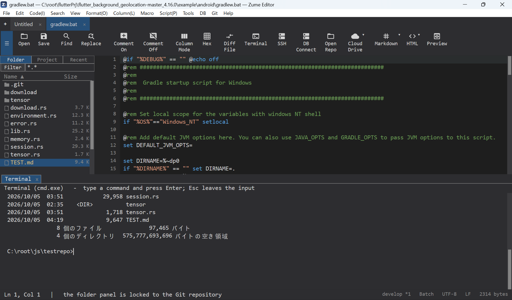
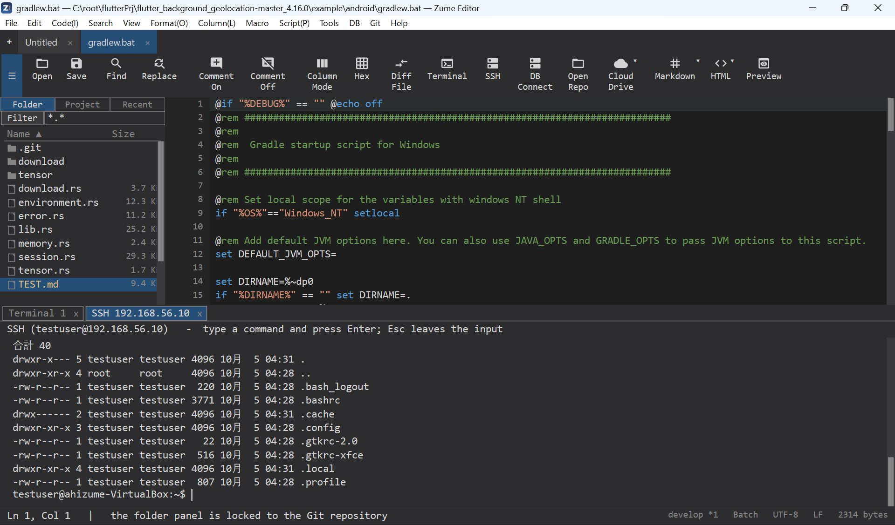

# 终端与 SSH

## 终端面板

**视图 → 终端面板**会在可停靠面板中打开一个交互式 shell
（Windows 上为 `cmd.exe`，macOS/Linux 上为你的登录 shell）。你可以将多个
终端作为标签页打开、直接输入、使用命令历史（++up++ / ++down++）、选择
并复制输出，以及用 ++ctrl+c++ 中断。

## SSH shell

**视图 → SSH 面板**会通过 SSH 在远程主机上打开一个 shell。它复用与
SFTP 浏览器相同的连接，你也可以直接连接。支持密码和密钥
身份验证（参见 [远程文件](remote.md)）。

!!! note
    这是一个交互式 shell 面板，并非完整的终端模拟器。

{ loading=lazy }

{ loading=lazy }
